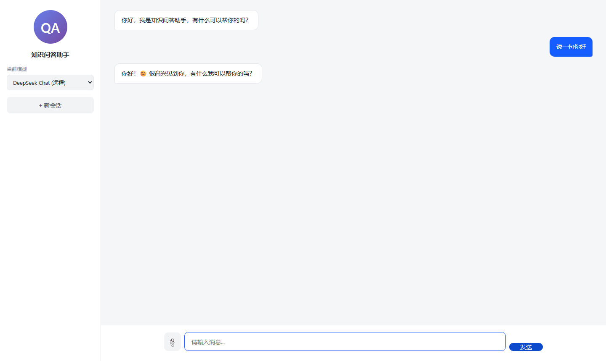
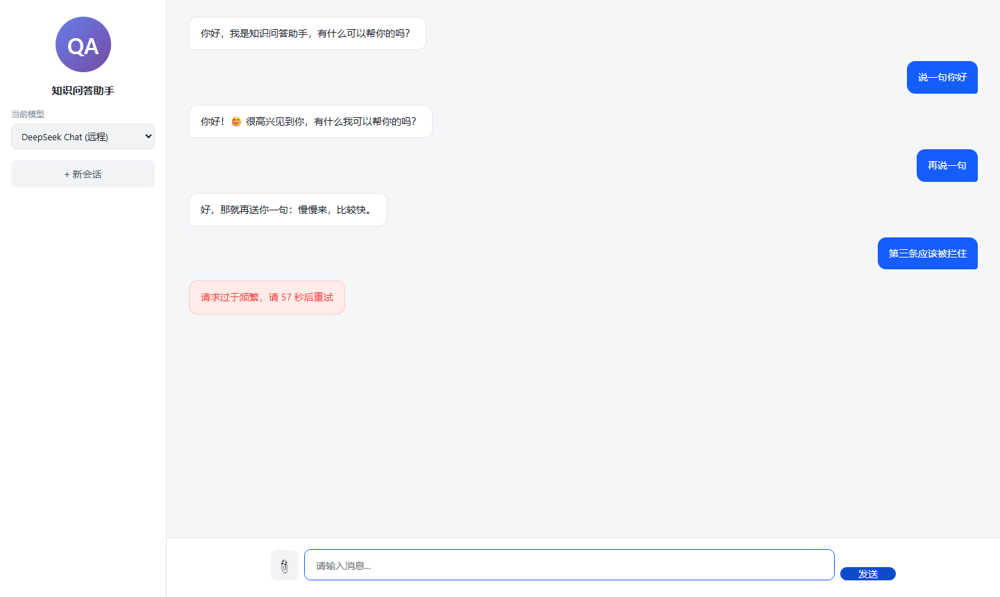

# 接口限流（固定窗口 + 429 + Retry-After）

> 一句话：在 `/api/` 前面加一道过滤器，按客户端 IP 在固定时间窗口内计数，超限直接返回 `429` 并告诉对方该等多久。
>
> 文档结构：一、业务目标｜二、理论知识｜三、实践操作｜四、测试题（1~5 层追问）

---

## 一、业务目标

### 1.1 场景与痛点

项目原来所有 `/api/**` 接口**完全裸奔**：

- 谁写个 `while(true) curl` 就能把远程模型的额度打空（真金白银）
- 也能瞬间占满 Tomcat 线程，把服务打成不可用
- 更糟的是：**这种破坏不需要任何技术含量**，一个循环就够了

### 1.2 目标（可验收）

| # | 目标 | 验收标准 |
|---|---|---|
| 1 | 限制单客户端请求频率 | 默认 60 次/分钟，第 61 次返回 429 |
| 2 | 告诉客户端该等多久 | 响应头带 `Retry-After`，body 带 `retryAfterSeconds` |
| 3 | 客户端之间互不影响 | A 被限流时，B 立即可以正常请求 |
| 4 | 不破坏既有功能 | 非 `/api/` 路径不计数、不加头；正常额度内行为不变 |
| 5 | 可开关、可调参 | `--rate-limit.enabled=false` 一键关闭；`limit`/`window-seconds` 可配 |

### 1.3 范围边界

- ❌ **不做分布式限流**（当前是单机内存，多副本各算各的）
- ❌ **不做用户维度限流**（项目还没有登录体系，只能用 IP）
- ❌ **不做接口分级**（所有 `/api/` 一个额度，不区分贵贱）
- ❌ **不做黑白名单**

这些都在第 6 节给了改造点，属于"知道往哪走，但现在不做"。

---

## 二、理论知识

### 2.1 限流要解决的问题是什么

不是"让系统变快"，而是**保护两个东西**：

| 被保护对象 | 被耗尽后的后果 |
|---|---|
| **钱**（模型 API 额度） | 账单爆炸，或额度用尽导致所有人不可用 |
| **资源**（线程、连接、内存） | 请求堆积，响应变慢，最终雪崩 |

所以限流的本质是：**在资源被耗尽之前，主动拒绝一部分请求。**

### 2.2 四种经典算法

| 算法 | 状态量 | 精度 | 缺点 |
|---|---|---|---|
| **固定窗口计数器** | 窗口起点 + 计数（2 个字段） | 窗口边界可突刺 2 倍 | 边界不精确 |
| 滑动窗口日志 | 每个请求的时间戳列表 | 准 | 内存随流量线性增长 |
| 滑动窗口计数器（分桶） | N 个桶的计数 | 较准 | 实现复杂度中等 |
| 令牌桶 / 漏桶 | 令牌数 + 上次补充时间 | 支持匀速与突发 | 需额外调参（容量/速率） |

**本项目选固定窗口**，理由很直接：20 行代码、2 个字段、够用。

### 2.3 固定窗口的缺陷：边界突刺

```
窗口 1（00:00-01:00）最后 1 秒：打满 60 次
窗口 2（01:00-02:00）第 1 秒：又能打满 60 次
→ 瞬时 1 秒内通过 120 次，是限额的 2 倍
```

为什么可以接受？因为本项目的目标是"**别把额度一次打空**"，不是"精确平滑限速"。2 倍误差在 1 秒尺度上，对账单无实质影响。

如果哪天要求"任意 1 秒不超过 N 次"，就得换令牌桶或滑动窗口——这是明确的演进路径，不是缺陷隐瞒。

### 2.4 为什么放在 Filter，而不是 Controller / AOP

| 位置 | 拦截时机 | 问题 |
|---|---|---|
| **Filter**（本项目） | 进入 DispatcherServlet **之前** | ✅ 最外层，最省资源 |
| Interceptor | 路由匹配之后、参数解析之前 | 已经消耗了部分框架开销 |
| Controller / AOP | 已进入方法 | 已经占用了线程，还可能已经查了库 |

越早拦截，省下的资源越多。**"省下的"包括线程、数据库连接、模型调用费用。**

### 2.5 429 还是 503、403

| 状态码 | 语义 | 适合场景 |
|---|---|---|
| **429 Too Many Requests** | 你请求太多了 | ✅ 限流（RFC 6585 定义） |
| 503 Service Unavailable | 服务暂时不可用 | 整体过载/维护 |
| 403 Forbidden | 你没权限 | 权限不足 |

429 的关键价值是配 `Retry-After`——客户端能据此**自动退避重试**，无需人工干预。用 403 会让客户端误以为"权限问题，重试无用"。

### 2.6 客户端标识：为什么是 IP，以及它的坑

项目没有登录体系，IP 是唯一稳定标识。

```
优先取 X-Forwarded-For 的第一段（真实客户端 IP）
否则取 request.getRemoteAddr()
```

**`X-Forwarded-For` 是把双刃剑**：

- 部署在 Nginx/网关后面时：`remoteAddr` 永远是代理 IP，**必须**读 XFF，否则所有人共用一个额度
- 直接暴露公网时：**XFF 可以被客户端随意伪造**，改个 header 就绕过限流

正确做法是只信任可信代理写入的 XFF（比如只接受来自内网网关的值）。本项目当前是"有就用"，属于"内网/本机部署够用，公网部署需加固"的取舍。

---

## 三、实践操作

### 3.0 环境与前置

| 项 | 要求 | 说明 |
|---|---|---|
| JDK | 17+ | 实测 17.0.18 |
| 端口 | 8086 空闲 | 用 8086 是为了不和日常实例抢额度 |
| PostgreSQL | **不需要** | 加 `--spring.sql.init.mode=never` 跳过 schema |
| API Key | **不需要** | 限流发生在调模型之前，用 `/api/models` 就能验证 |

> 关键点：**限流发生在进入 Controller 之前**，所以用一个不花钱、毫秒级的 `GET /api/models` 就能完整验证，不需要任何 Key。

### 3.1 Step 1：配置类

`src/main/java/com/example/chat/ratelimit/RateLimitProperties.java`：

```java
@Component
@ConfigurationProperties(prefix = "rate-limit")
public class RateLimitProperties {

    private boolean enabled = true;      // 是否开启
    private int limit = 60;              // 单窗口允许的请求数
    private int windowSeconds = 60;      // 窗口长度（秒）
    private int maxClients = 10000;      // 最多记录多少客户端

    // getter / setter 省略
}
```

### 3.2 Step 2：过滤器（核心）

```java
@Component
@Order(Ordered.HIGHEST_PRECEDENCE + 10)
public class RateLimitFilter extends OncePerRequestFilter {

    private static final String API_PREFIX = "/api/";
    private final RateLimitProperties props;
    private final ConcurrentHashMap<String, Window> windows = new ConcurrentHashMap<>();

    @Override
    protected void doFilterInternal(HttpServletRequest request,
                                    HttpServletResponse response,
                                    FilterChain chain) throws ServletException, IOException {

        // ① 只对 /api/ 计数，其余直接放行
        if (!props.isEnabled() || !request.getRequestURI().startsWith(API_PREFIX)) {
            chain.doFilter(request, response);
            return;
        }

        long windowMs = Math.max(1, props.getWindowSeconds()) * 1000L;
        String client = clientKey(request);

        // ② 内存兜底：客户端过多时整体重置
        if (windows.size() > props.getMaxClients()) {
            windows.clear();
            log.warn("限流窗口表超过 {} 个客户端，已整体重置", props.getMaxClients());
        }

        Window window = windows.computeIfAbsent(client, k -> new Window(System.currentTimeMillis()));

        boolean allowed;
        int remaining;
        long retryAfterSeconds;

        // ③ 三步必须原子：判断过期 → 自增 → 算剩余
        synchronized (window) {
            long now = System.currentTimeMillis();
            if (now - window.start >= windowMs) {
                window.start = now;
                window.count = 0;
            }
            if (window.count < props.getLimit()) {
                window.count++;
                allowed = true;
                remaining = props.getLimit() - window.count;
                retryAfterSeconds = 0;
            } else {
                allowed = false;
                remaining = 0;
                retryAfterSeconds = Math.max(1, (window.start + windowMs - now + 999) / 1000);
            }
        }

        response.setHeader("X-RateLimit-Limit", String.valueOf(props.getLimit()));
        response.setHeader("X-RateLimit-Remaining", String.valueOf(remaining));

        if (allowed) {
            chain.doFilter(request, response);
            return;
        }

        // ④ 超限：429 + Retry-After + JSON 错误体
        response.setHeader("Retry-After", String.valueOf(retryAfterSeconds));
        response.setStatus(429);
        response.setCharacterEncoding("UTF-8");
        response.setContentType("application/json;charset=UTF-8");
        response.getWriter().write("{\"error\":\"请求过于频繁，请 " + retryAfterSeconds + " 秒后重试\","
                + "\"retryAfterSeconds\":" + retryAfterSeconds + ","
                + "\"limit\":" + props.getLimit() + "}");
    }

    private static String clientKey(HttpServletRequest request) {
        String forwarded = request.getHeader("X-Forwarded-For");
        if (forwarded != null && !forwarded.isBlank()) {
            int comma = forwarded.indexOf(',');
            return (comma > 0 ? forwarded.substring(0, comma) : forwarded).trim();
        }
        return request.getRemoteAddr();
    }

    private static final class Window {
        long start;
        int count;
        Window(long start) { this.start = start; }
    }
}
```

**为什么用 `synchronized (window)` 而不是 `ConcurrentHashMap.compute`**：一个窗口要做"判断过期 + 自增 + 算剩余"三步，必须整体原子；锁粒度只到单个客户端，不同 IP 互不阻塞。

### 3.3 Step 3：默认配置

`application.yml`：

```yaml
rate-limit:
  enabled: ${RATE_LIMIT_ENABLED:true}
  limit: ${RATE_LIMIT_LIMIT:60}
  window-seconds: ${RATE_LIMIT_WINDOW_SECONDS:60}
  max-clients: 10000
```

**前端不用改**：既有发送逻辑已经是"429 也照常 `resp.json()`，有 `error` 字段就显示红色气泡"，限流提示天然能显示。

### 3.4 Step 4：启动（把额度调到 3 次，便于观察）

```bash
cd "F:/coding demo"
set -a && . ./.env && set +a
export no_proxy=localhost,127.0.0.1

mvn -DskipTests spring-boot:run \
  -Dspring-boot.run.jvmArguments="-Dstdout.encoding=UTF-8 -Dfile.encoding=UTF-8" \
  -Dspring-boot.run.arguments="--server.port=8086 --spring.sql.init.mode=never \
     --spring.datasource.hikari.initialization-fail-timeout=-1 \
     --rate-limit.limit=3 --rate-limit.window-seconds=60"
```

成功判定：

```
Tomcat started on port 8086 (http) with context path '/'
Started DemoApplication in 4.613 seconds
```

> `-Dstdout.encoding=UTF-8` 是为了让重定向到文件的中文日志不乱码（Windows 默认用 GBK 写管道）。

> **📷 待补截图 ①**　终端里这条启动命令与最后两行启动日志
> 存放位置：`evidence-基础功能/03-01-启动日志.png`


### 3.5 Step 5：命令行验证

```bash
bash docs/evidence-复现/限流/verify-ratelimit.sh http://localhost:8086
```

脚本核心就是"同一个客户端连打 4 次"：

```bash
for i in 1 2 3 4; do
  curl -s -D - -o /tmp/body.txt -H "X-Forwarded-For: 10.0.0.9" \
    http://localhost:8086/api/models | grep -Ei "^HTTP/|^X-RateLimit|^Retry-After"
done
```

**实测输出**：

```
---------- 第 1 次 ----------
HTTP/1.1 200        X-RateLimit-Limit: 3    X-RateLimit-Remaining: 2
---------- 第 2 次 ----------
HTTP/1.1 200        X-RateLimit-Limit: 3    X-RateLimit-Remaining: 1
---------- 第 3 次 ----------
HTTP/1.1 200        X-RateLimit-Limit: 3    X-RateLimit-Remaining: 0
---------- 第 4 次 ----------
HTTP/1.1 429        X-RateLimit-Limit: 3    X-RateLimit-Remaining: 0    Retry-After: 59
body: {"error":"请求过于频繁，请 59 秒后重试","retryAfterSeconds":59,"limit":3,"windowSeconds":60}
```

三个要点：

1. `Remaining` 每次减 1，到 0 之后下一次 429——**放行与拦截是同一条计数线上连续的两个状态**
2. `Retry-After: 59` 让客户端知道该等多久（SDK、网关都认这个头）
3. body 是 JSON 且字段与业务错误一致，前端不用写特判

> **📷 待补截图 ②**　终端里 4 次连打的完整输出（含 200→429 的转折与响应头）
> 存放位置：`evidence-基础功能/03-02-终端验证.png`


### 3.6 Step 6：换客户端，互不影响

```bash
curl -s -D - -o /dev/null -H "X-Forwarded-For: 10.0.0.8" http://localhost:8086/api/models
# HTTP/1.1 200    X-RateLimit-Remaining: 2
```

限流是**按客户端**而不是全局：10.0.0.9 已被拦，10.0.0.8 才用掉第 1 次。

### 3.7 Step 7：证明它拦在「路由」之前

这一步回答一个关键疑问：**限流到底是不是最外层？** 办法是额度用尽后，请求两个"正常情况下不会返回 429"的地址：

```bash
# ① 空 body 的 POST /api/chat：正常应 400，实测 429
curl -s -D - -X POST -H "Content-Type: application/json" -H "X-Forwarded-For: 10.9.9.9" \
  -d '' http://localhost:8087/api/chat | grep -Ei "^HTTP/|^\{"
# HTTP/1.1 429

# ② 不存在的 /api/nope：正常应 404，实测 429
curl -s -o /dev/null -D - -H "X-Forwarded-For: 10.9.9.9" http://localhost:8087/api/nope \
  | grep -Ei "^HTTP/"
# HTTP/1.1 429
```

400 和 404 都没出现，说明请求在**进入 DispatcherServlet 之前**就被写下 429 并结束了。

更硬的对照在 DEBUG 日志里：

```
# 放行的两次：DispatcherServlet 有处理记录
DEBUG o.s.web.servlet.DispatcherServlet : GET "/api/models", parameters={}
DEBUG o.s.web.servlet.DispatcherServlet : Completed 200 OK

# 被拦的三次：只有 RateLimitFilter 的 WARN，没有任何 DispatcherServlet 记录
WARN  c.e.chat.ratelimit.RateLimitFilter : 限流拦截 uri=/api/models client=10.9.9.9 ...
WARN  c.e.chat.ratelimit.RateLimitFilter : 限流拦截 uri=/api/chat   client=10.9.9.9 ...
```

启动日志里的"注册证据"也解释了为什么所有请求都会经过它：

```
Mapping filters: characterEncodingFilter urls=[/*] order=-2147483648,
                 rateLimitFilter        urls=[/*] order=-2147483638,
                 formContentFilter      urls=[/*] order=-9900
```

- `urls=[/*]`：映射到**所有路径**，所以静态资源、404 路径、multipart 上传都会进入 `doFilterInternal`
- `order=-2147483638` = `Ordered.HIGHEST_PRECEDENCE + 10`：只排在编码过滤器之后，远早于 `formContentFilter`

所以准确说法是：**所有 HTTP 请求都会进入限流过滤器，但只有 `/api/` 前缀才计数、才可能 429**。

> **📷 待补截图 ③**　DEBUG 日志对照：放行请求有 DispatcherServlet 记录，被拦请求没有
> 存放位置：`evidence-基础功能/03-03-过滤器时序日志.png`


### 3.8 Step 8：界面验证

连发 3 条消息，第 1、2 条正常回复：



第 3 条被拦，显示后端返回的原文：



「请求过于频繁，请 57 秒后重试」——秒数直接来自响应体，**前端一行代码都没改**。

> 复现机在同一窗口内先跑过 CLI 验证，所以浏览器只有 2 次额度可用（`limit=3`，其中 1 次被 `GET /api/models` 占掉）。想得到完全一样的"2 成功 + 1 拦截"，先等 60 秒窗口过去。

### 3.9 验证结果汇总

| # | 检查项 | 预期 | 实测 |
|---|---|---|---|
| 1 | 应用启动（限额 3） | 8086 可访问 | `Started in 4.613 seconds` ✅ |
| 2 | 前 3 次请求 | 200，Remaining 依次 2/1/0 | 一致 ✅ |
| 3 | 第 4 次请求 | 429 + Retry-After | `429`，`Retry-After: 59` ✅ |
| 4 | 客户端隔离 | 另一 IP 立即放行 | 10.0.0.8 → `200` ✅ |
| 5 | 后端日志 | 记录 uri/client/剩余窗口 | `限流拦截 uri=/api/models ...` ✅ |
| 6 | 界面提示 | 红色气泡显示后端文案 | 「请求过于频繁，请 57 秒后重试」 ✅ |
| 7 | 不影响既有功能 | 非 `/api/` 不计数、不加头 | `curl -D - /` 无 `X-RateLimit-*` ✅ |
| 8 | 注册到所有路径 | `urls=[/*]` | 启动日志验证 ✅ |
| 9 | 拦在路由之前 | `/api/nope` 返回 429 而非 404 | `HTTP/1.1 429` ✅ |
| 10 | 拦在参数解析之前 | 空 body 的 POST 返回 429 而非 400 | `HTTP/1.1 429` ✅ |

### 3.10 常见问题

| 现象 | 原因 | 处理 |
|---|---|---|
| 只发了 2 条就 429 | 页面加载的 `GET /api/models` 也占 1 次 | 调大 `limit`，或等窗口重置 |
| 改了 yml 没生效 | 启动参数优先级更高 | 检查是否还带着 `--rate-limit.limit=...` |
| 日志中文乱码 | Windows 重定向用 GBK | 加 `-Dstdout.encoding=UTF-8` |
| 所有客户端一起被限 | `max-clients` 过小导致 `clear()` | 调大上限，或换 Redis 方案 |
| 想彻底关掉 | — | `--rate-limit.enabled=false` |

**回滚**：删掉 `ratelimit/` 两个类 + yml 里的 `rate-limit:` 段即可（前端无需回滚）。

---

## 四、测试题（面试向，1~5 层追问）

> 建议先自己想一遍再展开对照；每道题下面还有 5 层追问，逐层点开。

### Q1｜为什么选固定窗口，不选令牌桶？

<details>
<summary>参考答案 + 5 层追问</summary>
<p><strong>参考答</strong>：20 行代码、2 个字段、对&quot;防额度打空&quot;这个目标够用；固定窗口的边界突刺在 1 秒尺度上影响可接受。</p><blockquote><p><strong>L1 追问</strong>：边界突刺到底有多大？<br>要点：最坏 2 倍。窗口 1 末秒打满 N 次，窗口 2 首秒又能打满 N 次，瞬时 2N。</p></blockquote><blockquote><p><strong>L2 追问</strong>：什么业务不能接受 2 倍突刺？<br>要点：后端正被压着跑的（数据库连接池很小）、按秒计费或有严格 SLA 的对外 API。</p></blockquote><blockquote><p><strong>L3 追问</strong>：如果要修掉突刺又不想上完整令牌桶，有什么折中？<br>要点：<strong>滑动窗口计数器</strong>（把 1 分钟拆成 6 个 10 秒桶，统计最近 6 个桶之和），精度接近滑动窗口，内存只多几倍。</p></blockquote><blockquote><p><strong>L4 追问</strong>：令牌桶相比固定窗口，多了哪些可调参数？各自解决什么？<br>要点：容量（允许多大突发）+ 补充速率（长期平均）。固定窗口只有一个&quot;每窗口上限&quot;，无法表达&quot;平均 1/秒但允许瞬时 10 个&quot;。</p></blockquote><blockquote><p><strong>L5 追问</strong>：如果要求&quot;平滑限速&quot;（比如调用第三方 API 每秒最多 5 次，均匀分布），固定窗口能做到吗？<br>要点：不能，必须令牌桶或漏桶 + 请求排队（甚至阻塞等待）。这时还要考虑排队超时与队列长度上限。</p></blockquote>
</details>

### Q2｜为什么放在 Filter，而不是 Interceptor 或 AOP？

<details>
<summary>参考答案 + 5 层追问</summary>
<p><strong>参考答</strong>：Filter 最靠外，能省下最多资源；且能覆盖所有 <code>/api/*</code>，包括未来新增的端点。</p><blockquote><p><strong>L1 追问</strong>：Interceptor 比 Filter 晚多少？晚在哪一步？<br>要点：晚在 DispatcherServlet 内部——已经完成 HandlerMapping 路由匹配，可能已经开始参数解析。</p></blockquote><blockquote><p><strong>L2 追问</strong>：晚这几步有什么实际代价？<br>要点：路由匹配与参数解析会消耗 CPU；如果是 multipart，请求体可能已被写入临时文件；如果是 AOP/Controller，线程已占用、甚至已查库。</p></blockquote><blockquote><p><strong>L3 追问</strong>：那是不是越靠外越好？放 Nginx 不是更外？<br>要点：更外更快，但<strong>信息更少</strong>——Nginx 拿不到用户身份、接口语义；且改配置要动运维。通常做法是<strong>边缘粗限流 + 应用细限流</strong>双层。</p></blockquote><blockquote><p><strong>L4 追问</strong>：如果某些接口要单独额度（比如上传接口 5 次/分），现在的结构怎么改？<br>要点：<code>clientKey</code> 从纯 IP 改成 <code>IP + 路由分组</code>，或按 URI 前缀查不同的 limit 表；结构不用变，只改 key 计算。</p></blockquote><blockquote><p><strong>L5 追问</strong>：如果要按&quot;用户 + 接口&quot;两个维度同时限流，怎么设计？<br>要点：两级计数（用户总量、用户在该接口的量）同时检查，任一超限即拒；注意两级窗口的原子性与性能，通常用 Redis 的 Lua 脚本一次算完。</p></blockquote>
</details>

### Q3｜`synchronized (window)` 会不会成为瓶颈？

<details>
<summary>参考答案 + 5 层追问</summary>
<p><strong>参考答</strong>：锁粒度是&quot;单个客户端&quot;，不同 IP 之间不争抢，所以并发下几乎没有 contention。</p><blockquote><p><strong>L1 追问</strong>：如果同一个客户端并发 100 个请求呢？<br>要点：会串行排队，但每个临界区只有几次整数运算（纳秒级），100 个请求的排队开销可忽略。</p></blockquote><blockquote><p><strong>L2 追问</strong>：那为什么不用 <code>ConcurrentHashMap.compute</code> 或原子类？<br>要点：逻辑是&quot;判断过期 + 自增 + 算剩余&quot;三步复合操作，<code>AtomicInteger</code> 只能保证单步；用 <code>compute</code> 会让 mapping 函数执行在 map 的锁内，且要处理&quot;过期重置&quot;的副作用，可读性差。</p></blockquote><blockquote><p><strong>L3 追问</strong>：<code>computeIfAbsent</code> 和后面的 <code>synchronized</code> 会不会有竞态？<br>要点：<code>computeIfAbsent</code> 保证 Window 对象只创建一次；之后的 <code>synchronized (window)</code> 锁的是同一个对象，所以计数逻辑安全。</p></blockquote><blockquote><p><strong>L4 追问</strong>：<code>windows.clear()</code> 那个兜底有什么问题？<br>要点：重置瞬间所有客户端额度清零，等于<strong>短暂放宽</strong>；而且 clear 与并发的 computeIfAbsent 之间可能丢窗口。属于&quot;宁可放宽也不 OOM&quot;的取舍。</p></blockquote><blockquote><p><strong>L5 追问</strong>：如果要做精确且不丢数据的内存控制，你会怎么改？<br>要点：换成有容量上限的 LRU（如 Caffeine），按访问时间淘汰而不是整体清空；代价是需要引入依赖并接受&quot;被淘汰的客户端额度重置&quot;。</p></blockquote>
</details>

### Q4｜`X-Forwarded-For` 为什么危险？怎么正确使用？

<details>
<summary>参考答案 + 5 层追问</summary>
<p><strong>参考答</strong>：它可以被客户端伪造，直接信任等于让攻击者改个 header 就绕过限流。</p><blockquote><p><strong>L1 追问</strong>：部署在 Nginx 后面，不读 XFF 会怎样？<br>要点：<code>remoteAddr</code> 全是代理 IP，所有客户端共用一个额度，一个人打满全员 429。</p></blockquote><blockquote><p><strong>L2 追问</strong>：XFF 是单个值还是一个链？<br>要点：是链，<code>client, proxy1, proxy2</code>。取第一段才是原始客户端，但要小心链可以被伪造前缀。</p></blockquote><blockquote><p><strong>L3 追问</strong>：正确的信任模型是什么？<br>要点：<strong>只信任可信代理写入的那一段</strong>。做法是配置可信代理 IP 列表，从右往左剥掉可信代理，取第一个不可信的地址。</p></blockquote><blockquote><p><strong>L4 追问</strong>：如果前面有两层代理（CDN + Nginx），怎么取？<br>要点：按可信代理列表从右往左剥：<code>XFF = [client, cdn, nginx]</code>，剥掉 nginx、cdn，剩下 client。取错会得到 CDN 的 IP，导致&quot;所有用户同一额度&quot;。</p></blockquote><blockquote><p><strong>L5 追问</strong>：除了 IP，还有更可靠的限流维度吗？<br>要点：<strong>账号/API Key</strong> 最可靠（不可伪造），其次是设备指纹或会话 ID；IP 只适合&quot;未登录 + 内网&quot;场景。生产上通常&quot;账号为主、IP 为辅&quot;。</p></blockquote>
</details>

### Q5｜多实例部署时这套实现会怎样？

<details>
<summary>参考答案 + 5 层追问</summary>
<p><strong>参考答</strong>：每台机器各算各的，实际额度变成 N 倍（N = 实例数）。</p><blockquote><p><strong>L1 追问</strong>：这是 bug 吗？<br>要点：不是 bug，是<strong>设计边界</strong>。单机实现天然如此，文档里必须说清。</p></blockquote><blockquote><p><strong>L2 追问</strong>：怎么改成分布式限流？<br>要点：把 <code>windows</code> 换成 Redis：<code>INCR key</code> + 首次 <code>EXPIRE</code>，或用 Lua 脚本一次完成&quot;判断+自增+取剩余&quot;。Filter 结构不变，只换存储。</p></blockquote><blockquote><p><strong>L3 追问</strong>：用 Redis 会引入什么新问题？<br>要点：① Redis 挂了怎么办（降级为放行还是拒绝）；② 网络往返增加延迟；③ 时钟与原子性；④ 热 key。</p></blockquote><blockquote><p><strong>L4 追问</strong>：Redis 挂了，你希望限流&quot;放行&quot;还是&quot;拒绝&quot;？<br>要点：看目标。保护后端 → 拒绝（fail closed）；保可用性 → 放行（fail open）但要有熔断与告警。通常配一个本地兜底计数。</p></blockquote><blockquote><p><strong>L5 追问</strong>：如果 Redis 抖动导致同一请求重复计数，怎么办？<br>要点：用 Lua 保证单次原子执行；请求侧加幂等键（traceId）避免重试重复计数；监控&quot;计数速率 vs 实际 QPS&quot;的偏差做告警。</p></blockquote>
</details>

### Q6｜为什么返回 429 而不是 503？两者在客户端行为上有什么区别？

<details>
<summary>参考答案 + 5 层追问</summary>
<p><strong>参考答</strong>：429 语义是&quot;你请求太多&quot;，配合 <code>Retry-After</code> 客户端会自动退避；503 表示&quot;服务不可用&quot;，客户端通常理解为故障。</p><blockquote><p><strong>L1 追问</strong>：<code>Retry-After</code> 的单位是什么？<br>要点：可以是秒数，也可以是 HTTP-date。本项目用秒数（更简单、误差可接受）。</p></blockquote><blockquote><p><strong>L2 追问</strong>：客户端拿到 <code>Retry-After</code> 应该怎么做？<br>要点：等待指定时间后重试；要有<strong>最大重试次数</strong>和<strong>总超时</strong>，否则会变成另一种形式的雪崩。</p></blockquote><blockquote><p><strong>L3 追问</strong>：如果所有客户端都严格遵守 Retry-After，会发生什么？<br>要点：<strong>惊群</strong>——同一秒集体重试，再次打满。所以服务端要在 Retry-After 上加随机抖动，客户端也要加退避。</p></blockquote><blockquote><p><strong>L4 追问</strong>：本项目的 Retry-After 有抖动吗？<br>要点：没有，是精确到窗口重置的秒数。这是可改进点：<code>retryAfter + random(0..3)</code> 能显著削峰。</p></blockquote><blockquote><p><strong>L5 追问</strong>：怎么验证抖动真的有用？<br>要点：压测时对比&quot;有抖动/无抖动&quot;两种情况下重置瞬间的 QPS 峰值，看是否出现尖刺；这是可量化的验证，不是感觉。</p></blockquote>
</details>
