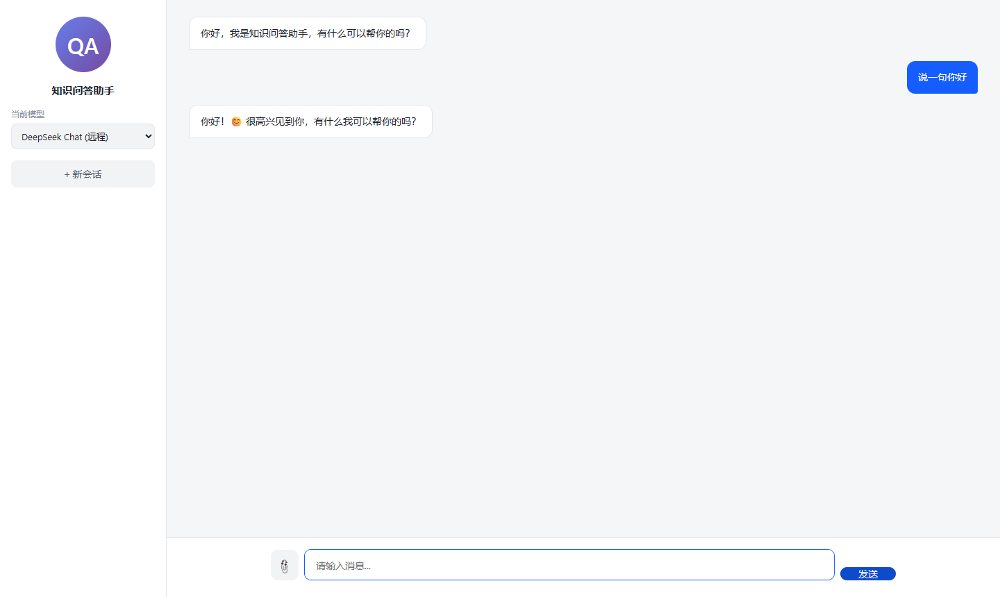
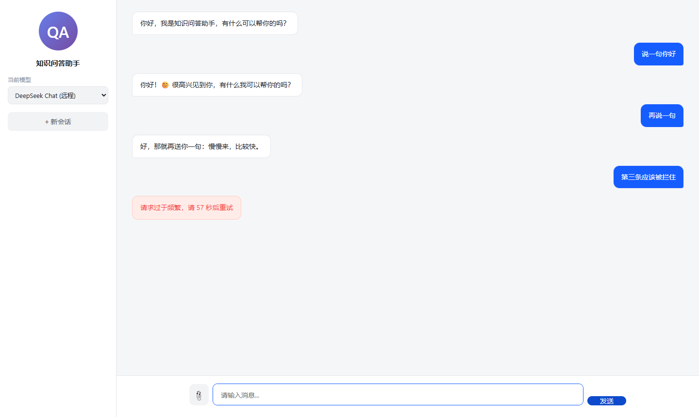

业务流程如上

# 新增功能 01：接口限流（固定窗口 + 429 + Retry-After）

> 这是给项目**新加**的一个功能，不是既有能力。文档同时是「实现教程」和「验收记录」：
> 照着第 3~5 节做完，你会得到一个每分钟限流 N 次、超限返回 429 的接口层，并能亲手看到 200→429 的转折。
>
> 证据来自 2026-11-09 的真实复现，文件在 `docs/evidence-复现/限流/`。

---

## 1. 为什么加它，为什么是"固定窗口"

项目原来的 `/api/**` 完全裸奔：任何人写个 `while(true) curl` 就能把远程模型的额度打空，也能把服务打满。

限流算法有好几种，本功能选**固定窗口计数器**，理由很直接：

| 方案 | 状态量 | 代码量 | 精度 | 本项目取舍 |
| --- | --- | --- | --- | --- |
| 固定窗口 | 窗口起点 + 计数（2 个字段） | ~20 行 | 窗口边界可突刺 2 倍 | ✅ 采用 |
| 滑动窗口日志 | 每个请求的时间戳列表 | ~60 行 | 准 | 内存随流量线性增长，不划算 |
| 令牌桶 / 漏桶 | 令牌数 + 上次补充时间 | ~40 行 | 支持匀速与突发 | 需要额外调参（容量/速率），讲解成本高 |

固定窗口的缺陷是**边界突刺**：窗口 1 的最后 1 秒打满 N 次，窗口 2 的第 1 秒又能打满 N 次，瞬时可达 2N。
对"防止额度被打空"这个目标，2 倍误差可以接受；如果哪天要求平滑限速，再换令牌桶（文档 6 节给了改造点）。

---

## 2. 前置条件

| 项 | 要求 | 说明 |
| --- | --- | --- |
| JDK | 17+ | 实测 17.0.18 |
| Maven | 3.9+ | 实测 3.9.11 |
| 端口 | 8086 空闲 | 用 8086 是为了不和 8083 的日常实例抢额度 |
| PostgreSQL | **不需要** | 加 `--spring.sql.init.mode=never` 跳过 `schema.sql` |
| Ollama / API Key | 需要（仅"界面验证"那一步要真实模型） | 只用 curl 验证限流的话，**一个 Key 都不需要** |
| Node.js | 可选 | 只用于重跑截图脚本 |
| 浏览器 | Chrome / Edge | 手动验证 |

关键点：**限流发生在进入 Controller 之前**，所以用 `GET /api/models`（不调模型、不花钱、毫秒级）就能验证，完全不需要 API Key。

---

## 3. 实现（三处改动）

### 3.1 新增配置类 `RateLimitProperties`

文件：`src/main/java/com/example/chat/ratelimit/RateLimitProperties.java`

```java
package com.example.chat.ratelimit;

import org.springframework.boot.context.properties.ConfigurationProperties;
import org.springframework.stereotype.Component;

@Component
@ConfigurationProperties(prefix = "rate-limit")
public class RateLimitProperties {

    private boolean enabled = true;      // 是否开启
    private int limit = 60;              // 单窗口允许的请求数
    private int windowSeconds = 60;      // 窗口长度（秒）
    private int maxClients = 10000;      // 最多记录多少客户端

    public boolean isEnabled() { return enabled; }
    public void setEnabled(boolean enabled) { this.enabled = enabled; }

    public int getLimit() { return limit; }
    public void setLimit(int limit) { this.limit = limit; }

    public int getWindowSeconds() { return windowSeconds; }
    public void setWindowSeconds(int windowSeconds) { this.windowSeconds = windowSeconds; }

    public int getMaxClients() { return maxClients; }
    public void setMaxClients(int maxClients) { this.maxClients = maxClients; }
}
```

### 3.2 新增过滤器 `RateLimitFilter`

文件：`src/main/java/com/example/chat/ratelimit/RateLimitFilter.java`

```java
package com.example.chat.ratelimit;

import jakarta.servlet.FilterChain;
import jakarta.servlet.ServletException;
import jakarta.servlet.http.HttpServletRequest;
import jakarta.servlet.http.HttpServletResponse;
import org.slf4j.Logger;
import org.slf4j.LoggerFactory;
import org.springframework.core.Ordered;
import org.springframework.core.annotation.Order;
import org.springframework.stereotype.Component;
import org.springframework.web.filter.OncePerRequestFilter;

import java.io.IOException;
import java.nio.charset.StandardCharsets;
import java.util.concurrent.ConcurrentHashMap;

@Component
@Order(Ordered.HIGHEST_PRECEDENCE + 10)
public class RateLimitFilter extends OncePerRequestFilter {

    private static final Logger log = LoggerFactory.getLogger(RateLimitFilter.class);
    private static final String API_PREFIX = "/api/";

    private final RateLimitProperties props;
    private final ConcurrentHashMap<String, Window> windows = new ConcurrentHashMap<>();

    public RateLimitFilter(RateLimitProperties props) {
        this.props = props;
    }

    @Override
    protected void doFilterInternal(HttpServletRequest request,
                                    HttpServletResponse response,
                                    FilterChain chain) throws ServletException, IOException {

        if (!props.isEnabled() || !request.getRequestURI().startsWith(API_PREFIX)) {
            chain.doFilter(request, response);
            return;
        }

        long windowMs = Math.max(1, props.getWindowSeconds()) * 1000L;
        String client = clientKey(request);

        if (windows.size() > props.getMaxClients()) {     // 内存兜底
            windows.clear();
            log.warn("限流窗口表超过 {} 个客户端，已整体重置", props.getMaxClients());
        }

        Window window = windows.computeIfAbsent(client, k -> new Window(System.currentTimeMillis()));

        boolean allowed;
        int remaining;
        long retryAfterSeconds;

        synchronized (window) {
            long now = System.currentTimeMillis();
            if (now - window.start >= windowMs) {         // 窗口过期 → 重新计数
                window.start = now;
                window.count = 0;
            }
            if (window.count < props.getLimit()) {
                window.count++;
                allowed = true;
                remaining = props.getLimit() - window.count;
                retryAfterSeconds = 0;
            } else {
                allowed = false;
                remaining = 0;
                retryAfterSeconds = Math.max(1, (window.start + windowMs - now + 999) / 1000);
            }
        }

        response.setHeader("X-RateLimit-Limit", String.valueOf(props.getLimit()));
        response.setHeader("X-RateLimit-Remaining", String.valueOf(remaining));

        if (allowed) {
            chain.doFilter(request, response);
            return;
        }

        long now = System.currentTimeMillis();
        long resetInMs = Math.max(0, window.start + windowMs - now);
        response.setHeader("Retry-After", String.valueOf(retryAfterSeconds));
        response.setHeader("X-RateLimit-Reset", String.valueOf(retryAfterSeconds));
        response.setStatus(429);
        response.setCharacterEncoding(StandardCharsets.UTF_8.name());
        response.setContentType("application/json;charset=UTF-8");
        response.getWriter().write("{\"error\":\"请求过于频繁，请 " + retryAfterSeconds + " 秒后重试\","
                + "\"retryAfterSeconds\":" + retryAfterSeconds + ","
                + "\"limit\":" + props.getLimit() + ","
                + "\"windowSeconds\":" + props.getWindowSeconds() + "}");

        log.warn("限流拦截 uri={} client={} 窗口剩余 {}ms", request.getRequestURI(), client, resetInMs);
    }

    private static String clientKey(HttpServletRequest request) {
        String forwarded = request.getHeader("X-Forwarded-For");
        if (forwarded != null && !forwarded.isBlank()) {
            int comma = forwarded.indexOf(',');
            return (comma > 0 ? forwarded.substring(0, comma) : forwarded).trim();
        }
        return request.getRemoteAddr();
    }

    private static final class Window {
        long start;
        int count;

        Window(long start) { this.start = start; }
    }
}
```

### 3.3 配置默认额度

文件：`src/main/resources/application.yml`（追加在 `rag:` 段之后）

```yaml
# 接口限流（RateLimitFilter）：固定窗口，按客户端 IP 计数
rate-limit:
  enabled: ${RATE_LIMIT_ENABLED:true}
  limit: ${RATE_LIMIT_LIMIT:60}
  window-seconds: ${RATE_LIMIT_WINDOW_SECONDS:60}
  max-clients: 10000
```

> 默认 60 次/分钟，日常开发完全无感；演示时用启动参数临时改小，不动配置文件。

**前端不用改**：既有的发送逻辑已经是「429 也照常 `resp.json()`，有 `error` 字段就显示红色气泡」，所以限流提示天然就能显示出来。

---

## 4. 启动（把额度调到 3 次，方便肉眼观察）

```bash
cd "F:/coding demo"
set -a && . ./.env && set +a
export no_proxy=localhost,127.0.0.1

mvn -DskipTests spring-boot:run \
  -Dspring-boot.run.jvmArguments="-Dfile.encoding=UTF-8 -Dstdout.encoding=UTF-8" \
  -Dspring-boot.run.arguments="--server.port=8086 --spring.sql.init.mode=never --spring.datasource.hikari.initialization-fail-timeout=-1 --rate-limit.limit=3 --rate-limit.window-seconds=60"
```

**成功判定**（取自 `evidence-复现/限流/01-启动日志.log`）：

```
Tomcat started on port 8086 (http) with context path '/'
Started DemoApplication in 4.613 seconds (process running for 5.797)
```

> `-Dstdout.encoding=UTF-8` 是为了让重定向到文件的中文日志不乱码（Windows 上默认会用 GBK 写管道）。不加也能跑，只是日志里的中文会变成 `????`。

---

## 5. 逐步复现与证据

### 步骤 1：命令行验证（3 次放行 + 1 次拦截）

完整脚本：`evidence-复现/限流/verify-ratelimit.sh`（一条命令跑完）：

```bash
bash docs/evidence-复现/限流/verify-ratelimit.sh http://localhost:8086
```

脚本核心就是「同一个客户端连打 4 次」：

```bash
for i in 1 2 3 4; do
  curl -s -D - -o /tmp/body.txt -H "X-Forwarded-For: 10.0.0.9" http://localhost:8086/api/models \
    | grep -Ei "^HTTP/|^X-RateLimit|^Retry-After"
done
```

**实测输出**（取自 `evidence-复现/限流/终端验证.log`）：

```
---------- 第 1 次 ----------
HTTP/1.1 200
X-RateLimit-Limit: 3
X-RateLimit-Remaining: 2

---------- 第 2 次 ----------
HTTP/1.1 200
X-RateLimit-Limit: 3
X-RateLimit-Remaining: 1

---------- 第 3 次 ----------
HTTP/1.1 200
X-RateLimit-Limit: 3
X-RateLimit-Remaining: 0

---------- 第 4 次 ----------
HTTP/1.1 429
X-RateLimit-Limit: 3
X-RateLimit-Remaining: 0
Retry-After: 59
X-RateLimit-Reset: 59
body: {"error":"请求过于频繁，请 59 秒后重试","retryAfterSeconds":59,"limit":3,"windowSeconds":60}
```

三个要点：

1. `X-RateLimit-Remaining` 每次减 1，到 0 之后下一次就 429——**放行与拦截是同一条计数线上连续的两个状态**；
2. 429 带 `Retry-After: 59`，客户端知道该等多久（标准语义，/api 调用方如 SDK、网关都认这个头）；
3. body 是 JSON 且字段与业务错误一致（只有 `error` 是最小公共集），前端不用写特判。

### 步骤 2：换一个客户端，计数互不影响

```bash
curl -s -D - -o /dev/null -H "X-Forwarded-For: 10.0.0.8" http://localhost:8086/api/models | grep -Ei "^HTTP/|^X-RateLimit"
# HTTP/1.1 200
# X-RateLimit-Limit: 3
# X-RateLimit-Remaining: 2
```

限流是**按客户端**而不是全局的：10.0.0.9 已被拦，10.0.0.8 才用掉第 1 次。

### 步骤 3：后端日志（被拦截时留下了什么）

```
2026-11-09T00:52:56.863+08:00  WARN 11836 --- [agentscope-chat] [nio-8086-exec-8] c.e.chat.ratelimit.RateLimitFilter : 限流拦截 uri=/api/models client=10.0.0.9 窗口剩余 58679ms
```

`窗口剩余 xx ms` 是写日志那一刻距离窗口重置的时间，和 `Retry-After: 59` 互相印证。

### 步骤 4：界面验证（用户看到什么）

连发 3 条消息。测试功能是否正常

第 1、2 条正常回复：



第 3 条被拦，后端返回的 `error` 原文：



「请求过于频繁，请 57 秒后重试」——秒数直接来自响应体，前端一行代码都没改。

> 复现机在同一窗口内先跑过 CLI 验证，所以浏览器这次只有 2 次额度可用（`limit=3`，其中 1 次被 `GET /api/models` 占掉）。想得到完全一样的"2 成功 + 1 拦截"，先等 60 秒窗口过去再操作。

### 步骤 5：证明它拦在「路由」和「参数解析」之前

这一步回答一个关键疑问：**限流到底是不是最外层？** 办法是让额度用尽，然后请求两个"正常情况下不会返回 429"的地址。

```bash
# 额度已用尽（同一客户端 10.9.9.9）
# ① 空 body 的 POST /api/chat：正常应 400（参数解析失败），实测被 429 挡下
curl -s -D - -X POST -H "Content-Type: application/json" -H "X-Forwarded-For: 10.9.9.9" \
  -d '' http://localhost:8087/api/chat | grep -Ei "^HTTP/|^\{"
# HTTP/1.1 429
# {"error":"请求过于频繁，请 53 秒后重试","retryAfterSeconds":53,"limit":2,"windowSeconds":60}

# ② 不存在的 /api/nope：正常应 404（路由找不到），实测同样是 429
curl -s -o /dev/null -D - -H "X-Forwarded-For: 10.9.9.9" http://localhost:8087/api/nope | grep -Ei "^HTTP/"
# HTTP/1.1 429
```

400 和 404 都没有出现，说明请求在**进入 DispatcherServlet 之前**就被写下 429 并结束了。
更硬的对照在日志里（用 `--logging.level.org.springframework.web=DEBUG` 启动）：

```
# 放行的两次请求：DispatcherServlet 留下了处理记录
DEBUG ... o.s.web.servlet.DispatcherServlet : GET "/api/models", parameters={}
DEBUG ... o.s.web.servlet.DispatcherServlet : Completed 200 OK

# 被拦的三次请求：只有 RateLimitFilter 的 WARN，没有任何 DispatcherServlet 记录
WARN ... c.e.chat.ratelimit.RateLimitFilter : 限流拦截 uri=/api/models client=10.9.9.9 窗口剩余 52876ms
WARN ... c.e.chat.ratelimit.RateLimitFilter : 限流拦截 uri=/api/chat   client=10.9.9.9 窗口剩余 52519ms
WARN ... c.e.chat.ratelimit.RateLimitFilter : 限流拦截 uri=/api/nope   client=10.9.9.9 窗口剩余 52140ms
```

完整片段见 `evidence-复现/限流/02-过滤器链与拦截时序.log`。

同一份日志里还有一行"注册证据"，它解释了**为什么所有请求都会经过这个过滤器**：

```
Mapping filters: characterEncodingFilter urls=[/*] order=-2147483648,
                 rateLimitFilter        urls=[/*] order=-2147483638,
                 formContentFilter      urls=[/*] order=-9900,
                 requestContextFilter   urls=[/*] order=-105
```

- `urls=[/*]`：映射到**所有路径**，所以静态资源、404 路径、multipart 上传都会进入 `doFilterInternal`；
- `order=-2147483638` 正好等于 `Ordered.HIGHEST_PRECEDENCE + 10`（-2147483648 + 10）：只排在 `characterEncodingFilter` 之后，位列 `formContentFilter`、`requestContextFilter` **之前**；整条链走完才轮到 `DispatcherServlet`。

因此准确的说法是：**所有 HTTP 请求都会进入限流过滤器**，但只有 `/api/` 前缀的请求才计数、才可能被 429；
非 `/api/` 请求在方法第一行就被放行（不加 `X-RateLimit-*` 头，也不占额度）。

---

## 6. 设计要点（讲解用）

| 点 | 说明 |
| --- | --- |
| 为什么在 Filter 而不是 Controller/AOP | 限流要在**最外层**做：越早拦截，越省后面的线程、连接、模型调用；Filter 还能覆盖以后新增的所有 `/api/*` 端点 |
| 为什么 `synchronized (window)` 而不是 `ConcurrentHashMap.compute` | 一个窗口要做「判断过期 + 自增 + 计算剩余」三步，必须原子；锁粒度只到单个客户端，不同 IP 互不阻塞 |
| 为什么 key 用 IP | 项目没有登录体系，IP 是唯一稳定标识；接入登录后换成 userId 即可（改 `clientKey` 一处） |
| `X-Forwarded-For` 的双刃性 | 部署在 Nginx/网关后面时，`remoteAddr` 永远是代理 IP，必须读 XFF；但**直接暴露公网时可以伪造 XFF 绕过限流**。生产环境应只信任可信代理写入的这个头 |
| 内存会涨吗 | 每个客户端一个 `Window`（2 个 long/int），上限由 `max-clients` 兜底，超过就整体 `clear()`——极简策略，代价是重置瞬间会短暂放宽 |
| 多实例/集群怎么办 | 本实现是**单机内存**计数，多副本时每个副本各算各的；要全局精确限流，把 `windows` 换成 Redis（`INCR` + `EXPIRE`）即可，Filter 结构不用动 |
| 为什么返回 429 而不是 403 | 429 Too Many Requests 是"限流"的标准语义，配合 `Retry-After` 是 RFC 6585 的约定；403 表示"没权限"，会误导客户端 |

---

## 7. 验证结果汇总

| # | 检查项 | 预期 | 实测（2026-11-09） | 结论 |
| --- | --- | --- | --- | --- |
| 1 | 应用启动（限额 3） | 8086 可访问 | `Started DemoApplication in 4.613 seconds` | ✅ |
| 2 | 前 3 次请求 | 200，`Remaining` 依次 2/1/0 | 完全一致 | ✅ |
| 3 | 第 4 次请求 | 429 + `Retry-After` | `429`，`Retry-After: 59`，JSON 带秒数 | ✅ |
| 4 | 客户端隔离 | 另一个 IP 立即放行 | 10.0.0.8 → `200`，`Remaining: 2` | ✅ |
| 5 | 后端日志 | 记录被拦的 uri/客户端/剩余窗口 | `限流拦截 uri=/api/models client=10.0.0.9 窗口剩余 58679ms` | ✅ |
| 6 | 界面提示 | 红色气泡显示后端文案 | 「请求过于频繁，请 57 秒后重试」 | ✅ |
| 7 | 不影响既有功能 | 非 `/api/` 请求不计数；正常额度下功能不变 | `curl -D - /` 无 `X-RateLimit-*` 头；`limit=60` 时既有接口正常 | ✅ |
| 8 | 单元测试回归 | 52 通过 / 3 跳过（需库） | `Tests run: 52, Failures: 0, Errors: 0, Skipped: 3` | ✅ |
| 9 | 注册到所有路径 | `urls=[/*]`，order 紧跟 characterEncodingFilter | 启动日志 `rateLimitFilter urls=[/*] order=-2147483638` | ✅ |
| 10 | 拦在路由之前 | 不存在的 `/api/nope` 也返回 429 而非 404 | `HTTP/1.1 429` | ✅ |
| 11 | 拦在参数解析之前 | 空 body 的 `POST /api/chat` 返回 429 而非 400 | `HTTP/1.1 429` + JSON 错误体 | ✅ |
| 12 | 未进入 MVC | 被拦请求无 DispatcherServlet 日志（放行的有） | 对照组日志见步骤 5 | ✅ |

---

## 8. 常见问题

| 现象 | 原因 | 处理 |
| --- | --- | --- |
| 只发了 2 条就 429 | 页面加载的 `GET /api/models` 也占 1 次 | 把 `limit` 调大，或按本节说明等待窗口重置 |
| 改了 `application.yml` 没生效 | 启动参数优先级更高 | 检查是否还带着 `--rate-limit.limit=...` |
| 日志中文乱码 | Windows 重定向输出用 GBK | 加 `-Dstdout.encoding=UTF-8` |
| 所有客户端一起被限 | `max-clients` 过小导致 `clear()` | 调大 `max-clients`，或换成 Redis 方案 |
| 想只针对某个接口 | 当前是 `/api/` 前缀全包 | 在 `doFilterInternal` 里加白名单/黑名单判断 |
| 想彻底关掉 | — | `--rate-limit.enabled=false` |

**回滚**：删掉 `ratelimit/` 两个类 + `application.yml` 里 `rate-limit:` 段，即恢复原状（前端无需回滚）。

---

## 9. 证据文件清单

| 文件 | 说明 |
| --- | --- |
| `evidence-复现/限流/01-启动日志.log` | 8086 实例启动日志（含限额参数的启动命令输出） |
| `evidence-复现/限流/终端验证.log` | 4 次连打 + 换客户端的原始终端输出（含响应头） |
| `evidence-复现/限流/02-限流前-正常回复.png` | 额度未用尽时的正常对话 |
| `evidence-复现/限流/03-触发限流-错误气泡.png` | 第 3 条被 429 拦截，前端红色气泡 |
| `evidence-复现/限流/02-过滤器链与拦截时序.log` | 过滤器注册顺序 + 放行/拦截的 DEBUG 日志对照 |
| `evidence-复现/限流/verify-ratelimit.sh` | 一键重跑上面全部 curl 校验 |
| `evidence-复现/截图脚本/shots-ratelimit.cjs` | 生成两张 UI 截图的 Playwright 脚本 |

截图由 `playwright-core` 驱动本机 Chrome 真实访问页面后截取，非拼接。
重跑：`NODE_PATH=<node_modules> node docs/evidence-复现/截图脚本/shots-ratelimit.cjs`（实例需在 8086 且额度为 3）。
