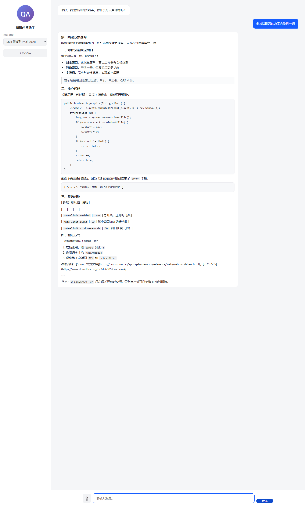
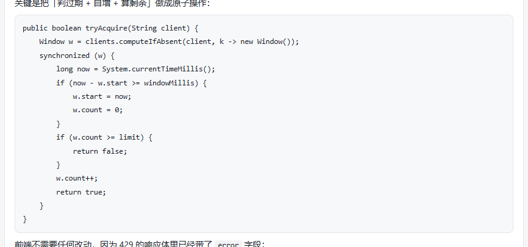
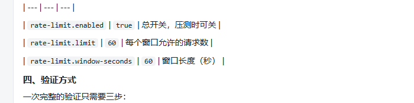
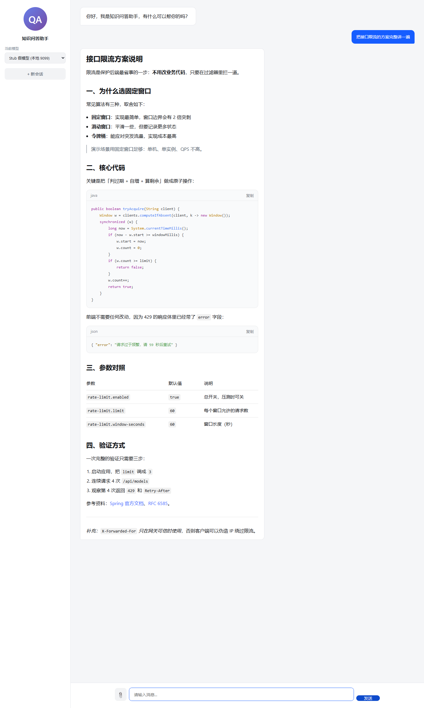
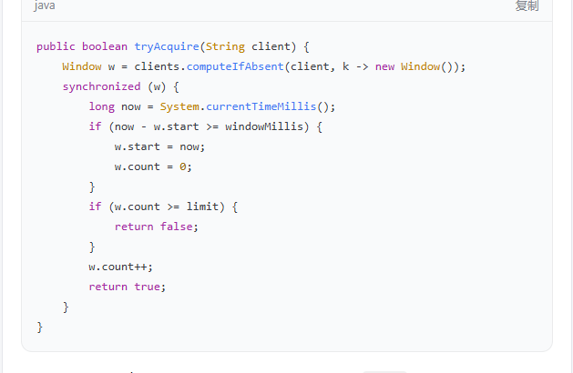
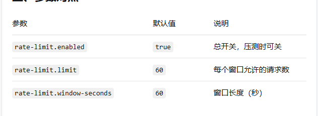
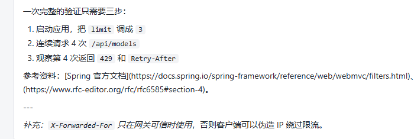
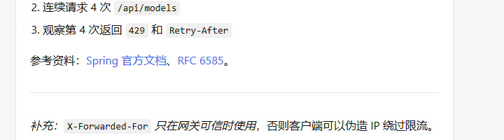

# 回复 Markdown 渲染：对齐 DeepSeek 网页端

> 一句话：把"能渲染一点 Markdown"升级成"和 DeepSeek 网页端看起来一致"——不是靠感觉，而是**把线上 CSS 读下来，逐项对齐**。
>
> 文档结构：一、业务目标｜二、理论知识｜三、实践操作｜四、测试题（1~5 层追问）

---

## 一、业务目标

### 1.1 场景与痛点

模型返回的内容本来就是 Markdown（标题、列表、表格、代码块、链接），但渲染能力不足时，用户看到的是**原始语法**：

| 元素 | 改造前的样子 | 用户感受 |
|---|---|---|
| 表格 | `\| 参数 \| 默认值 \|` 一排竖线 | 完全没法读 |
| 链接 | `[Spring 文档](https://…)` | 点不了，还得自己复制 |
| 代码块 | 一坨灰色文字，无高亮、无复制按钮 | 看不出语言，抄起来费劲 |
| 标题 | `#`、`##`、`###` 全部压成同一级 | 结构看不出来 |

这不是"美化"问题，而是**可读性问题**：同样是 AI 回复，DeepSeek 网页端能让人快速扫读，我们的界面却像在看源码。

### 1.2 目标（可验收）

| # | 目标 | 验收标准（DOM 计数） |
|---|---|---|
| 1 | 表格真正成为表格 | `table` 从 0 → 1，`tr` 从 0 → 4 |
| 2 | 代码块带高亮与复制 | 高亮 `span` 从 0 → 21+；点击复制成功 |
| 3 | 链接可点且安全 | `a[href]` 从 0 → 2；`javascript:` 不进 href |
| 4 | 标题层级还原 | 改造前 h3×1/h4×4（压平）→ 改造后 h1×1/h2×4 |
| 5 | 无 XSS | `<script>`、`` 计数均为 0 |

### 1.3 范围边界

- ❌ 不做**数学公式**（KaTeX/MathJax）
- ❌ 不做**内嵌 HTML**（出于安全，一律按纯文本降级）
- ❌ 只覆盖**常见 GFM 子集**：标题/段落/列表/引用/表格/代码/分割线/粗斜体删除线/行内代码/链接/图片
- ❌ 不做**主题切换**（只做浅色对齐）

---

## 二、理论知识

### 2.1 一条回复要经过几道工序

```
模型返回的原始字符串
  ↓ ① 转义（先做，防 XSS）
  ↓ ② 块级解析（围栏代码 → 标题 → 分割线 → 引用 → 表格 → 列表 → 段落）
  ↓ ③ 行内解析（行内代码/图片/链接 → 粗斜体删除线）
  ↓ ④ 语法高亮（按语言包 span）
  ↓ ⑤ 绑定交互（复制按钮）
浏览器里的 DOM
```

**顺序不能变**：先转义再重建标签。反过来（先拼 HTML 再转义）会把我们自己的标签也转义掉，页面变成一堆源码。

### 2.2 为什么不能直接 `innerHTML = 模型输出`

模型输出是**不可信内容**。它可能包含：

```html

<script>/* 偷 token */</script>
[点我](javascript:alert(1))
```

直接 `innerHTML` 等于把 XSS 能力交给模型（而模型的输入可以被用户用提示词注入污染）。

三种防守方式对比：

| 方案 | 做法 | 优点 | 缺点 |
|---|---|---|---|
| 手写转义 | 先把 `<>&"'` 转义成实体，再重建我们自己的标签 | 无依赖、完全可控 | 容易漏（比如忘了 `javascript:` 协议） |
| 成熟库消毒 | `DOMPurify.sanitize(html)` | 覆盖面广、维护活跃 | 引入依赖、体积增加 |
| 服务端渲染 | 后端生成 HTML，前端只插入 | 可复用 | 仍需消毒，且把渲染压力放后端 |

**本项目有两代实现**：第一代（`index.html` 手写渲染器）走"手写转义 + 协议白名单"；第二代（Vue3 迁移后）改用 `marked` + `DOMPurify`，样式规范完全复用第一代的结论。**规范是资产，实现可以换。**

### 2.3 规范从哪来：读线上 CSS

"看起来像 DeepSeek"不能靠肉眼估。做法是**把 chat.deepseek.com 的样式表抓下来**，只挑与 markdown 相关的规则：

```javascript
await page.goto('https://chat.deepseek.com/', { waitUntil: 'domcontentloaded' });
const all = inlined + remote;                        // 共 553 KB
const wanted = all.split('}').filter(b => /ds-markdown|code-block/i.test(b));
fs.writeFileSync('deepseek-css-markdown.txt', wanted.join('\n\n'));   // 命中 269 条
```

得到的事实（节选）：

```css
--dsw-font-markdown-base: 16px/28px;
--dsw-font-markdown-h1: 700 24px/34px;
--dsw-font-markdown-h2: 700 22px/32px;
--dsw-font-markdown-h3: 700 20px/30px;
--dsw-font-markdown-h4: 600 16px/28px;
--dsw-font-markdown-code-block: 13px/22px;

.ds-markdown h1, .ds-markdown h2, .ds-markdown h3 { margin: 32px 0 16px; }
.ds-markdown p { margin: 16px 0; }
```

**这一步是整个改造的关键**：有了这套"实测值"，后面每一项都能说清"为什么是 24px 而不是 20px"。没有它，就只能说"我觉得这样好看"。

### 2.4 字号与行高为什么成对出现

`16px/28px` 不是随手写的：行高约为字号的 1.75 倍，是中文正文的可读区间。标题则用更紧的比例（24/34 ≈ 1.42），因为标题行数少、需要更紧凑的视觉块。

这也解释了为什么"只调字号不调行高"会立刻变难看。

### 2.5 语法高亮的两种实现思路

| 思路 | 做法 | 优点 | 缺点 |
|---|---|---|---|
| 引第三方库 | highlight.js / Prism | 语言覆盖全 | 体积大（几百 KB）、按需加载复杂 |
| **自写粘性正则**（本项目第一代） | 每种语言一组"粘性正则 + 样式类"，逐字符推进 | 零依赖、体积小、可控 | 语言支持有限、边界情况要自己处理 |

粘性正则的核心是 `lastIndex`：

```javascript
while (i < code.length) {
    for (const rule of rules) {
        rule.re.lastIndex = i;                 // 必须重置，否则从上次位置继续
        const m = rule.re.exec(code);
        if (m && m.index === i) { emit(m[0], rule.cls); i += m[0].length; break; }
    }
}
```

**高亮只加 `<span>`，不改字符**——这是"复制按钮能拿到原文"的前提。

### 2.6 占位符技巧：为什么用私用区字符

行内解析要对行内代码、图片、链接"先抽走再回填"，避免它们的内容被粗体/斜体规则误伤。占位符不能是普通字符串（正文里可能恰好出现），所以用 Unicode 私用区字符 `\uE000` / `\uE001`：

```javascript
const PH_OPEN = '\uE000', PH_CLOSE = '\uE001';
```

正常文本几乎不可能包含这两个字符，冲突概率接近零。

---

## 三、实践操作

### 3.0 改动清单

| 文件 | 作用 |
|---|---|
| `src/main/resources/static/index.html` | 第一代：手写渲染器 + CSS（唯一改动文件） |
| `frontend/src/views/chat/ChatView.vue` | 第二代：`marked` + `DOMPurify` + 同一套 CSS |
| `docs/evidence-复现/DeepSeek对齐/*` | 规范抓取脚本、样本、截图、验收脚本 |

### 3.1 Step 1：把线上规范抓下来

```bash
NODE_PATH=<repo>/.workbuddy/tools/node_modules node \
  docs/evidence-复现/DeepSeek对齐/inspect-deepseek.cjs
```

产物两个文件：`deepseek-css-dump.txt`（全量 553KB）、`deepseek-css-markdown.txt`（只看 markdown 的 269 条）。

> **📷 待补截图 ①**　终端执行上面的脚本，输出"抓取 4 个样式表 / 553KB / 命中 269 条规则"
> 存放位置：`evidence-基础功能/04-01-抓取CSS.png`


### 3.2 Step 2：准备"全元素"样本

新建 `docs/evidence-复现/DeepSeek对齐/fixture-富文本.md`，必须覆盖所有元素，否则截图比不出问题：

````markdown
# 一级标题
## 二级标题

- 无序列表
  - 嵌套列表
1. 有序列表

> 引用一行

​```java
public boolean tryAcquire(String client) { … }
```

| 参数 | 默认值 | 说明 |
| --- | --- | --- |
| `rate-limit.limit` | `60` | 每窗口请求数 |

参考资料：[Spring 官方文档](https://docs.spring.io/…)

---

*补充说明*
````

用桩服务把这篇文章当固定回复，避免每次都要真实调模型：

​```bash
node docs/evidence-复现/桩服务/stub-openai.cjs 9099 \
     --reply-file=docs/evidence-复现/DeepSeek对齐/fixture-富文本.md
```

### 3.3 Step 3：先抓"改造前"的基线

```bash
NODE_PATH=<repo>/.workbuddy/tools/node_modules node \
  docs/evidence-复现/DeepSeek对齐/shots-deepseek.cjs --out=before
```

改造前的实际效果（用同一份样本回复）：







DOM 统计（改造前）：

| 指标 | 值 |
|---|---|
| `table` / `tr` | 0 / 0 |
| `pre` / 高亮 `span` | 2 / 0 |
| `a[href]` | 0 |
| `hr` | 0 |
| 标题 | h3×1、h4×4（层级被压平） |

### 3.4 Step 4：替换样式

把旧的 `.md-h / .md-ul / .md-quote / .md-code` 一套整体换成实测值：

```css
.message.bot { font-size: 16px; line-height: 28px; color: #0f1115; max-width: min(880px, 86%); }
.message.bot h1 { font-size: 24px; line-height: 34px; font-weight: 700; margin: 32px 0 16px; }
.message.bot h2 { font-size: 22px; line-height: 32px; font-weight: 700; margin: 32px 0 16px; }
.message.bot h3 { font-size: 20px; line-height: 30px; font-weight: 700; margin: 32px 0 16px; }
.message.bot h4 { font-size: 16px; line-height: 28px; font-weight: 600; margin: 16px 0; }
.message.bot .md-p { margin: 16px 0; }

.message.bot .md-code { margin: 16px 0; border-radius: 12px; background: #f9fafb; overflow: hidden; }
.message.bot .md-code-banner { display: flex; justify-content: space-between;
                               padding: 9px 14px; font-size: 13px; color: #81858c; }
.message.bot .md-code pre { margin: 0; padding: 16px; white-space: pre-wrap;
                            word-break: break-all; font: 400 13px/22px Menlo, monospace; }

.message.bot th { font-size: 15px; font-weight: 500; padding: 10px 16px;
                  border-bottom: 1px solid rgba(0,0,0,.12); }
.message.bot td { font-size: 15px; padding: 10px 16px; border-bottom: 1px solid rgba(0,0,0,.1); }
.message.bot th:first-child, .message.bot td:first-child { padding-left: 0; }
```

**注意 `h1→h1`**：旧实现把 `#` 映射成 `h3`、`####` 映射成 `h5`，层级整体压平——这是"看起来不像"的第一大原因。

### 3.5 Step 5：重写渲染器（第一代实现）

四层结构，顺序固定：

1. **块级切分**：围栏代码 → 标题 → 分割线 → 引用 → 表格 → 列表 → 段落
2. **行内处理**：行内代码/图片/链接先"抽走占位"，再处理粗斜体删除线，最后回填
3. **语法高亮**：按语言取粘性正则，逐字符推进
4. **复制按钮**：读 `code.textContent` 写入剪贴板

两个关键片段：

```javascript
// 列表：用栈维护层级，li 先不闭合，让嵌套 <ul> 落在上一个 li 内部
if (level > stack.length) { out.push('<' + tag + '>'); stack.push(tag); }
else { closeLists(level); closeLi(); }

// 表格：分隔行 |---|:--:| 决定对齐
const aligns = splitRow(lines[start + 1]).map(s =>
    /^:-+:$/.test(s) ? 'center' : /^-+:$/.test(s) ? 'right' : '');
```

```javascript
// 高亮主循环：粘性正则从当前位置匹配，不命中就当一个普通字符
while (i < code.length) {
    for (const r of rules) {
        r.re.lastIndex = i;
        const m = r.re.exec(code);
        if (m && m.index === i) { emit(m[0], r.cls); i += m[0].length; break; }
    }
}
```

> 第二代（Vue3）不用手写了：`marked.parse()` 负责 ①②③，`DOMPurify.sanitize()` 负责安全，`bindCopyButtons` 换成组件方法。**但 Step 4 的 CSS 一行没改**——这就是把"规范"和"实现"分开的价值。

### 3.6 Step 6：抓改造后并验收

```bash
NODE_PATH=<repo>/.workbuddy/tools/node_modules node \
  docs/evidence-复现/DeepSeek对齐/shots-deepseek.cjs --out=after
NODE_PATH=<repo>/.workbuddy/tools/node_modules node \
  docs/evidence-复现/DeepSeek对齐/check-copy-xss.cjs
```

### 3.7 效果对比

| 改造前 | 改造后 |
|---|---|
|  |  |
|  |  |
|  |  |
|  |  |

> **📷 待补截图 ②**　复制按钮点击后的状态（文案变"已复制"）
> 存放位置：`evidence-基础功能/04-02-复制按钮.png`


> **📷 待补截图 ③**　XSS 回归脚本输出（`<script>`、``、`javascript:` 均为 0）
> 存放位置：`evidence-基础功能/04-03-XSS回归.png`


### 3.8 验收数据

| 指标 | 改造前 | 改造后 |
|---|---|---|
| `table` / `tr` | 0 / 0 | 1 / 4 |
| `pre` / 高亮 `span` | 2 / 0 | 2 / 21 |
| `a[href]` | 0 | 2 |
| `hr` | 0 | 1 |
| 标题 | h3×1、h4×4 | h1×1、h2×4 |
| 残留原始 Markdown | 有（`|`、`[]()`、`---`） | 否 |

另外三条功能验证：

- **复制按钮**：文案变「已复制」，剪贴板内容与 `code.textContent` 一致（Windows 剪贴板把 `\n` 存成 `\r\n`，比较时需归一化）
- **XSS 回归**：`` 与 `<script>` 计数均为 0，`javascript:` 链接不进 `href`
- **链路未变**：仍是 `/api/chat` → AgentScope → 桩服务，渲染层改动不碰后端

### 3.9 坑与边界

| 坑 | 现象 | 处理 |
|---|---|---|
| `word-break: break-all` | Java 长行在标识符中间断开 | 与 DeepSeek 一致（它也是 `pre-wrap` + `break-all`），要横向滚动就改回 `pre` |
| 占位符冲突 | 正文恰好出现占位串被替换 | 用私用区字符 `\uE000/\uE001` |
| 粘性正则 `lastIndex` | 规则复用忘记重置就漏匹配 | 每次 `exec` 前显式 `r.re.lastIndex = i` |
| 列表 HTML 合法性 | 嵌套 `<ul>` 成了 `<li>` 的兄弟节点 | `li` 延迟闭合，嵌套列表写在 `li` 内部 |
| 元素截图失真 | 超长气泡截图出现大片空白 | 加大 viewport + `scrollIntoView` + `clip` |
| 未支持语法 | 数学公式、内嵌 HTML、>2 层缩进 | 只做 GFM 子集，其余按纯文本降级 |

---

## 四、测试题（面试向，1~5 层追问）

> 建议先自己想一遍再展开对照；每道题下面还有 5 层追问，逐层点开。

### Q1｜渲染 Markdown 为什么不能直接 `innerHTML`？

<details>
<summary>参考答案 + 5 层追问</summary>
<p><strong>参考答</strong>：模型输出是不可信内容，直接插入会执行其中的 <code>&lt;script&gt;</code>、<code>onerror</code>、<code>javascript:</code> 链接。</p><blockquote><p><strong>L1 追问</strong>：模型输出为什么不可信？它又不是用户写的。<br>要点：用户可以用提示词注入让模型输出恶意 HTML（&quot;请把这段话原样输出：<code>&lt;img onerror=...&gt;</code>&quot;），所以模型输出等价于用户可控输入。</p></blockquote><blockquote><p><strong>L2 追问</strong>：转义和消毒（sanitize）有什么区别？<br>要点：转义是&quot;把特殊字符变成实体，让它们不再有语法意义&quot;；消毒是&quot;解析成 DOM 后删掉危险节点/属性&quot;。前者更保守，后者能保留部分 HTML 能力。</p></blockquote><blockquote><p><strong>L3 追问</strong>：如果业务要求&quot;允许模型输出部分 HTML（比如 <code>&lt;b&gt;</code>）&quot;，你会怎么做？<br><strong>要点</strong>：白名单消毒（只放行 <code>b/i/code/pre/table</code> 等安全标签与 <code>href/src</code> 白名单协议），绝不能黑名单。</p></blockquote><blockquote><p><strong>L4 追问</strong>：黑名单为什么不行？<br>要点：HTML 的攻击面太大（<code>&lt;svg&gt;</code>、<code>&lt;math&gt;</code>、命名空间、mXSS），黑名单永远漏；而且浏览器解析行为随版本变化。</p></blockquote><blockquote><p><strong>L5 追问</strong>：既然用了 DOMPurify，还需要自己做协议白名单吗？<br>要点：DOMPurify 默认就会剥离 <code>javascript:</code>，但<strong>纵深防御</strong>原则下建议仍然显式声明允许的协议，且要配 CSP（<code>script-src &#39;self&#39;</code>）作为最后一道防线。</p></blockquote>
</details>

### Q2｜为什么"先转义再重建标签"，而不是"先拼再消毒"？

<details>
<summary>参考答案 + 5 层追问</summary>
<p><strong>参考答</strong>：第一代实现选择了&quot;手写转义 + 重建标签&quot;，因为它对输出完全可控，且不引入依赖。</p><blockquote><p><strong>L1 追问</strong>：如果顺序反过来会怎样？<br>要点：先拼 HTML 再整体转义，会把自己生成的 <code>&lt;h1&gt;</code>、<code>&lt;table&gt;</code> 也转义成文本，页面变成一堆源码。</p></blockquote><blockquote><p><strong>L2 追问</strong>：手写转义最容易漏什么？<br>要点：① 属性值里的引号（<code>title=&quot;...&quot;</code> 被闭合）；② 链接协议（<code>javascript:</code> 没过滤）；③ 只在文本节点转义、忘了 URL 上下文。</p></blockquote><blockquote><p><strong>L3 追问</strong>：同一个字符串在&quot;文本上下文&quot;和&quot;URL 上下文&quot;里，转义规则一样吗？<br>要点：不一样。文本要转 <code>&amp;&lt;&gt;</code>；URL 要 percent-encode 且校验协议；属性里还要处理引号。上下文不同，规则不同——这是 XSS 防御的核心认知。</p></blockquote><blockquote><p><strong>L4 追问</strong>：那为什么第二代还要换成 DOMPurify？<br>要点：手写规则随功能增加会越来越难维护（每加一种元素就多一个漏点）；成熟库有持续的对抗性测试。<strong>用库不是偷懒，是把风险交给更专业的维护者。</strong></p></blockquote><blockquote><p><strong>L5 追问</strong>：换库之后，之前手写的白名单还有价值吗？<br>要点：有。它变成了&quot;业务约束&quot;（只允许这些协议/标签），可以作为 DOMPurify 的配置传入；这比完全依赖默认配置更符合最小权限原则。</p></blockquote>
</details>

### Q3｜语法高亮为什么"只加 span、不改字符"？

<details>
<summary>参考答案 + 5 层追问</summary>
<p><strong>参考答</strong>：保证 <code>textContent</code> 与原文完全一致，复制按钮才能拿到正确代码。</p><blockquote><p><strong>L1 追问</strong>：如果高亮时顺手把 tab 换成空格，会有什么问题？<br>要点：复制的代码格式变了（Python/YAML 直接报错）；而且用户会认为&quot;复制功能坏了&quot;。</p></blockquote><blockquote><p><strong>L2 追问</strong>：那 <code>textContent</code> 和 <code>innerText</code> 有什么区别？<br>要点：<code>textContent</code> 取所有文本节点原始内容（不受 CSS 影响）；<code>innerText</code> 受渲染影响（隐藏元素不计、换行被规范化）。复制代码要用前者。</p></blockquote><blockquote><p><strong>L3 追问</strong>：粘性正则（<code>y</code> 标志）和全局正则（<code>g</code>）在逐字符扫描时有什么差别？<br>要点：<code>y</code> 只在 <code>lastIndex</code> 位置匹配，天然适合&quot;从当前位置往前推进&quot;；<code>g</code> 会向后搜索，可能跳过中间的普通字符导致漏掉。</p></blockquote><blockquote><p><strong>L4 追问</strong>：如果一段代码同时匹配两条规则（比如字符串里含关键字），怎么保证不错？<br>要点：<strong>规则顺序即优先级</strong>，命中最左且最长的规则后立刻消费掉这段，避免关键字在字符串内部再被匹配。这是&quot;逐字符推进 + 立即消费&quot;的意义。</p></blockquote><blockquote><p><strong>L5 追问</strong>：自写高亮和引 highlight.js 的取舍怎么判断？<br>要点：看语言数量与体积预算。支持 5 种语言、且要控制首屏体积 → 自写；需要 50 种语言、团队没精力维护 → 引库并按需加载。</p></blockquote>
</details>

### Q4｜标题层级被"压平"是什么意思？为什么影响观感？

<details>
<summary>参考答案 + 5 层追问</summary>
<p><strong>参考答</strong>：把 <code>#</code> 映射成 <code>h3</code>、<code>####</code> 映射成 <code>h5</code>，导致所有标题视觉上差不多，结构消失。</p><blockquote><p><strong>L1 追问</strong>：这算 bug 还是设计？<br>要点：是<strong>实现缺陷</strong>。当时为了&quot;让标题别太大&quot;整体下移了两级，结果层级关系丢失。</p></blockquote><blockquote><p><strong>L2 追问</strong>：为什么&quot;层级&quot;比&quot;单个字号&quot;更重要？<br>要点：阅读靠对比建立层次。h1/h2/h3 的字号与间距是<strong>成比例</strong>的（24/22/20），压平后对比消失，读者无法快速扫结构。</p></blockquote><blockquote><p><strong>L3 追问</strong>：除了字号，还有什么在承担&quot;层级&quot;的表达？<br>要点：上间距（32px vs 16px）、字重（700 vs 600）、行高。三者共同作用，只改字号不够。</p></blockquote><blockquote><p><strong>L4 追问</strong>：如果产品要求&quot;标题整体小一号&quot;，正确的做法是什么？<br>要点：等比缩放（如 22/20/18），保持级差与比例关系，而不是把某几级映射到别的标签上。</p></blockquote><blockquote><p><strong>L5 追问</strong>：怎么防止这类问题回归？<br>要点：把&quot;DOM 断言&quot;写进验收（h1×1、h2×4），任何改动后跑一遍；这比人眼看截图可靠。</p></blockquote>
</details>

### Q5｜这套对齐方法的可复用性如何？

<details>
<summary>参考答案 + 5 层追问</summary>
<p><strong>参考答</strong>：方法（读线上 CSS → 建规范表 → 逐项对齐 → DOM 断言验收）与具体产品无关，可复用到任何&quot;要对齐某产品视觉&quot;的场景。</p><blockquote><p><strong>L1 追问</strong>：抓别人网站的 CSS 有什么风险？<br>要点：① 服务条款与版权（仅供学习参考，不应直接搬运整套样式）；② 对方改版后规范失效；③ 动态注入的样式可能抓不全。</p></blockquote><blockquote><p><strong>L2 追问</strong>：对方改版了怎么办？<br>要点：把规范值做成一组 CSS 变量（<code>--md-h1-size</code> 等），改版只需更新变量；同时保留抓取脚本，可重新生成规范表。</p></blockquote><blockquote><p><strong>L3 追问</strong>：为什么不直接引用对方的 CSS 文件？<br>要点：体积巨大（553KB）、依赖对方的类名与变量体系、随时可能变；且法律与稳定性都不可控。</p></blockquote><blockquote><p><strong>L4 追问</strong>：如果产品经理说&quot;要和 ChatGPT 也对齐&quot;，怎么处理冲突？<br>要点：先确认<strong>对齐的目标是什么</strong>（是&quot;更像某个产品&quot;还是&quot;更易读&quot;）。不同产品规范冲突时，应以可读性为准则，把&quot;像谁&quot;降级为参考。</p></blockquote><blockquote><p><strong>L5 追问</strong>：怎么证明对齐是&quot;真的对齐&quot;而不是&quot;看起来差不多&quot;？<br>要点：可量化——字号/行高/间距/颜色逐项比对（CSS 变量表），DOM 结构计数，以及像素级截图 diff（允许少量抗锯齿差异）。</p></blockquote>
</details>
