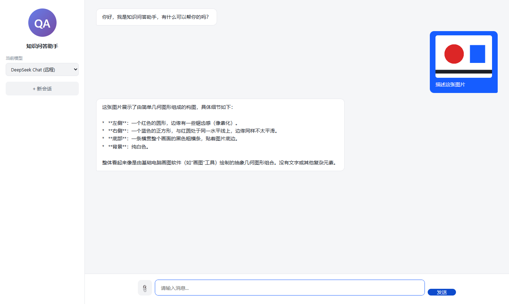
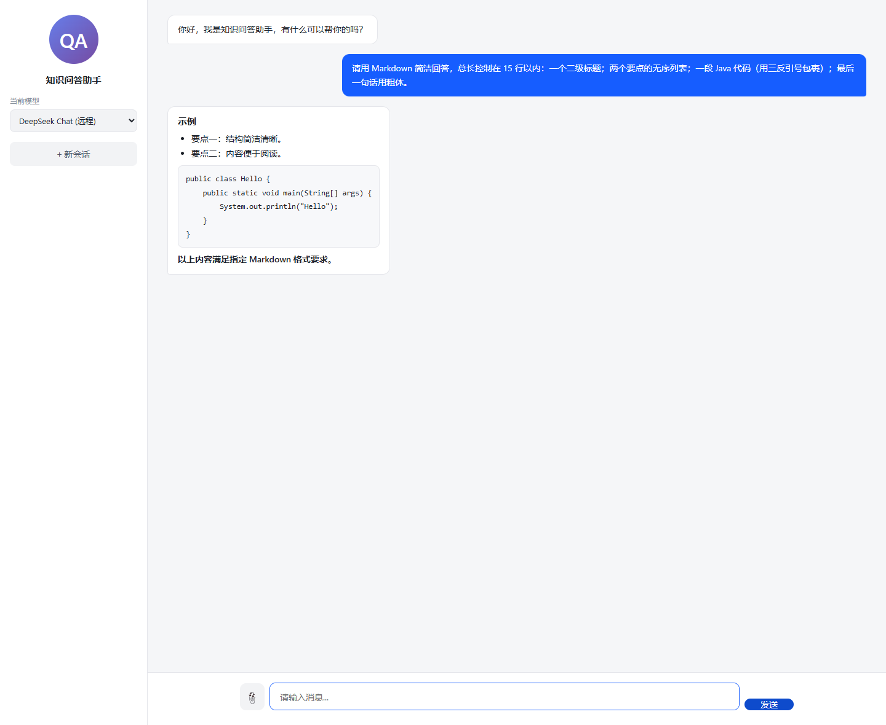
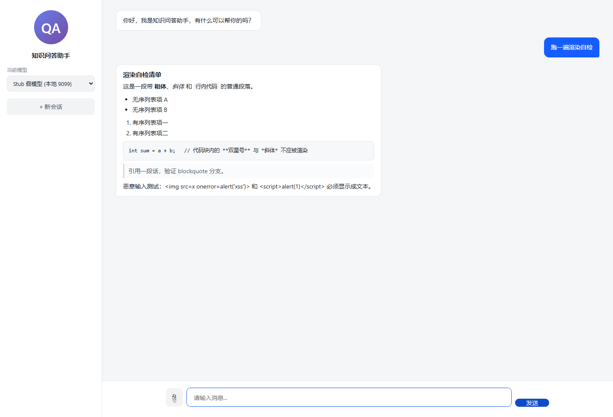

# 新增功能 02：机器人回复的 Markdown 渲染（含 XSS 转义）

> 同样是给项目**新加**的功能。它解决的问题非常具体：模型返回的是 Markdown，但前端一直用
> `textContent` 原样塞进去，于是 `**粗体**`、`* 列表`、三反引号代码块全都以符号形态显示。
>
> 证据来自 2026-11-09 的真实复现，文件在 `docs/evidence-复现/Markdown渲染/`。

---

## 1. 改造前是什么样

改造前的机器人气泡（这张截图取自旧版本，就是本文档要修掉的毛病）：



能看到三处典型问题：

- `* **左侧**：一个红色的圆形…` —— 星号和双星号直接露出来；
- 列表项前面的 `*` 与正文挤在一起，没有缩进层级；
- 如果模型返回三反引号代码块，会看到一坨带 ``` 的等宽文本。

根因一行代码就够定位（`index.html` 改造前）：

```javascript
if (text) div.appendChild(document.createTextNode(text));   // 全部当纯文本
```

---

## 2. 为什么自己写，不引 marked.js / markdown-it

| 方案 | 体积 | 依赖 | 可控性 | 取舍 |
| --- | --- | --- | --- | --- |
| marked.js / markdown-it | 30~100 KB | 新增 CDN 或 vendored 文件 | 默认不转义，需配合 DOMPurify 才安全 | 对本项目过重 |
| 自己写白名单渲染器 | ~60 行 | 0 | 每一行都能讲清楚、能审计 | ✅ 采用 |

关键判断：**模型输出必须当作不可信输入**。它可能被用户用 prompt 注入成 ``。
所以这里的核心不是"把 Markdown 渲染得多全"，而是"**先把所有 HTML 转义，再只对白名单语法做替换**"。

只支持 6 种语法（够覆盖模型实际输出的 95%）：标题、无序/有序列表、围栏代码块、行内代码、粗体/斜体、引用。

---

## 3. 前置条件

| 项 | 真实回复路线（A） | 桩路线（B，验证 XSS） |
| --- | --- | --- |
| 应用 | 8083 实例（改造后的代码） | 8084 实例 + 桩配置 |
| 模型 | 需要可用 API Key（`.env` 里的 `DEEPSEEK_API_KEY`） | 不需要，桩服务固定返回 |
| Node.js | 可选（仅截图脚本） | 需要（跑桩服务） |
| PostgreSQL / Ollama | 不需要 | 不需要 |
| 浏览器 | Chrome / Edge | 同左 |

A 路线花 1 次模型调用（约 5~10 秒），B 路线零成本、结果完全确定。

---

## 4. 实现（改一个文件：`src/main/resources/static/index.html`）

### 4.1 新增 CSS（插在 `.message.error` 规则之后）

```css
/* ===== 新增功能②：Markdown 渲染样式（只作用于 bot 气泡） ===== */
.message.bot { white-space: normal; }               /* 关掉父级 pre-wrap，改由块级元素控制间距 */
.message.bot .md-p { margin: 0 0 8px; }
.message.bot .md-p:last-child { margin-bottom: 0; }
.message.bot .md-h { margin: 10px 0 6px; font-size: 15px; font-weight: 600; line-height: 1.5; }
.message.bot .md-h:first-child { margin-top: 0; }
.message.bot .md-ul, .message.bot .md-ol { margin: 6px 0 8px; padding-left: 22px; }
.message.bot .md-ul li, .message.bot .md-ol li { margin: 2px 0; }
.message.bot .md-quote {
    margin: 8px 0; padding: 6px 10px; color: #4e5969;
    border-left: 3px solid #d9d9d9; background: #fafbfc;
}
.message.bot .md-code {
    margin: 8px 0; padding: 10px 12px; background: #f7f8fa;
    border: 1px solid #e5e6eb; border-radius: 8px;
    overflow-x: auto; white-space: pre;             /* 代码块自己保留换行 */
}
.message.bot .md-code code {
    font-family: ui-monospace, Consolas, "Courier New", monospace;
    font-size: 12.5px; line-height: 1.6; background: none; padding: 0;
}
.message.bot .md-inline {
    padding: 1px 5px; background: #f2f3f5; border-radius: 4px;
    font-family: ui-monospace, Consolas, "Courier New", monospace; font-size: 12.5px;
}
.message.bot strong { font-weight: 600; }
```

### 4.2 新增三个函数（插在 `scrollToBottom()` 之后）

```javascript
/* 安全原则：先把整段文本的 HTML 特殊字符全部转义，再只对白名单语法做替换。
   因此模型输出  只会显示成文本，不会被执行。 */
function escapeHtml(s) {
    return s.replace(/[&<>"']/g, c => ({
        '&': '&amp;', '<': '&lt;', '>': '&gt;', '"': '&quot;', "'": '&#39;'
    })[c]);
}

function inlineFormat(s) {
    return s
        .replace(/`([^`]+)`/g, '<code class="md-inline">$1</code>')      // 行内代码
        .replace(/\*\*([^*]+)\*\*/g, '<strong>$1</strong>')              // **粗体**
        .replace(/(^|[^*])\*([^*\n]+)\*/g, '$1<em>$2</em>');             // *斜体*
}

function renderMarkdown(src) {
    if (!src) return '';
    const escaped = escapeHtml(src);

    // 1) 先把 ``` 代码块整体抽走，避免里面的 * 或 ` 被行内规则误伤
    const codes = [];
    const text = escaped.replace(/```[a-zA-Z0-9+#-]*\n?([\s\S]*?)```/g, (m, body) => {
        codes.push(body.replace(/\n$/, ''));
        return '@@CODE' + (codes.length - 1) + '@@';
    });

    const out = [];
    let listTag = null;
    const closeList = () => { if (listTag) { out.push('</' + listTag + '>'); listTag = null; } };

    for (const raw of text.split('\n')) {
        const line = raw.trim();
        if (!line) { closeList(); continue; }                            // 空行 = 段落分隔

        let m;
        if ((m = /^@@CODE(\d+)@@$/.exec(line))) {                        // 代码块占位符
            closeList(); out.push(line); continue;
        }
        if ((m = /^(#{1,4})\s+(.+)$/.exec(line))) {                       // 标题，最多映射到 h5
            closeList();
            const level = Math.min(m[1].length + 2, 5);
            out.push('<h' + level + ' class="md-h">' + inlineFormat(m[2]) + '</h' + level + '>');
            continue;
        }
        if ((m = /^[-*+]\s+(.+)$/.exec(line))) {                          // 无序列表
            if (listTag !== 'ul') { closeList(); out.push('<ul class="md-ul">'); listTag = 'ul'; }
            out.push('<li>' + inlineFormat(m[1]) + '</li>');
            continue;
        }
        if ((m = /^\d+[.)]\s+(.+)$/.exec(line))) {                        // 有序列表
            if (listTag !== 'ol') { closeList(); out.push('<ol class="md-ol">'); listTag = 'ol'; }
            out.push('<li>' + inlineFormat(m[1]) + '</li>');
            continue;
        }
        if ((m = /^&gt;\s?(.*)$/.exec(line))) {                           // 引用（> 已被转义成 &gt;）
            closeList();
            out.push('<blockquote class="md-quote">' + inlineFormat(m[1]) + '</blockquote>');
            continue;
        }
        closeList();
        out.push('<p class="md-p">' + inlineFormat(line) + '</p>');
    }
    closeList();

    // 2) 最后把占位符换回真正的代码块（此时不再经过行内规则）
    return out.join('').replace(/@@CODE(\d+)@@/g,
        (m, i) => '<pre class="md-code"><code>' + codes[+i] + '</code></pre>');
}
```

### 4.3 只让机器人气泡走渲染

```javascript
function appendMessage(text, cls, imageUrl) {
    // ……前面创建 div、挂图片的代码不变
    if (text) {
        if (cls.indexOf('bot') >= 0) {
            div.innerHTML = renderMarkdown(text);                 // 只有机器人回复走渲染
        } else {
            div.appendChild(document.createTextNode(text));       // 用户输入永远当纯文本
        }
    }
    // ……appendChild / scrollToBottom 不变
}
```

**为什么用户消息不渲染**：用户输入完全不可信，且没必要支持 Markdown；保持 `textContent` 等于零风险。
另外 `error` 气泡同样走纯文本分支，后端返回的原始错误串不会被误当成语法。

---

## 5. 逐步复现

### 路线 A：真实模型回复（8083）

```bash
cd "F:/coding demo"
set -a && . ./.env && set +a
export no_proxy=localhost,127.0.0.1
mvn -DskipTests spring-boot:run -Dspring-boot.run.arguments="--spring.sql.init.mode=never --spring.datasource.hikari.initialization-fail-timeout=-1"
```

浏览器打开 <http://localhost:8083/>，模型选 `DeepSeek Chat (远程)`，发送：

```
请用 Markdown 简洁回答，总长控制在 15 行以内：一个二级标题；两个要点的无序列表；一段 Java 代码（用三反引号包裹）；最后一句话用粗体。
```

**预期**：机器人气泡里出现"标题（加粗小标题样式）+ 两条带 • 的列表 + 灰底代码块 + 最后一句话为粗体"，且**看不到任何 `**` 或 ``` 符号**。



自动化核验（`evidence-复现/截图脚本/shots-markdown.cjs` 会直接打印这些值）：

```javascript
// 浏览器 DevTools Console 里等效的一条命令
[...document.querySelectorAll('.message.bot')].pop().querySelectorAll('pre.md-code').length  // 1
[...document.querySelectorAll('.message.bot')].pop().querySelectorAll('ul.md-ul li').length   // 2
/\*\*|```/.test([...document.querySelectorAll('.message.bot')].pop().textContent)             // false
```

**实测统计**（脚本输出）：

```json
{
  "hasCodeBlock": true,
  "codeBlocks": 1,
  "hasUnorderedList": true,
  "listItems": 2,
  "headings": 1,
  "strongTags": 1,
  "rawMarkdownLeft": false
}
```

### 路线 B：桩服务 + XSS 用例（不需要 API Key）

模型回复不可控，验证"转义是否真的生效"要用一段固定的恶意 payload。

**B1. 准备 payload**：`evidence-复现/Markdown渲染/xss-payload.md`

````markdown
## 渲染自检清单

这是一段带 **粗体**、*斜体* 和 `行内代码` 的普通段落。

- 无序列表项 A
- 无序列表项 B

1. 有序列表项一
2. 有序列表项二

```java
int sum = a + b;   // 代码块内的 **双星号** 与 *斜体* 不应被渲染
```

> 引用一段话，验证 blockquote 分支。

恶意输入测试： 和 <script>alert(1)</script> 必须显示成文本。
````

**B2. 起桩（固定返回上面的文件内容）**：

```bash
node docs/evidence-复现/桩服务/stub-openai.cjs 9099 --reply-file="docs/evidence-复现/Markdown渲染/xss-payload.md"
# [stub] listening on http://localhost:9099
```

**B3. 用桩配置起应用（8084）**：

```bash
mvn -DskipTests spring-boot:run -Dspring-boot.run.arguments="--server.port=8084 --spring.sql.init.mode=never --spring.datasource.hikari.initialization-fail-timeout=-1 --spring.config.additional-location=file:docs/evidence-复现/桩服务/application-stub.yml"
```

**B4. 打开 <http://localhost:8084/> 发一句话**，等桩回复：



一眼能看到的四件事：

1. `**粗体**` 变成真粗体、`*斜体*` 变斜体、`行内代码` 有灰底——白名单语法生效；
2. 无序/有序列表各自成块；
3. 代码块里那句 `// 代码块内的 **双星号** 与 *斜体* 不应被渲染` **原样保留**（星号没被吃掉）；
4. 最后一行 `` 与 `<script>alert(1)</script>` **显示成文本**，页面没有弹窗、没有破图。

自动化核验（`evidence-复现/截图脚本/shots-xss.cjs`）：

```json
{
  "codeBlocks": 1,
  "inlineCode": 1,
  "listItems": 4,
  "quotes": 1,
  "strong": 1,
  "imgInsideBubble": 0,
  "scriptInsideBubble": 0,
  "textContainsImgLiteral": true,
  "strongInsideCode": 0
}
```

`imgInsideBubble: 0` / `scriptInsideBubble: 0` 说明 DOM 里**根本没有**这两个危险节点；
`textContainsImgLiteral: true` 说明它确实以纯文本形式出现在气泡里；脚本同时监听了 `dialog` 事件，输出「无（符合预期）」。

---

## 6. 三个容易踩的坑（也是这个功能的知识点）

**① 顺序错了就白做**：必须「先整体转义 → 再替换语法」。如果先替换再转义，`<strong>` 自己会被转义成 `&lt;strong&gt;`；
如果只在不转义的前提下替换，恶意 HTML 就活了。这一点是整段代码的安全底线。

**② 代码块要"先抽走"**：行内规则（`` ` `` / `**` / `*`）用的都是正则全局替换，如果不把三反引号块先替换成占位符，
代码里的 `**` 会被误判成粗体、`*` 会被当成斜体，代码就被改花了。这也是核验里专门看 `strongInsideCode: 0` 的原因。

**③ 占位符不能被包进 `<p>`**：`renderMarkdown` 里对 `@@CODEn@@` 单独 `continue`，就是为了让代码块作为块级元素输出；
否则会生成 `<p><pre>…</pre></p>` 这种非法嵌套，浏览器会把 `<p>` 提前闭合，样式错位。

**已知不支持**（有意留白，代码里没写就说明不支持，不会静默出错）：

| 语法 | 现状 | 想加怎么做 |
| --- | --- | --- |
| `[文字](url)` 链接 | 原样显示 | 在 `inlineFormat` 末尾加一条替换，注意 `href` 要过滤 `javascript:` |
| `| 表格 |` | 原样显示 | 需要识别连续 `|` 行 + 分隔行，改成分组状态机 |
| 嵌套列表 | 拍平为一层 | 依据行首缩进维护栈 |
| `---` 分隔线 / 引用内多段 | 原样显示 | 各加一个分支 |

---

## 7. 验证结果汇总

| # | 检查项 | 预期 | 实测（2026-11-09） | 结论 |
| --- | --- | --- | --- | --- |
| 1 | 标题渲染 | 生成 `.md-h` 元素 | 真实回复 `headings: 1`；XSS 用例 `h4` 正常 | ✅ |
| 2 | 围栏代码块 | 生成 `pre.md-code` 且保留缩进 | 真实回复 1 个；XSS 用例 1 个 | ✅ |
| 3 | 行内代码 | 生成 `code.md-inline` | XSS 用例 `inlineCode: 1` | ✅ |
| 4 | 粗体 / 斜体 | `<strong>` / `<em>` | `strong: 1`；截图中"粗体""斜体"已变形 | ✅ |
| 5 | 无序 / 有序列表 | `ul.md-ul` / `ol.md-ol` 分组正确 | 真实回复 2 项；XSS 用例 4 项（2+2） | ✅ |
| 6 | 引用 | `blockquote.md-quote` | XSS 用例 `quotes: 1` | ✅ |
| 7 | 无残留符号 | 气泡内不再出现 `**` 或 ``` | `rawMarkdownLeft: false` | ✅ |
| 8 | XSS：危险节点 | DOM 中无 `img` / `script` | `imgInsideBubble: 0`，`scriptInsideBubble: 0` | ✅ |
| 9 | XSS：不执行 | 无弹窗 | 监听 `dialog`，实测「无」 | ✅ |
| 10 | 代码块内语法不被误伤 | `pre` 内无 `strong` | `strongInsideCode: 0` | ✅ |
| 11 | 用户消息不受影响 | 仍为纯文本 | 代码只对 `cls` 含 `bot` 的分支渲染 | ✅ |
| 12 | 既有功能回归 | 图片上传、模型切换、限流、52 个单测 | 上传/预览截图正常；`Tests run: 52, Failures: 0` | ✅ |

---

## 8. 常见问题

| 现象 | 原因 | 处理 |
| --- | --- | --- |
| 改了 `index.html` 但页面没变 | 浏览器缓存 | Ctrl+F5 强刷；或 DevTools 勾选 Disable cache |
| 回复里仍是 `**` | 命中的是用户气泡分支或旧页面 | 确认改的是 `appendMessage` 的 `bot` 分支，且强力刷新 |
| 代码块挤成一行 | CSS 里 `.md-code` 的 `white-space: pre` 被覆盖 | 检查是否漏了这段 CSS |
| 列表没有圆点 | `.md-ul` 的 `padding-left` 被重置 | 同上 |
| 中文被吃掉几个字 | 正则里 `[^*\n]+` 遇到星号截断 | 属预期：该行含奇数个 `*` 时按斜体处理，必要时换更严格的解析 |
| 想支持表格/链接 | 未实现 | 见第 6 节表格里的改造点 |
| 担心模型输出超长拖慢渲染 | 全部是字符串 replace + 单次遍历 | 1 万字符内是毫秒级；超过再考虑分块渲染 |

**回滚**：把 `appendMessage` 里那 5 行改回 `if (text) div.appendChild(document.createTextNode(text));`，
再删掉新增的 CSS 与三个函数即可（纯前端，无后端影响）。

---

## 9. 证据文件清单

| 文件 | 说明 |
| --- | --- |
| `evidence-复现/Markdown渲染/00-改造前-原样显示.png` | 改造前：星号与列表符号原样暴露 |
| `evidence-复现/Markdown渲染/03-渲染后-真实回复.png` | 真实模型回复的渲染效果（标题/列表/代码块/粗体） |
| `evidence-复现/Markdown渲染/05-XSS用例-转义后仅显示文本.png` | 桩返回恶意 payload，标签只显示为文本 |
| `evidence-复现/Markdown渲染/xss-payload.md` | 覆盖 6 种语法 + 两种注入的固定输入 |
| `evidence-复现/Markdown渲染/01-启动日志.log` | 8083 实例启动日志 |
| `evidence-复现/Markdown渲染/02-桩模式实例启动日志.log` | 8084 桩模式实例启动日志 |
| `evidence-复现/截图脚本/shots-markdown.cjs` | 真实回复路线：发问 + 统计 + 截图 |
| `evidence-复现/截图脚本/shots-xss.cjs` | XSS 路线：统计危险节点 + 监听 dialog + 截图 |
| `evidence-复现/桩服务/stub-openai.cjs` | 假模型服务，支持 `--reply-file=` 返回固定内容 |

重跑：

```bash
export NODE_PATH=<你的 node_modules 路径>     # 内含 playwright-core
node docs/evidence-复现/截图脚本/shots-markdown.cjs    # 需 8083 在跑且有 API Key
node docs/evidence-复现/截图脚本/shots-xss.cjs         # 需 9099 桩 + 8084 实例
```
