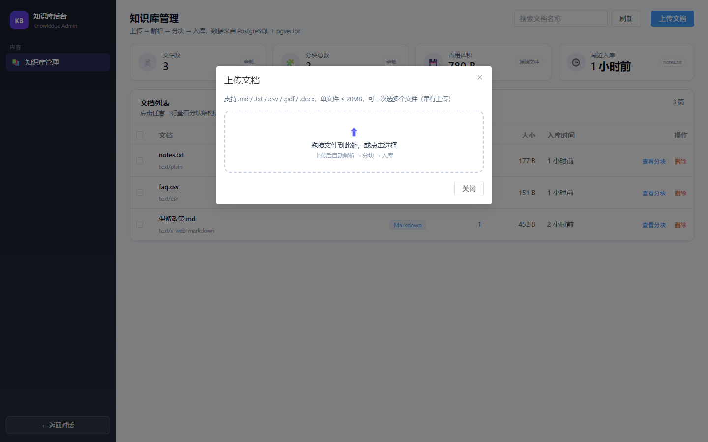
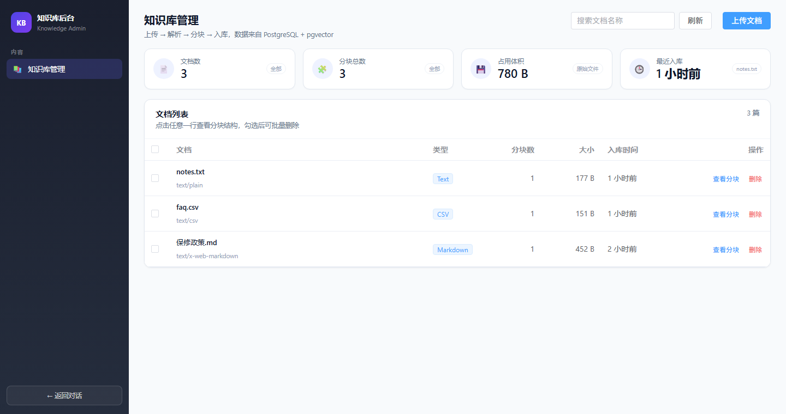

# 功能点一：知识库文档的增删改查

> 所属模块：知识库（RAG 上游）　｜　技术栈：Spring Boot 3.3 + JDBC + PostgreSQL 16 / pgvector + Vue3
> 前置知识：HTTP 语义、SQL 事务、multipart 上传、Vue3 组合式 API
> 本文目标：读完并照着「二、实践」敲一遍，能独立做出这个功能点

---

## 一、理论知识

### 1.1 这个功能点在整个系统里的位置

```
上传文件 → 解析(parse) → 分块(chunk) → 入库(store) → 后台查看/编辑 → 【向量化 + 检索】← 下一阶段
└──────────────────── 本功能点覆盖 ────────────────────┘
```

必须先说清边界：**本功能点不含向量检索**。它解决的是「文档怎么进来、怎么看、怎么改、怎么删」，是 RAG 的地基。地基不牢，后面检索再准也没用——因为检索只能在已有的块里找。

### 1.2 为什么这个功能的「增」不是一条 INSERT

普通业务表的「增」就是插一行；知识库的「增」是一条**摄取流水线**，六步顺序固定：

1. 校验：空文件、扩展名白名单、大小上限
2. 内容哈希：SHA-256，用于判重
3. 查重：同名 + 同哈希 + 已有块 → 直接返回 `skipped: true`
4. MIME 探测 + 解析器路由
5. 结构化解析（标题/段落/列表/表格/代码）
6. 分块 → 事务内整体替换文档与块

**关键设计：解析或分块失败，绝不落库。** 只有全部分块成功，才在同一个事务里删旧块、写文档、写新块。否则会出现「文档记录存在但块是空的」这种脏数据。

### 1.3 幂等与覆盖

| 场景 | 行为 |
|---|---|
| 同名 + 同内容（hash 相同） | `skipped: true`，返回已有 docId 与块数，不重复入库 |
| 同名 + 内容不同 | 复用 docId，事务内「删旧块 → 更新文档 → 写新块」 |
| 不同名 | 新建 docId |

依赖数据库层的 `name TEXT NOT NULL UNIQUE` 保证同名唯一，应用层用 `ON CONFLICT (doc_id) DO UPDATE` 做 upsert。

### 1.4 一致性：`chunk_count` 是冗余列

`rag_documents.chunk_count` 存的是「这篇文档有几个块」。它本可以 `COUNT(*)` 实时算，但列表页要一次展示 N 篇文档，逐条 count 就是 N 次查询，所以做成冗余列。

**代价**：任何块级增删都必须同步它，否则列表数字和实际对不上。本项目把「删块 + 重算计数」放在同一个事务里：

```sql
UPDATE rag_documents SET chunk_count =
  (SELECT COUNT(*) FROM rag_chunks WHERE doc_id = ?) WHERE doc_id = ?
```

这是本项目最容易出错、也最值得讲的一个点。

### 1.5 「改」有两层，不要混为一谈

| 层次 | 内容 | 本项目实现方式 |
|---|---|---|
| 元信息层 | 文档名、MIME、大小 | 同名重传即覆盖（upsert） |
| 内容层 | 块的正文 | `PATCH` 单块正文，同时重建 `embedding_text` 并清空 `embedding` |

**注意**：独立的「文档改名接口」（`PATCH /documents/{docId} {name}`）目前**未实现**，列入下一阶段。因为 `name` 是唯一键，改名要额外处理 409 重名冲突。

### 1.6 删除为什么要级联

块表外键声明了 `ON DELETE CASCADE`，删文档自动删块。应用层不需要先删块再删文档，但**批量删除**必须单独做接口，原因见 1.7。

### 1.7 REST 语义与批量接口

批量删除为什么不用 `DELETE /documents` 带 body？两个现实原因：

1. HTTP 规范没有禁止，但很多网关/客户端会丢弃 DELETE 的请求体
2. 更重要的是**限流**：接口限流是 60 次/分钟（按 IP 固定窗口）。前端勾选 20 篇文档循环调 20 次 DELETE，加上列表刷新，很容易触发 429

所以批量操作统一走 `POST /documents/batch-delete`，一次请求删 N 条。

### 1.8 文件校验为什么要双限

| 层 | 限制 | 原因 |
|---|---|---|
| Spring multipart | 25MB | 容器层面兜底，超了请求根本进不来 |
| 业务校验（`rag.max-file-size-mb`） | 20MB | 给用户明确提示，且留 5MB 余量避免解析时 OOM |

扩展名白名单：`.md / .markdown / .txt / .csv / .pdf / .docx`。MIME 由 Tika 探测，不信任浏览器给的 `Content-Type`。

### 1.9 方案对比与选型

这一节回答「为什么这么做，而不是那么做」。四个关键决策点，每个都按「备选 → 取舍 → 本项目选择」展开。

#### ① 文档与块存在哪

| 方案 | 优点 | 缺点 | 适用场景 |
|---|---|---|---|
| 纯文件系统 + JSON 元数据 | 零依赖、上手快 | 无事务、无并发控制、查询靠扫目录 | 单机 demo |
| **PostgreSQL + pgvector（本项目）** | 事务、唯一约束、数组类型、向量能力同库 | 千万级向量不如专用库 | 中小知识库，要求强一致 |
| 专用向量库（Milvus/Qdrant）+ 关系库 | 检索性能好、索引丰富 | 双写一致性难保证、运维成本高 | 大规模、检索是瓶颈 |

选择理由：本项目的硬约束是「文档与块必须强一致」——`chunk_count` 要同步、删文档要级联删块，这些放一个库里一个事务就解决了。向量规模在十万级以内，pgvector 够用。**先不引入双写**，等检索真成瓶颈再拆。

#### ② 幂等用什么判定

| 方案 | 问题 |
|---|---|
| 按文件名判重 | 内容改了也会被当成重复，用户更新不了文件 |
| 按修改时间 | 时间不可靠（复制、同步、解压都会变） |
| **按内容哈希（本项目）** | 多算一次 SHA-256 的成本，换来「内容没变就跳过、变了就覆盖」的准确语义 |
| 不做幂等 | 重复上传产生重复文档，块数翻倍，检索噪音也翻倍 |

#### ③ 批量删除怎么实现

| 方案 | 评价 |
|---|---|
| 前端循环 DELETE | 最省事，但 N 篇文档 = N 个请求；60 次/分的限流下，删 20 篇就可能吃 429 |
| **批量接口（本项目）** | 一次请求、返回真实删除条数、可在单事务内完成 |
| 软删除（`deleted_at`） | 可恢复，但所有查询都要加过滤条件，当前没有审计需求，暂不做 |

#### ④ 「改」做到哪一层

| 方案 | 优点 | 缺点 |
|---|---|---|
| 只能整篇重传 | 实现最简单、语义单一 | 改一个字也要重跑解析与分块，且会丢掉手工修正过的块 |
| **块级编辑（本项目）** | 精准、快、改完立刻可见 | 需要处理 `embedding_text` 重建与向量失效 |
| 版本化（保留历史版本） | 可回溯、可对比、可回滚 | 表结构与查询复杂度显著上升，超出当前范围 |

选择理由：调完分块参数后，总有几块切歪需要手改，这是高频场景；整篇重传成本太高。版本化留到出现审计或合规需求时再做。

---

## 二、实践

### 2.1 环境准备

```bash
# 数据库（独立实例，5434）
docker compose -f docker-compose.kb.yml up -d

# 后端
mvn spring-boot:run            # http://localhost:8080

# 前端（开发态，代理 /api 到 8080）
cd frontend && npm install && npm run dev     # http://localhost:5173/app/
```

### 2.2 建表（`src/main/resources/schema.sql`）

```sql
CREATE EXTENSION IF NOT EXISTS vector;

CREATE TABLE IF NOT EXISTS rag_documents (
    doc_id       UUID PRIMARY KEY,
    name         TEXT NOT NULL UNIQUE,        -- 同名唯一，幂等的依据
    mime_type    TEXT NOT NULL,
    size         BIGINT NOT NULL,
    content_hash TEXT NOT NULL,               -- SHA-256，判重
    chunk_count  INT NOT NULL,                -- 冗余列，块级增删必须同步
    ingested_at  TIMESTAMPTZ NOT NULL
);

CREATE TABLE IF NOT EXISTS rag_chunks (
    chunk_id      UUID PRIMARY KEY,
    doc_id        UUID NOT NULL REFERENCES rag_documents(doc_id) ON DELETE CASCADE,
    chunk_index   INT NOT NULL,
    content       TEXT NOT NULL,
    embedding_text TEXT NOT NULL,
    outline_path  TEXT[] NOT NULL DEFAULT '{}',
    source_file   TEXT NOT NULL,
    embedding     vector(1024),               -- 本阶段恒为 NULL
    CONSTRAINT uk_rag_chunks_doc_index UNIQUE (doc_id, chunk_index)
);

CREATE INDEX IF NOT EXISTS idx_rag_chunks_doc_id ON rag_chunks(doc_id);
```

> `spring.sql.init.mode=always` 会在启动时执行它，所以表结构跟着代码走，不用手工建。

### 2.3 后端接口清单

| 方法 | 路径 | 说明 |
|---|---|---|
| `POST` | `/api/rag/documents` | 上传（multipart，字段 `file`），返回 `docId/chunkCount/skipped/timings` |
| `GET` | `/api/rag/documents` | 文档列表 |
| `GET` | `/api/rag/documents/{docId}/chunks` | 块列表（预览用） |
| `POST` | `/api/rag/documents/{docId}/chunks` | 新建块 |
| `PATCH` | `/api/rag/documents/{docId}/chunks/{chunkId}` | 编辑块正文 |
| `DELETE` | `/api/rag/documents/{docId}/chunks/{chunkId}` | 删除单块 |
| `POST` | `/api/rag/documents/{docId}/chunks/batch-delete` | 批量删块 |
| `POST` | `/api/rag/documents/batch-delete` | 批量删文档 |
| `DELETE` | `/api/rag/documents/{docId}` | 删除文档（块级联） |

### 2.4 存储层：接口先定，实现后写

```java
public interface ChunkStore {
    void replaceDocument(DocumentRecord doc, List<Chunk> chunks);
    boolean deleteDocument(String docId);
    List<DocumentRecord> listDocuments();
    Optional<DocumentRecord> findByName(String name);
    Optional<DocumentRecord> findById(String docId);
    List<Chunk> listChunks(String docId);
    Optional<Chunk> findChunk(String docId, String chunkId);
    boolean updateChunk(String docId, String chunkId, String content, String embeddingText);
    int deleteChunks(String docId, List<String> chunkIds);
    Chunk appendChunk(String docId, String content, String embeddingText,
                      List<String> outlinePath, String sourceFile);
}
```

好处：单元测试用 `InMemoryChunkStore`，集成测试用 `JdbcChunkStore`，上层 Service 完全不用改。

### 2.5 JDBC 实现的关键四段 SQL

```java
// ① upsert：同名重传复用 docId，覆盖元信息
private static final String UPSERT_DOCUMENT_SQL =
    "INSERT INTO rag_documents (doc_id, name, mime_type, size, content_hash, chunk_count, ingested_at) " +
    "VALUES (?, ?, ?, ?, ?, ?, ?) " +
    "ON CONFLICT (doc_id) DO UPDATE SET name = EXCLUDED.name, mime_type = EXCLUDED.mime_type, " +
    "size = EXCLUDED.size, content_hash = EXCLUDED.content_hash, " +
    "chunk_count = EXCLUDED.chunk_count, ingested_at = EXCLUDED.ingested_at";

// ② 改块：正文与检索文本一起换，旧向量必须清空
private static final String UPDATE_CHUNK_SQL =
    "UPDATE rag_chunks SET content = ?, embedding_text = ?, embedding = NULL " +
    "WHERE doc_id = ? AND chunk_id = ?";

// ③ 追加块：序号取当前最大值 + 1
private static final String MAX_CHUNK_INDEX_SQL =
    "SELECT COALESCE(MAX(chunk_index), -1) FROM rag_chunks WHERE doc_id = ?";

// ④ 计数重算：任何块级增删后必须调用
private static final String SYNC_CHUNK_COUNT_SQL =
    "UPDATE rag_documents SET chunk_count = " +
    "(SELECT COUNT(*) FROM rag_chunks WHERE doc_id = ?) WHERE doc_id = ?";
```

`replaceDocument` 用 `@Transactional` 包住「删旧块 + upsert 文档 + 批量插新块」，三步要么全成要么全不成。

⚠️ 批量插块时 `outline_path` 是 `text[]`，JDBC 的 `setArray` 需要拿到**同一个** `Connection`：

```java
jdbcTemplate.execute((ConnectionCallback<Void>) connection -> {
    doInsertChunks(connection, docId, sourceFile, chunks);
    return null;
});
```

### 2.6 摄取编排（`IngestionService`）

```java
public IngestResult ingest(String filename, byte[] bytes) {
    // ① 校验
    if (bytes == null || bytes.length == 0) throw new IngestionException("文件为空");
    if (bytes.length > maxBytes) throw new IngestionException("文件超过 " + maxFileSizeMb + "MB 限制");
    String ext = extensionOf(name);
    if (!ALLOWED_EXTENSIONS.contains(ext)) throw new IngestionException("不支持的扩展名: ." + ext);

    // ②③ 哈希 + 查重
    String contentHash = sha256(bytes);
    Optional<DocumentRecord> existing = chunkStore.findByName(name);
    if (existing.isPresent() && existing.get().contentHash().equals(contentHash)
            && existing.get().chunkCount() > 0) {
        return new IngestResult(existing.get().docId(), name, existing.get().chunkCount(), true, Timings.ZERO);
    }
    String docId = existing.map(DocumentRecord::docId).orElseGet(() -> UUID.randomUUID().toString());

    // ④⑤ 探测 + 解析
    String mimeType = mimeTypeDetector.detect(bytes, name);
    DocumentParser parser = parserRegistry.require(mimeType);
    ParsedDocument parsed = parser.parse(bytes, mimeType, Map.of("sourceFile", name));

    // ⑥ 分块
    List<Chunk> chunks = chunkingService.chunk(parsed.blocks(), name);

    // ⑦ 入库（此时才碰数据库）
    chunkStore.replaceDocument(
        new DocumentRecord(docId, name, mimeType, bytes.length, contentHash, chunks.size(), Instant.now()),
        chunks);
    return new IngestResult(docId, name, chunks.size(), false, timings);
}
```

### 2.7 控制器

```java
@PostMapping(value = "/documents", consumes = MediaType.MULTIPART_FORM_DATA_VALUE)
public Map<String, Object> upload(@RequestParam("file") MultipartFile file) throws IOException {
    IngestResult r = ingestionService.ingest(file.getOriginalFilename(), file.getBytes());
    return Map.of("docId", r.docId(), "docName", r.docName(),
                  "chunkCount", r.chunkCount(), "skipped", r.skipped(), "timings", r.timings());
}

@PostMapping("/documents/batch-delete")
public Map<String, Object> batchDeleteDocuments(@RequestBody Map<String, List<String>> body) {
    return Map.of("deleted", knowledgeAdminService.deleteDocuments(body.get("docIds")));
}
```

异常分层：`ChunkNotFoundException → 404`、`IngestionException → 400`、其它 `→ 500`，统一返回 `{"error": "..."}`。

### 2.8 前端：三块代码

**① API 层**（`frontend/src/api/rag.ts`）——上传必须用 XHR，因为 `fetch` 拿不到上传进度：

```ts
export function uploadDocument(file: File, onProgress?: (p: number) => void) {
  return new Promise((resolve, reject) => {
    const xhr = new XMLHttpRequest()
    xhr.open('POST', '/api/rag/documents')
    xhr.upload.onprogress = e => e.lengthComputable && onProgress?.(Math.round(e.loaded / e.total * 100))
    xhr.onload = () => xhr.status < 300 ? resolve(JSON.parse(xhr.responseText))
                                        : reject(new Error(JSON.parse(xhr.responseText).error))
    const form = new FormData(); form.append('file', file); xhr.send(form)
  })
}
```

**② 上传弹窗**：前端预校验（扩展名/空文件/20MB）+ 串行队列，避免并发触发限流。

**③ 列表页**：`el-table` 加 `type="selection"` 列 + 批量删除按钮。注意行点击与复选框冲突：

```ts
function onRowClick(row, _col, event: MouseEvent) {
  const target = event?.target as HTMLElement
  if (target?.closest('.el-checkbox') || target?.closest('button')) return  // 勾选/按钮不跳转
  openChunks(row)
}
```

### 2.9 联调验收（照着敲一遍）

```bash
# 1. 上传
curl -F "file=@src/test/resources/docs/保修政策.md" http://localhost:8080/api/rag/documents
# 期望：{"docId":"...","chunkCount":1,"skipped":false,"timings":{...}}

# 2. 重复上传同文件 → 幂等
curl -F "file=@src/test/resources/docs/保修政策.md" http://localhost:8080/api/rag/documents
# 期望：skipped: true

# 3. 列表
curl http://localhost:8080/api/rag/documents

# 4. 改块
curl -X PATCH -H "Content-Type: application/json" \
     -d '{"content":"新正文"}' \
     http://localhost:8080/api/rag/documents/{docId}/chunks/{chunkId}

# 5. 批量删文档
curl -X POST -H "Content-Type: application/json" \
     -d '{"docIds":["{docId}"]}' \
     http://localhost:8080/api/rag/documents/batch-delete
# 期望：{"deleted":1}
```

### 2.10 实际操作截图

上传弹窗（拖拽区 + 支持多选 + 串行队列）：



文档列表（4 张统计卡 + 多选列 + 行内操作）：



### 2.11 踩过的坑

| 现象 | 原因 | 解法 |
|---|---|---|
| 表格标签看不见 | `el-tag` 自带 zoom-in 过渡，截图时停在 `opacity:0` | 加 `disable-transitions` |
| 块数显示 0 但块存在 | 只改了块表，没重算 `chunk_count` | 块级写操作一律同事务同步计数 |
| 上传报 400 但文件没问题 | 前端 accept 放行了 `.markdown`，后端白名单漏了 | 前后端白名单保持同一份常量 |
| 容器里连不上库 | PG 端口只绑 `127.0.0.1`，`host.docker.internal` 走网卡地址 | 容器间用容器名直连 + 共享网络 |

---

## 三、测试题（4 题，每题 6 层追问）

> 建议先自己答一遍再展开。每题都是连环追问，卡在第几层就说明哪一块还没吃透。

### Q1｜上传为什么能做到"重复传不报错、内容变了就覆盖"？

<details>
<summary>答案 + 6 层追问</summary>
<p><strong>参考答</strong>：用内容哈希（SHA-256）判重 + <code>name</code> 唯一约束做归属 + 事务内整体替换。</p><blockquote><p><strong>L1 追问</strong>：为什么不按文件名判重？<br>要点：业务上&quot;同名 = 同一份制度的最新版&quot;。比如《保修政策》把退货期从 15 天改成 30 天，运维重新上传——按名字判重会把新版本拒收，或者产生两份并存。按哈希才能区分&quot;内容真的没变&quot;和&quot;内容变了&quot;。</p></blockquote><blockquote><p><strong>L2 追问</strong>：内容变了，为什么选择覆盖而不是新增一条？<br>要点：覆盖符合运营直觉，也保护检索质量。如果新旧两版并存，用户问&quot;退货几天&quot;时，向量检索可能同时召回&quot;15 天&quot;和&quot;30 天&quot;两块，模型据哪个答都是错的。覆盖 = 只保留一个事实。</p></blockquote><blockquote><p><strong>L3 追问</strong>：两个运维同时上传同名文件的两个版本，会发生什么？<br>要点：哈希判重在事务外、upsert 在事务内，所以可能出现&quot;两个请求都判重通过&quot;，最后<strong>后提交的覆盖先提交的</strong>。业务上通常可接受（最终等于最后提交者的版本）；若要求严格，需要加版本号或乐观锁，冲突时返回 409 让人来定。</p></blockquote><blockquote><p><strong>L4 追问</strong>：解析到一半失败，会留下半截数据吗？<br>要点：不会。解析、分块全在内存完成，只有全部成功才进 <code>replaceDocument</code>——一个事务里&quot;删旧块 + upsert 文档 + 写新块&quot;。失败即回滚，<strong>旧版本原样还在</strong>。这就是&quot;要么全换、要么不动&quot;。</p></blockquote><blockquote><p><strong>L5 追问</strong>：19MB 文档用 1 秒入库，如果业务要求传 200MB 呢？<br>要点：现在 <code>file.getBytes()</code> 整包进内存，200MB 很容易 OOM；Tika 解析也是 CPU 密集。正确做法是改<strong>异步任务</strong>：上传即返回 taskId，后台流式解析分块，前端轮询进度。业务上大文件本来就该&quot;提交后等通知&quot;，而不是让用户盯着转圈。</p></blockquote><blockquote><p><strong>L6 追问</strong>：如果要求&quot;保留历史版本、可回滚&quot;，表结构怎么改？<br>要点：<code>rag_chunks</code> 从&quot;按 doc_id 归属&quot;改成&quot;按 version_id 归属&quot;，加 <code>rag_document_versions(doc_id, version, ingested_at, is_current)</code>。检索只取 <code>is_current</code> 的版本；回滚就是把 is_current 挪回去。代价是所有查询多一次关联，<code>chunk_count</code> 的口径也要变成&quot;当前版本&quot;。</p></blockquote>
</details>

### Q2｜列表页的 `chunk_count` 为什么是冗余列？一致性怎么保证？

<details>
<summary>答案 + 6 层追问</summary>
<p><strong>参考答</strong>：避免列表页 N+1 次聚合查询；块级增删在同一事务里重算它。</p><blockquote><p><strong>L1 追问</strong>：为什么不直接 <code>COUNT(*)</code>？<br>要点：列表页要展示 N 篇文档，逐篇 count 就是 N 次聚合。十几篇时无感，上百篇时首屏明显变慢——而列表只需要&quot;大概几个块&quot;，不需要精确到毫秒。</p></blockquote><blockquote><p><strong>L2 追问</strong>：冗余了怎么保证不出现&quot;显示 3 块、点进去 5 块&quot;？<br>要点：所有块级写操作都走同一个入口 <code>syncChunkCount</code>，并且和写操作在<strong>同一个事务</strong>里。禁止任何地方绕过它直接 <code>UPDATE chunk_count</code>——这是纪律问题，不是技术问题。</p></blockquote><blockquote><p><strong>L3 追问</strong>：事务提交前的瞬间，用户可能读到旧数字，怎么处理？<br>要点：这是正常的一致性窗口。产品上靠&quot;写后刷新&quot;消化：上传/删除接口返回后前端立即重新拉列表，用户看到的就是新值。若要更强，就得在读时校验（成本又回来了）。</p></blockquote><blockquote><p><strong>L4 追问</strong>：现在按文件名搜索放在前端过滤，什么时候必须挪到后端？<br>要点：现在只有十几篇，全量拉回前端过滤最省事。一旦上千篇，首屏要传几 MB JSON，必须后端分页 + <code>name ILIKE</code> + trigram 索引。判断标准是&quot;首屏传输量&quot;和&quot;结果集规模&quot;，不是文档数本身。</p></blockquote><blockquote><p><strong>L5 追问</strong>：一万篇文档的列表怎么优化？<br>要点：① 分页（limit/offset 或游标）；② 只查列表需要的列，不要 <code>SELECT *</code>；③ <code>name</code> 建索引；④ 深翻页改用游标（<code>WHERE ingested_at &lt; ?</code>）避免 offset 越翻越慢。</p></blockquote><blockquote><p><strong>L6 追问</strong>：如果要做&quot;按文档内容搜索&quot;，方案是什么？<br>要点：块表建全文索引（PG 用 <code>tsvector</code> + 中文分词扩展，或 <code>pg_trgm</code> 做模糊匹配），搜块后按 doc_id 聚合回文档。注意要过滤掉停用词，并对搜索结果按相关度排序——这已经是检索功能的雏形了。</p></blockquote>
</details>

### Q3｜删除为什么用外键级联？批量删除为什么必须单独做接口？

<details>
<summary>答案 + 6 层追问</summary>
<p><strong>参考答</strong>：级联让&quot;删文档必删块&quot;由数据库保证；批量接口是为了避开限流并且能返回真实删除数。</p><blockquote><p><strong>L1 追问</strong>：为什么不在应用层&quot;先删块、再删文档&quot;？<br>要点：两条 SQL、两个事务边界，中间失败就会留下<strong>孤儿块</strong>（文档没了、块还在），列表里看不到但它仍可能被检索到。级联由数据库在一个事务里完成，不给这种中间态留机会。</p></blockquote><blockquote><p><strong>L2 追问</strong>：为什么批量删还要专门开接口？前端循环调 DELETE 不行吗？<br>要点：接口限流是 60 次/分钟。运营勾 20 篇文档循环删，加上列表刷新，很容易自己把自己限流（429）。批量接口一次请求删完，还能返回真实删除条数，前端提示准确。</p></blockquote><blockquote><p><strong>L3 追问</strong>：如果要删 1000 篇呢？<br>要点：单请求体太大、执行时间长，会撞网关超时。应该改成异步任务：接口只负责创建任务返回 taskId，后台分批删、失败可续跑。业务上&quot;清理历史数据&quot;就是这种场景。</p></blockquote><blockquote><p><strong>L4 追问</strong>：误删了怎么恢复？<br>要点：两条路——① 数据库 PITR/备份（重、适合灾难）；② 软删除 <code>deleted_at</code> + 回收站（轻、适合误操作）。软删除的代价是所有查询都要加 <code>deleted_at IS NULL</code>，且 <code>name</code> 唯一约束要改成<strong>部分唯一索引</strong>（只对未删除的行生效），否则删了就不能再传同名文件。</p></blockquote><blockquote><p><strong>L5 追问</strong>：如果将来块向量放到独立向量库，删除要怎么同步？<br>要点：不能用同一事务跨系统。做法是删除时发事件（消息队列），向量库消费后删向量；再加对账任务定期比对&quot;库里有的块 vs 向量库有的向量&quot;，清理孤儿向量。核心是<strong>接受最终一致，但必须有兜底对账</strong>。</p></blockquote><blockquote><p><strong>L6 追问</strong>：如果块已经被某条回答引用（回答里标注了来源），删除要不要拦截？<br>要点：要区分&quot;引用记录&quot;和&quot;内容本身&quot;。合理做法是允许删，但引用表标记为&quot;来源已失效&quot;，前端展示时提示；或者删除前告知&quot;该文档被 N 条历史回答引用&quot;。绝不能因为历史引用就永远删不掉——那会让知识库越用越脏。</p></blockquote>
</details>

### Q4｜"改"为什么要分成两层？编辑一个块会引发哪些连锁反应？

<details>
<summary>答案 + 6 层追问</summary>
<p><strong>参考答</strong>：元信息层（名字/MIME）和内容层（块正文）变更的代价完全不同，混在一起会互相拖累。</p><blockquote><p><strong>L1 追问</strong>：两层的区别具体是什么？<br>要点：改名只需更新一行；改正文要重建 <code>embedding_text</code>、清空旧向量、可能影响检索结果。如果只做&quot;整篇重传&quot;来改名，会顺带重跑解析分块，把手工修好的块全部覆盖掉。</p></blockquote><blockquote><p><strong>L2 追问</strong>：文档改名为什么比想象中难？<br>要点：<code>name</code> 是唯一键，重名要返回 409 而不是 500；另外 <code>rag_chunks.source_file</code> 冗余了文件名，改名要一起更新，否则块里显示的还是旧名。</p></blockquote><blockquote><p><strong>L3 追问</strong>：为什么改正文必须清空 <code>embedding</code>？<br>要点：举个真实场景——把&quot;签收后 15 天内可退货&quot;改成 30 天。旧向量仍然表达&quot;15 天&quot;，用户问&quot;退货几天&quot;时它会照常被召回，但内容已经改了；更糟的是新内容相关的问法可能召不回它。<strong>留着错向量比召不回更危险</strong>，因为它不报错。</p></blockquote><blockquote><p><strong>L4 追问</strong>：现在谁能改？没有权限体系会有什么风险？<br>要点：任何能打开后台的人都能改生产知识库，等于把&quot;对外承诺的条款&quot;交给所有人。最低要求是登录 + 角色（只读/编辑），否则一次误操作就可能让客服照着错条款回答。</p></blockquote><blockquote><p><strong>L5 追问</strong>：审计日志怎么设计才不至于把库撑爆？<br>要点：记 <code>who / when / docId / chunkId / 字段 / 前后值</code>。块正文动辄上千字，全量存两份会把表撑大，建议存 <strong>diff 或摘要</strong>（前 50 字 + 长度变化），需要还原时再取版本快照。</p></blockquote><blockquote><p><strong>L6 追问</strong>：如果要做&quot;草稿 → 审核 → 发布&quot;，改动量有多大？<br>要点：要引入 <code>status(draft/published)</code> 和版本表，检索只读 published；后台要能做对比与回滚。这是把&quot;编辑&quot;升级成&quot;发布流程&quot;，本质上和 Q1 的 L6 是同一套版本化改造——<strong>先有版本，才有流程</strong>。</p></blockquote>
</details>

---

## 四、业务价值

> 这一节回答两个问题：为什么非做不可？做完之后项目多了什么？

### 4.1 不做会怎样（反事实）

没有这套增删改查，项目就停留在「一次性对话 demo」：

- 文档进了库改不了、删不掉，用户只能找你改数据库
- 想看库里有什么，得开 `psql` 手敲 SQL
- 传错了只能重来，没有覆盖、没有幂等
- 后面要接检索时，连「库里有哪些块、块长什么样」都没有入口

一句话：**RAG 的效果问题，七成出在数据层，不在模型层。** 数据层不可维护，模型再强也没用。

### 4.2 对项目的三重作用

| 作用 | 说明 |
|---|---|
| **数据地基** | `rag_documents` / `rag_chunks` 是全系统唯一数据源。后续的向量化、检索、引用、评测，全部建立在这两张表上 |
| **运营闭环** | 上传、纠错、下线都能自助完成，不必改代码发版本；这是知识库从「开发者的玩具」变成「业务能用的工具」的分界线 |
| **边界解耦** | 把「文档管理」和「检索问答」切开。将来检索层换成 ES 或 Milvus，管理端几乎不用动 |

### 4.3 可量化的收益

| 场景 | 没有这个功能 | 有（实测/估算） |
|---|---|---|
| 新增一份政策文档 | 手工 SQL 插入或改代码 | 拖一次文件，全链路约 **170ms**（实测 detect 91 / parse 34 / chunk 7 / index 40） |
| 重复上传同一文件 | 重复入库，块数翻倍 | **直接跳过**，解析与分块 0 开销 |
| 批量下架 20 篇过期文档 | 20 次请求，大概率触发 429 | **1 次请求**，返回真实删除条数 |
| 修正一个切错的块 | 重传整篇、重跑分块 | **1 次 PATCH**，秒级生效 |

### 4.4 对不同角色的价值

- **使用者**：不需要懂技术，拖拽即可维护知识库；错了能看见、能改
- **开发者**：新增一种解析器只需实现 `DocumentParser` 接口，管理端零改动（依赖倒置的收益）
- **下一阶段**：检索、评测集、答案引用都需要「以块为单位」的数据，这个功能把单位准备好了

### 4.5 一句话总结

> 它不产生任何 AI 能力，但决定了 AI 能不能被信任——因为**答案的对错，取决于库里的内容对不对、块切得准不准、过期内容有没有下架**。
