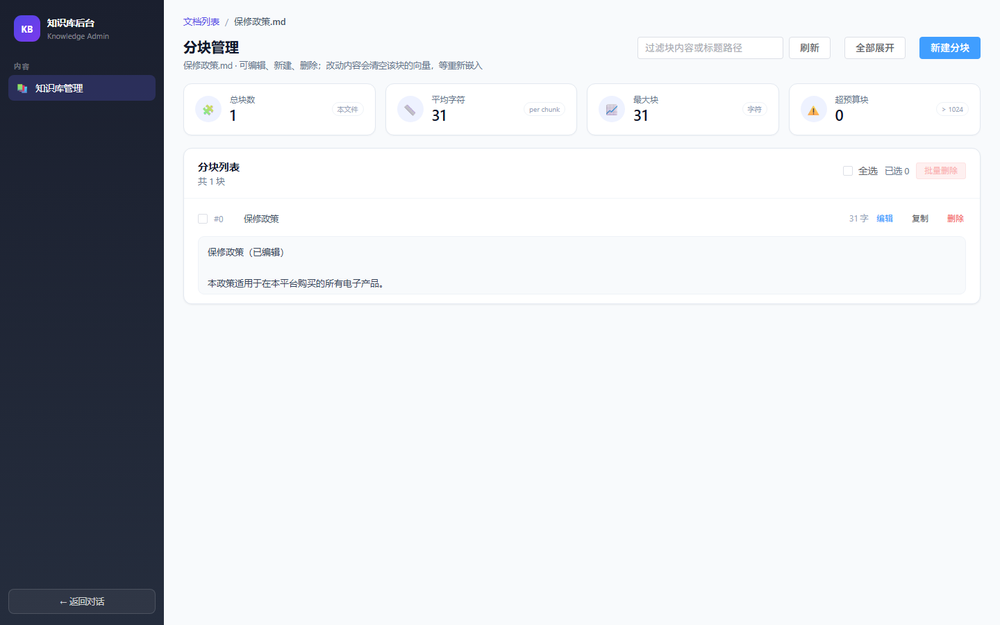
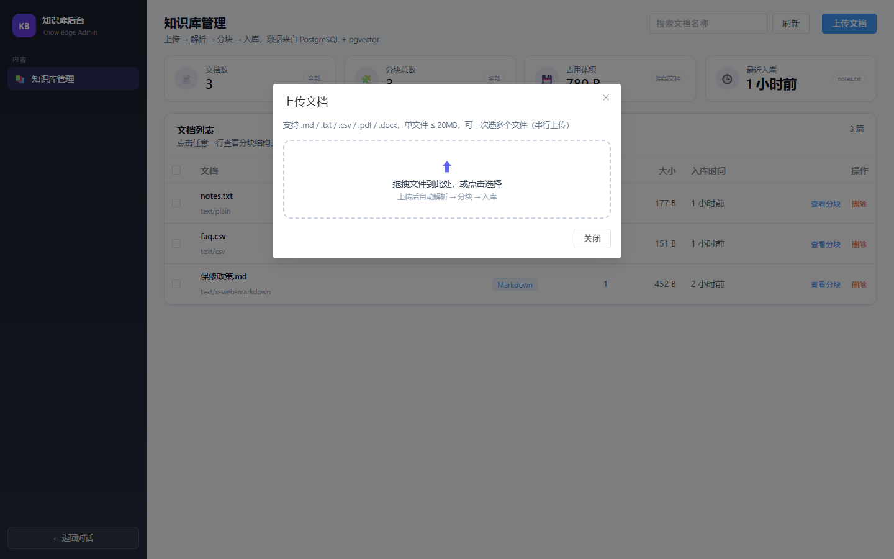

# 功能点二：知识库分块的选择与预览

> 所属模块：知识库（RAG 上游）　｜　技术栈：Spring Boot 3.3 + PostgreSQL 16 + Vue3 + Element Plus
> 前置知识：文本分块、数组类型（`text[]`）、Vue3 响应式与 Set、REST 批量接口
> 本文目标：读完并照着「二、实践」敲一遍，能独立做出这个功能点

---

## 一、理论知识

### 1.1 为什么分块质量决定检索上限

RAG 的检索单元不是「文档」而是「块」。这带来一个硬约束：

> 检索的上限由分块决定。块切歪了，后面的向量再准也召不回正确内容。

三种典型「切歪」：

| 症状 | 后果 |
|---|---|
| 一个块塞了两个主题 | 召回的上下文一半是噪音，模型容易被带偏 |
| 一个块只有半句话 | 语义不完整，向量表达失真 |
| 表格被拦腰截断 | 表头和数据分离，召回后无法解读 |

所以「预览」不是装饰功能，它是**分块质量的唯一可视入口**——不看块，就不知道参数调得对不对。

### 1.2 为什么用 block-aware 分块，而不是定长滑窗

定长滑窗（每 512 字切一刀）实现最简单，但会切在句子中间、把表格切断、丢掉章节标题。

本项目先**结构化解析**成 5 种块，再按类型分别处理：

| Block 类型 | 分块策略 |
|---|---|
| Heading | 不单独成块，用于维护「当前标题路径」 |
| Paragraph | 短段直接成块；超长段按句子边界切 + 重叠 |
| List | 整列表一块；过长按条目切 |
| Table | 按行数切（`rows-per-chunk`），**每块重复表头** |
| Code | 整段代码一块，不切（切了就没法运行） |

这是「先理解结构，再切分」的思路，代价是要写解析器，收益是块的可读性与语义完整性。

### 1.3 四个预算参数

```yaml
rag.chunk.max-chars: 1024        # 单块目标上限（字符）
rag.chunk.overlap-chars: 128     # 相邻块重叠，防止跨块语义断裂
rag.chunk.rows-per-chunk: 50     # 表格每块最多多少行
rag.chunk.tolerance-factor: 3    # 打包容忍系数：为凑整节可短暂超出预算
```

理解要点：

- **max-chars 不是硬截断**，而是打包容量的目标值；一个完整的段落/表格不会被强行劈开
- **overlap 解决的是「答案横跨两块」**：第二块开头重复第一块末尾 128 字，召回任一块都能看到完整语义
- **tolerance-factor 是工程妥协**：严格按 1024 切会产生大量碎块，允许 3 倍短时超出，换取「块内语义完整」

### 1.4 `outlinePath` 与 `embeddingText` 的区别

这两个字段最容易被问混：

| 字段 | 是什么 | 举例 |
|---|---|---|
| `content` | 块的**原文**，给人看的 | `手机自签收之日起 15 天内可申请无理由退货。` |
| `outlinePath` | 块所在的章节路径，`text[]` | `["保修政策","三、换货","3.2 时限"]` |
| `embeddingText` | 给**向量模型**看的文本 = 缺失的章节前缀 + 正文 | `保修政策 / 三、换货\n手机自签收之日起…` |

为什么要单独造 `embeddingText`？因为块正文里往往没有章节名，单看「15 天内可退货」不知道是退货还是换货。补上路径后再做嵌入，向量才带上下文。

补全规则有个细节：**路径自根向下拼，遇到已出现在正文里的层级就停**。所以正文自带「换货」二字时，只补根级「保修政策」。

### 1.5 预览要回答的三个问题

一个好的分块预览页，必须让人一眼看出：

1. **切歪了吗** → 显示每块的标题路径，路径为空的块标出来
2. **太长了吗** → 显示字符数，超过 `max-chars` 的块标黄
3. **丢上下文了吗** → 折叠状态下也能看到路径；展开看全文

本项目的实现：卡片列表 + 路径面包屑 + 字符数徽标（>1024 标黄）+ 点击展开 + 关键词过滤高亮 + 单块复制。

### 1.6 「选择」的价值在于它后面的动作

只有复选框没有意义。选择必须服务于动作，本项目当前支持：

```
勾选若干块 → 批量删除
```

规划中的动作：**参与/不参与检索**（`enabled` 开关）。这才是选择在知识库场景下的真正用途——不是所有块都值得被检索到，比如目录块、页眉页脚块、重复声明块。

### 1.7 改块为什么要清空向量

块的 `embedding` 是正文的向量表示。正文一改，旧向量立刻失真：

- 留着 → 检索时会召回到一个「内容与向量不符」的块，等于埋雷
- 清空 → 该块暂时不参与检索，等重新嵌入后恢复

所以更新语句写成 `SET content = ?, embedding_text = ?, embedding = NULL`。这是**数据一致性优先于可用性**的取舍：宁可少召回一块，不可召回错块。

### 1.8 方案对比与选型

这一节专门回答「为什么分块选这套方案，不用其他方案」。六个决策点。

#### ① 分块策略（核心对比）

| 方案 | 原理 | 优点 | 缺点 |
|---|---|---|---|
| 定长滑窗 | 每 N 字切一刀，留固定重叠 | 实现最简单、速度最快 | 切在句子中间；表格被拦腰截断；章节标题丢失 |
| 按句子/标点聚合 | 累积到预算上限就断在句号处 | 句子完整 | 仍不知道章节归属；表格照切不误 |
| 递归字符切分（LangChain `RecursiveCharacterTextSplitter` 风格） | 按 `["\n\n","\n","。",""]` 逐级退让 | 通用、无需写解析器、生态成熟 | 结构信息全部丢失；对表格/代码不友好 |
| **block-aware 结构化（本项目）** | 先解析成 5 类 Block，再按类型分派 Chunker | 保结构、保表头、保章节路径 | 要为每种格式写解析器，代码量大 |
| 语义分块（相邻句向量差超阈值就切） | 用嵌入模型判断语义边界 | 边界最准 | 需先有嵌入链路；成本高；结果不可解释、难调试 |

**为什么选 block-aware**：本项目文档以中文制度、FAQ、产品手册为主，核心结构就是「标题层级 + 表格 + 列表」。定长滑窗会把「3.2 时限」这种标题和数据行切开，检索回来后无法判断这条规则属于谁；递归切分能保住句子，但保不住章节归属。block-aware 的代价是要写 5 个 Chunker，收益是块自带结构——而结构正是 embeddingText 补上下文的前提。

**语义分块为什么不做**：它需要先对全文做嵌入，属于「用检索能力反过来优化分块」，依赖下一阶段；而且切分结果依赖模型版本，不可解释、不好回归测试。

#### ② 表格怎么切

| 方案 | 后果 |
|---|---|
| 整表一块 | 大表超出预算，向量被稀释，命中率下降 |
| 按行数切但丢表头 | **最差**：数据行失去列含义，「15 天」不知道是退货还是换货 |
| **按行数切 + 每块重复表头（本项目）** | 略增存储，但每块都能独立解读 |

#### ③ 上下文怎么补

| 方案 | 评价 |
|---|---|
| 只嵌正文 | 块离开章节后语义不明，「15 天内可退货」不知道主语是谁 |
| **嵌「缺失的章节前缀 + 正文」（本项目）** | 拼装成本为零；同一方法被初次分块与编辑重建复用，口径一致 |
| 每块用 LLM 生成摘要再嵌入（Contextual Retrieval） | 效果最好，但每块一次模型调用，成本与延迟不可接受，超出当前范围 |

注意「缺失的」三个字：路径自根向下拼，**遇到已出现在正文里的层级就停**，避免重复注入「换货 / 换货：签收后 10 天内…」。

#### ④ 编辑块之后向量怎么办

| 方案 | 风险 |
|---|---|
| 保留旧向量 | 向量与正文不一致，属于静默错误：不报错，但召回结果错，最难排查 |
| **置空（本项目）** | 该块暂时不参与检索——可接受的降级，等重新嵌入恢复 |
| 同步重新嵌入 | 最理想，但当前还没接嵌入链路，属于下一阶段 |

#### ⑤ 预览怎么呈现

| 方案 | 评价 |
|---|---|
| 表格分页（每页 10 条） | 适合扫描字段，但长正文被压成一行省略号，看不到切分效果——而「看到全文」正是预览的目的 |
| **卡片流 + 折叠展开（本项目）** | 长文本可读、可展开；路径/字符数/操作都在一行 |
| 虚拟滚动 | 千块以上才需要；当前文档块数在几十量级，属于过度设计 |

#### ⑥ 分块参数的作用域

| 方案 | 优点 | 缺点 |
|---|---|---|
| 全局配置（本项目当前） | 实现简单、口径统一 | 调参要重启 + 重传；无法针对单篇文档定制 |
| 上传时高级设置 | 灵活，可按文档类型调 | 需要参数快照（知道每篇用什么切的）与后端校验 |
| 自适应（按文档长度/类型自动选） | 体验最好 | 规则难定，结果不可预期，现阶段不建议 |

当前选全局配置是**有意为之的阶段性取舍**：先把分块、预览、编辑链路跑通，参数化留到有「参数快照」能力之后再做。

---

## 二、实践

### 2.1 分块链路总览

```
ParsedDocument.blocks()
   ↓ HeadingHandler 维护当前标题路径
   ↓ 按 Block 类型分发到 5 个 Chunker，产出 ChunkDraft
   ↓ ChunkPacker 按「节」打包，受 ChunkBudget 约束
   ↓ ChunkAssembler 装配成 Chunk（content 原样 + embeddingText 补前缀 + UUID）
List<Chunk>
```

### 2.2 入口代码（`ChunkingService`）

```java
private static final Map<Class<? extends Block>, BlockChunker<?>> CHUNKERS = Map.of(
        HeadingBlock.class,  new HeadingChunker(),
        ParagraphBlock.class, new ParagraphChunker(),
        ListBlock.class,     new ListChunker(),
        TableBlock.class,    new TableChunker(),
        CodeBlock.class,     new CodeChunker());

public List<Chunk> chunk(List<Block> blocks, ChunkBudget budget, String sourceFile) {
    HeadingHandler headingHandler = new HeadingHandler();
    List<ChunkDraft> drafts = new ArrayList<>();
    for (Block block : blocks) {
        if (block instanceof HeadingBlock heading) {
            headingHandler.apply(heading);          // 维护路径，标题本身不产块
        }
        drafts.addAll(chunkOne(block, new ChunkContext(headingHandler.currentPath(), budget)));
    }
    return ChunkAssembler.assembleAll(ChunkPacker.pack(drafts, budget), sourceFile);
}
```

> 注意 `chunk(blocks, budget, sourceFile)` 这个重载：它允许**按次覆盖预算**。将来做「上传时自定义分块参数」就是从这里接进去的，不用改上层。

### 2.3 预算对象

```java
public record ChunkBudget(int maxChars, int overlapChars, int rowsPerChunk, int toleranceFactor) {
    // 构造期校验：maxChars > 0、overlap < maxChars、rowsPerChunk > 0、toleranceFactor >= 1
}
```

参数来自 `application.yml` → `RagProperties` → `RagConfig` 里的 `@Bean`，全局唯一。

### 2.4 装配：`embeddingText` 的拼装规则

```java
public static String composeEmbeddingText(List<String> outlinePath, String content) {
    StringBuilder sb = new StringBuilder();
    appendIfPresent(sb, missingOutlinePrefix(outlinePath, content));  // 只补正文里没有的层级
    appendIfPresent(sb, content);
    return sb.toString();
}

/** 路径自根向下，到首个已出现在正文中的层级为止 */
private static String missingOutlinePrefix(List<String> outlinePath, String content) {
    int keep = 0;
    while (keep < outlinePath.size() && !content.contains(outlinePath.get(keep))) keep++;
    return keep == 0 ? null : String.join(" / ", outlinePath.subList(0, keep));
}
```

这个方法被两处复用：初次分块、**编辑块后重建**。口径必须一致，否则同一文档的块会出现两种 embeddingText 风格。

### 2.5 查询接口

```java
@GetMapping("/documents/{docId}/chunks")
public ResponseEntity<Map<String, Object>> listChunks(@PathVariable String docId) {
    if (chunkStore.findById(docId).isEmpty()) {
        return ResponseEntity.status(HttpStatus.NOT_FOUND).body(errorBody("文档不存在"));
    }
    List<Map<String, Object>> chunks = chunkStore.listChunks(docId).stream()
            .map(RagDocumentController::chunkBody).toList();
    return ResponseEntity.ok(Map.of("chunks", chunks));
}
```

返回结构：

```json
{"chunks":[{"chunkId":"...","index":0,"outlinePath":["保修政策"],
            "content":"...","embeddingText":"...","charCount":196}]}
```

排序由 SQL 保证：`ORDER BY chunk_index ASC`。

### 2.6 四个写接口

```java
@PostMapping("/documents/{docId}/chunks")                       // 新建，追加到末尾
@PatchMapping("/documents/{docId}/chunks/{chunkId}")            // 编辑正文
@DeleteMapping("/documents/{docId}/chunks/{chunkId}")           // 删单块
@PostMapping("/documents/{docId}/chunks/batch-delete")          // 批量删块
```

编辑的编排（`KnowledgeAdminService`）：

```java
public Chunk updateChunk(String docId, String chunkId, String content) {
    String normalized = normalizeContent(content);              // 非空 + ≤20000 字
    Chunk existing = chunkStore.findChunk(docId, chunkId)
            .orElseThrow(() -> new ChunkNotFoundException("分块不存在"));

    List<String> path = existing.metadata() == null ? List.of() : existing.metadata().outlinePath();
    String embeddingText = ChunkAssembler.composeEmbeddingText(path, normalized);  // 同口径重建

    chunkStore.updateChunk(docId, chunkId, normalized, embeddingText);             // 内部置空 embedding
    return chunkStore.findChunk(docId, chunkId).orElse(existing);
}
```

### 2.7 前端：预览 + 选择（`ChunkListView.vue`）

**① 选择模型**：用 `string[]` 存选中的 chunkId，配合两个计算属性：

```ts
const allSelected = computed(() =>
  visible.value.length > 0 && visible.value.every(c => selected.value.includes(c.chunkId)))
const indeterminate = computed(() =>
  selected.value.length > 0 && !allSelected.value)   // 半选态
```

**② 过滤 + 高亮**：关键字同时匹配正文与路径，命中处包 `<mark>`：

```ts
const visible = computed(() => {
  const kw = keyword.value.trim().toLowerCase()
  if (!kw) return chunks.value
  return chunks.value.filter(c =>
    c.content.toLowerCase().includes(kw) ||
    (c.outlinePath || []).join(' › ').toLowerCase().includes(kw))
})
```

**③ 展开/收起**：用 `Set<string>` 记展开态，比给每个对象加 `expanded` 字段更省事，也不会污染接口数据。

**④ 批量删除**：一次请求，把选中的 id 数组发过去。

```ts
const deleted = await batchDeleteChunks(props.docId, selected.value)
ElMessage.success(`已删除 ${deleted} 个分块`)
refreshAll()   // 重新拉块 + 刷新列表页的统计
```

### 2.8 一次真实的分块实验（可现场演示）

**目标**：证明「参数变了，块就变了」。

1. 记下当前 `保修政策.md` 的块数（1024 字符预算下是 1 块，196 字）
2. 改 `application.yml`：

```yaml
rag:
  chunk:
    max-chars: 200      # 从 1024 调到 200
```

3. 重启服务 → 删除该文档 → 重新上传
4. 回到分块页观察：**块数变多、每块字符数下降、路径重复出现**

结论：分块参数直接决定检索粒度。这也是为什么下一阶段要做「上传时高级设置 + 参数快照」——否则调完参数根本不知道某篇文档当初是用什么切的。

### 2.9 实际操作截图

分块预览（路径面包屑 + 字符数 + 超预算标黄 + 选择框 + 编辑/复制/删除）：



上传入口（文档进来后才有块可看）：



### 2.10 联调验收

```bash
DOC=<docId>

# 看块
curl "http://localhost:8080/api/rag/documents/$DOC/chunks"

# 新建块（追加，序号自动）
curl -X POST -H "Content-Type: application/json" -d '{"content":"手工补充条款"}' \
     "http://localhost:8080/api/rag/documents/$DOC/chunks"

# 编辑块（正文 + embeddingText 重建，embedding 清空）
curl -X PATCH -H "Content-Type: application/json" -d '{"content":"改写后的正文"}' \
     "http://localhost:8080/api/rag/documents/$DOC/chunks/<chunkId>"

# 批量删块
curl -X POST -H "Content-Type: application/json" -d '{"chunkIds":["<id1>","<id2>"]}' \
     "http://localhost:8080/api/rag/documents/$DOC/chunks/batch-delete"
# 期望：{"deleted":2}

# 验证计数同步
curl http://localhost:8080/api/rag/documents | grep chunkCount
```

### 2.11 已知问题（当成改进项讲）

| 问题 | 说明 | 改进方向 |
|---|---|---|
| 超预算阈值前端硬编码 `1024` | 改了后端参数，前端预警线不会跟着变 | 由后端下发 `chunkSpec`，前端读它 |
| 新建块的 `outlinePath` 为空 | 手工补的块没有章节归属 | 允许手填路径，或继承上一块路径 |
| 没有「重新分块」 | 调参后只能删了重传 | 需先留存原文，再支持原地重切 |
| 选择只能删 | 选择的动作单一 | 增加「参与检索」开关（`enabled` 列） |

---

## 三、测试题（4 题，每题 6 层追问）

> 建议先自己答一遍再展开。分块这块的追问最容易露馅，因为每一步都有"为什么不那样"的备选。

### Q1｜为什么选 block-aware 分块，而不是定长滑窗或递归切分？

<details>
<summary>答案 + 6 层追问</summary>
<p><strong>参考答</strong>：因为目标文档（制度、手册、FAQ）的价值恰恰在结构——标题层级、表格、条款。block-aware 是唯一能保住这些结构的方案。</p><blockquote><p><strong>L1 追问</strong>：定长滑窗具体坏在哪？举个业务例子。<br>要点：拿《产品保修政策》来说，表格里&quot;手机 | 15 天 | 无理由退货&quot;这行如果被切到下一块，而表头&quot;商品类别 | 退货 | 换货&quot;留在上一块，那&quot;15 天&quot;就失去了含义。定长切分还常把&quot;### 3.1 不予保修的情形&quot;和数据切开——检索回来一段规则，却不知道它属于哪个标题。</p></blockquote><blockquote><p><strong>L2 追问</strong>：递归分隔符（先按段落、再按句子）能解决吗？<br>要点：能保证&quot;不切在句子中间&quot;，但不知道章节归属，表格照样会被切断（表格行之间是换行，递归切分不认识表头）。它解决的是&quot;切得难看&quot;，没解决&quot;切错了地方&quot;。</p></blockquote><blockquote><p><strong>L3 追问</strong>：为什么不做语义分块（按向量相似度突变处切）？<br>要点：三个成本——① 全文要先嵌入，成本随文档量线性增长；② 切点依赖模型版本，换模型就变，不可复现；③ 出问题时无法解释&quot;为什么这里切开&quot;。它适合长篇叙述（访谈、论文正文），不适合&quot;标题 + 表格 + 条款&quot;这种强结构文档。</p></blockquote><blockquote><p><strong>L4 追问</strong>：那 block-aware 的代价是什么？<br>要点：每种格式都要写解析器；而且<strong>结构解析失败就退化</strong>——docx/pdf 走 Tika 纯文本抽取时，标题层级直接丢了，实测 <code>outlinePath</code> 为空。也就是说，这个方案的优势只在&quot;解析层能拿到结构&quot;时成立。</p></blockquote><blockquote><p><strong>L5 追问</strong>：那混合策略怎么落地？<br>要点：按 MIME 分流——md 走结构解析（已有），docx 换 POI 读标题样式，pdf 用字号/字体做标题推断，实在拿不到结构就退回&quot;递归分隔符 + 表格后处理&quot;。关键是<strong>保持下游分块器不变</strong>：解析层只负责把内容变成类型化的 Block。</p></blockquote><blockquote><p><strong>L6 追问</strong>：什么信号说明该换策略了？<br>要点：三个可观测指标——① 路径缺失率（<code>outlinePath</code> 为空的块占比）；② 超预算块比例；③ 金标问答的召回率。当路径缺失率超过 30%，说明结构没解析出来，策略退化成了&quot;伪 block-aware&quot;，此时该换解析器而不是调参数。</p></blockquote>
</details>

### Q2｜1024 / 128 / 3072 这三个数字是怎么定出来的？

<details>
<summary>答案 + 6 层追问</summary>
<p><strong>参考答</strong>：1024 是单块字符预算，128 是相邻块重叠，3072（1024×3）是&quot;容忍上限&quot;——整节不超过它就不切。</p><blockquote><p><strong>L1 追问</strong>：1024 这个值怎么定？有依据吗？<br>要点：中文 1024 字约 500~700 词，刚好覆盖一个小节（如&quot;3.1 不予保修的情形&quot;），既不至于碎，也不至于把三个主题塞一起。它同时受嵌入模型上下文限制的约束。这个值可配置，不是硬编码在代码里。</p></blockquote><blockquote><p><strong>L2 追问</strong>：为什么允许块超预算到 3 倍？<br>要点：举个实测——<code>01-产品保修政策.md</code> 全文 573 字，只有一个 H1、四个 H2。若严格按 1024 硬切，会切出一个&quot;只有标题 + 半句引言&quot;的碎块；而它整篇就是一个完整语义单元，整块保留更好。容忍系数就是为这种&quot;略超但完整&quot;的节准备的。</p></blockquote><blockquote><p><strong>L3 追问</strong>：overlap 128 解决什么？为什么合并后的块之间反而没有重叠？<br>要点：overlap 只用在<strong>段内强制切分</strong>时——比如一个 2000 字的长段落被切成两块，第二块开头重复前一块末尾 128 字，防止&quot;退货需在 15 天内&quot;这句话被切成&quot;退货需在&quot;和&quot;15 天内&quot;两半。而块与块之间的切口落在<strong>节的边界</strong>，语义天然完整，再加重叠只会造成重复召回。</p></blockquote><blockquote><p><strong>L4 追问</strong>：那为什么 60 行的 CSV 只有 1 块？<code>rows-per-chunk: 50</code> 明明应该切两刀。<br>要点：这是实测发现的&quot;参数失效&quot;现象。表格确实按 50 行切成了两段草稿，但整节只有 2412 字 &lt; 3072 容忍上限，<strong>打包阶段又把两段合并回去了</strong>。所以 <code>rows-per-chunk</code> 只在&quot;节超过容忍上限&quot;时才真正生效——表格得超过约 80 行才看得到效果。</p></blockquote><blockquote><p><strong>L5 追问</strong>：块太大、太小，分别有什么业务后果？<br>要点：太大 → 向量被多主题稀释，检索&quot;什么都沾一点&quot;；一次带进 prompt 的 token 多，成本上升。太小 → 语义不完整，召回一块答不出完整规则，要靠多块拼；块数暴涨又会让检索索引变大、命中噪音变多。</p></blockquote><blockquote><p><strong>L6 追问</strong>：怎么用金标集把参数定下来？<br>要点：准备 30 条&quot;答案在文档第几段&quot;的问答，分别用 512 / 1024 / 2048 跑一遍，比三个数：召回率@5、平均块长、超预算块比例。参数一定要记进快照，否则过两周没人知道某篇文档当初用什么切的。</p></blockquote>
</details>

### Q3｜预览页为什么要显示字符数和章节路径？编辑块之后为什么要清空向量？

<details>
<summary>答案 + 6 层追问</summary>
<p><strong>参考答</strong>：预览是分块质量的唯一可视入口。字符数回答&quot;有没有超预算&quot;，路径回答&quot;有没有切歪/丢结构&quot;。</p><blockquote><p><strong>L1 追问</strong>：这两个字段各自对应什么业务问题？<br>要点：字符数超 1024 说明这块可能塞了两个主题；路径为空说明解析阶段没拿到结构。运营看到&quot;某块 1800 字且路径为空&quot;，就知道要么重传，要么手工拆块。</p></blockquote><blockquote><p><strong>L2 追问</strong>：前端把 1024 写死成预警阈值，有什么问题？<br>要点：后端 <code>max-chars</code> 是可配置的，一旦调到 512，前端仍在 1024 才标黄，结果是&quot;看起来正常的块其实已经超预算&quot;。正确做法是后端通过 <code>/api/models</code> 那样的接口下发 <code>chunkSpec</code>，前端读它，而不是各写一份常量。</p></blockquote><blockquote><p><strong>L3 追问</strong>：编辑一个块之后，为什么必须把 <code>embedding</code> 置空？<br>要点：正文变了，向量还停在旧语义。比如把&quot;15 天&quot;改成&quot;30 天&quot;，用户问&quot;退货几天&quot;时这个块照常被召回，但内容已经是 30 天——向量与文本不一致属于<strong>静默错误</strong>，不报错、结果错，最难排查。置空的代价是这块暂时不参与检索，可接受。</p></blockquote><blockquote><p><strong>L4 追问</strong>： &quot;选择&quot;现在只能批量删除，还应该能做什么？<br>要点：真正有价值的是&quot;参与/不参与检索&quot;——目录块、页眉页脚块、重复声明块不该被召回。其次是&quot;合并两块&quot;和&quot;移动到其他文档&quot;。只有删除一个动作，选择机制的价值用不到三成。</p></blockquote><blockquote><p><strong>L5 追问</strong>：批量删除和接口限流会冲突吗？<br>要点：会。60 次/分钟的限流下，勾 100 个块循环删必然 429。所以要有批量接口，并且单次请求设上限（比如 200 个），超了就分批或走异步任务。</p></blockquote><blockquote><p><strong>L6 追问</strong>：块级&quot;启用/禁用&quot;怎么实现？代价是什么？<br>要点：加 <code>enabled boolean default true</code>，检索 SQL 加 <code>AND enabled = true</code>。代价有三：① 索引要把这个条件下沉（复合索引）；② 统计口径要区分&quot;总块数/启用块数&quot;；③ 禁用块在预览页要能看出状态，否则运营不知道它为什么不参与检索。</p></blockquote>
</details>

### Q4｜实测发现"合并后章节路径退化成根级"，这暴露了什么根本问题？

<details>
<summary>答案 + 6 层追问</summary>
<p><strong>参考答</strong>：暴露了&quot;为了凑够块大小而跨节合并&quot;与&quot;保留子章节归属&quot;是冲突的，当前实现选择了前者。</p><blockquote><p><strong>L1 追问</strong>：具体是什么现象？<br>要点：<code>09-长文档-多章节.md</code> 有 8 个二级标题（退货申请/换货办理/…），合并成 2 块后，<code>outlinePath</code> 只剩根级&quot;售后服务细则（分章节）&quot;。因为合并取的是所有草稿的<strong>公共路径前缀</strong>。</p></blockquote><blockquote><p><strong>L2 追问</strong>：这对检索有什么实际影响？<br>要点：这块里其实混了多个子主题，但检索命中后展示的出处是&quot;售后服务细则&quot;——用户看不出这一段讲的是&quot;退款到账&quot;还是&quot;运费承担&quot;；按路径过滤时也定位不到子章节。回答的<strong>可解释性</strong>下降。</p></blockquote><blockquote><p><strong>L3 追问</strong>：怎么缓解？<br>要点：三条路——① 降低 <code>toleranceFactor</code>，让跨节合并更难发生（代价是块数变多）；② 干脆<strong>禁止跨节合并</strong>，宁可块小；③ 合并时保留&quot;主路径 + 覆盖的子标题列表&quot;，代价是路径字段语义变复杂。</p></blockquote><blockquote><p><strong>L4 追问</strong>：docx/pdf 的路径直接是空的，又怎么补？<br>要点：短期用文件级兜底（把文件名作为根路径），至少让块有归属；中期换结构化解析（POI 读 <code>pStyle</code>，PDF 按字号推断标题）；长期要有评测指标盯着&quot;路径覆盖率&quot;。</p></blockquote><blockquote><p><strong>L5 追问</strong>：没有路径的块，怎么让向量带上上下文？<br>要点：<code>embeddingText</code> 里补文件名 + 前后块首句，制造&quot;伪上下文&quot;；也可以用 LLM 给每块生成一句摘要再嵌入（Contextual Retrieval），效果最好但每块一次模型调用，成本要算清楚。</p></blockquote><blockquote><p><strong>L6 追问</strong>：长期方案应该是什么样？<br>要点：分三层各司其职——解析层负责<strong>不丢结构</strong>（结构化解析器），分块层负责<strong>不破坏结构</strong>（不跨节合并、路径随块走），评测层负责<strong>验证没退化</strong>（路径缺失率、召回率）。任何一层偷懒，都会被&quot;路径退化&quot;这种事暴露出来。</p></blockquote>
</details>

---

## 四、业务价值

> 这一节回答两个问题：为什么非做不可？做完之后项目多了什么？

### 4.1 不做会怎样（反事实）

没有预览与选择，分块就是一个**黑盒**：

- 用户只知道「传了」，不知道切成了什么样
- 检索答不准时，无法判断是「模型不行」还是「块切歪了」
- 调分块参数全靠猜，改完只能看总块数，看不到内容
- 某一块切错了，只能整篇重传——而重传会连带覆盖其他手工修好的块

一句话：**分块不可见 = 参数不可调 = 检索效果不可控。**

### 4.2 对项目的三重作用

| 作用 | 说明 |
|---|---|
| **诊断** | 把「检索不准」这个模糊问题，收敛成可指认的具体问题：「这块 1800 字太长」「这块路径是空的」「这句话被切到两块去了」 |
| **修复** | 改一块、删一块、补一块都不用重传整篇，修正成本从一个文件降到一次请求 |
| **治理** | 勾选 + 批量操作是后续「哪些块参与检索」的入口；知识库里必然存在目录块、页眉块、重复声明块，需要能批量清理 |

### 4.3 可量化的收益

| 场景 | 没有这个功能 | 有 |
|---|---|---|
| 发现异常块 | 只能猜，或写 SQL 捞 | 超过 1024 字的块**标黄**，一眼定位；统计卡给出平均值与最大值 |
| 修正一个切错的块 | 重传整篇 → 重跑解析与分块 → 手工修正全部丢失 | **1 次 PATCH**，正文与 embeddingText 同步重建 |
| 验证分块参数 | 只能看「块数」一个数字 | 看到每块的路径、字符数、全文，参数调整有依据 |
| 清理一批冗余块 | 逐块删除 | **1 次批量请求** |
| 构建评测集 | 无法标注「答案在第几块」 | 分块视图本身就是标注界面 |

### 4.4 对下一阶段的铺垫

这个功能不只是「给人看的页面」，它同时是三个后续能力的前置：

1. **上传时高级设置** —— 参数调整后必须能立刻看到效果，否则没人敢调
2. **重新分块** —— 需要先能对比新旧块，用户才会确认「重切」
3. **块级启用开关** —— 选择机制已经在了，只差一个 `enabled` 字段和它的语义

### 4.5 一句话总结

> 它把「分块」从一个内部实现细节，变成了**可观察、可编辑、可批量治理的产品对象**——而这正是 RAG 系统能持续调优的前提。
