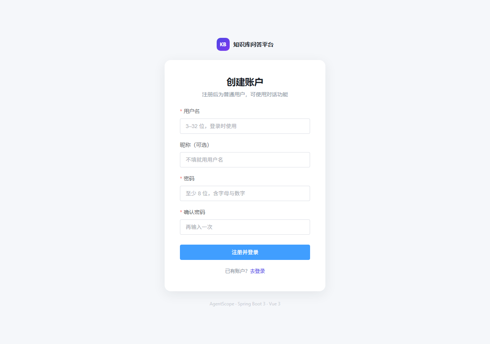

# 功能点三：登录鉴权与会话（含图片验证码）

> 所属模块：账号与访问控制（全站入口）　｜　技术栈：Spring Boot 3.3 + PostgreSQL 16 + Vue3 + Pinia + vue-router + axios
> 参考实现：`ai-vue`（心理健康助手前端）的 `utils/request.js` + `router/index.js` + `views/login.vue`
> 本文目标：照着「七、实践」从 7.1 敲到 7.12，能自己跑通「验证码 → 登录 → 拿 token → 被拦 → 被放行」整条链路

---

## 一、先记住三样东西分别存在哪

这是最容易搞混的地方，先钉死：

| 东西 | 存在哪 | 长什么样 |
|---|---|---|
| **账号**（用户名 + 密码） | **数据库 `app_users` 表** | 一行一个账号，密码列 `password_hash` 存 BCrypt 哈希 |
| **登录态**（这次登录有效） | **数据库 `app_sessions` 表** | 一行一次登录，主键是 token 的 SHA-256 |
| **验证码答案** | **后端内存**（`CaptchaService`） | 2 分钟过期，用完即删，**前端拿不到** |
| **前端凭证** | **localStorage** | `token` 和 `userInfo` 两个 key |

**账号密码就是存在数据库里的**，不在配置文件、不在代码、不在环境变量。登录时后端执行的就是这一句：

```sql
SELECT user_id, username, password_hash, role, display_name, enabled, must_change_password
FROM app_users WHERE username = 'admin';
```

查出来之后，用 BCrypt 把用户输入的密码和 `password_hash` 比一下，对上才放行。

启动后可以进容器直接看表：

```bash
docker exec agentscope-kb-pg psql -U postgres -d ragdb_kb \
  -c "SELECT username, role, LEFT(password_hash,29) AS hash FROM app_users;"
```

```
 username | role  |             hash
----------+-------+--------------------------------
 admin    | ADMIN | $2a$10$GSWjQDEVupGP1trfDgTKPu
 user     | USER  | $2a$10$nyMM0soediGs5XVLz6xfnO
(2 rows)
```

改密码就改这张表（哈希要用 BCrypt 生成）：

```sql
UPDATE app_users SET password_hash = '<新密码的 BCrypt 哈希>' WHERE username = 'admin';
```

默认两个账号（`application.yml` → `app.auth` 下可改，只在库里没有账号时才创建）：

| 用户名 | 密码 | 角色 | 能干什么 |
|---|---|---|---|
| `admin` | `admin123` | ADMIN（userType=2） | 进后台、改知识库、用对话 |
| `user` | `user12345` | USER（userType=1） | 只能用对话，进不了后台 |

---

## 二、点一下「登录」，系统做了 8 件事

```
① 页面打开时：GET /api/auth/captcha 拿一张图（同时服务端记下答案）
② 用户填：用户名 / 密码 / 验证码
③ POST /api/auth/login 带上 captchaId + captchaCode
④ 后端先验验证码（错就直接返回，根本不查库）
⑤ 查 app_users，BCrypt 比对密码
⑥ 都对 → 生成随机 token，把它的 SHA-256 写进 app_sessions（24 小时）
⑦ 返回 {code:"200", data:{token, userInfo}}，前端存进 localStorage
⑧ 按 userInfo.userType 跳转：2 → 后台，1 → 对话
```

注意第 ④ 步的顺序：**验证码在密码之前校验**。如果反过来，攻击者可以用"密码对不对"当探测信号，验证码就白加了。

---

## 三、图片验证码怎么实现

### 3.1 为什么自己画，不用第三方库

验证码的本质是「画一张图 + 服务端记一个答案」，JDK 自带的 `BufferedImage` + `Graphics2D` 三十行就能画完。多引一个 `kaptcha` 之类的库，多一份依赖、多一个要跟着升级的组件，收益不成比例。

### 3.2 三个必须做到的点

| 要求 | 做不到会怎样 |
|---|---|
| **一次性** | 拿同一张图能反复试，4 位字符暴力猜几次就中 |
| **有有效期**（默认 2 分钟） | 攻击者先批量取 10 万张图存着，慢慢识别慢慢撞 |
| **答案只在服务端** | 答案跟着图片一起回给前端，改一行 JS 就能读出正确答案，等于没有验证码 |

### 3.3 代码：`CaptchaService`

```java
private static final String CHARS = "34679ACDEFGHJKMNPQRTUVWXY";   // 去掉 0O1Il，减少看错

public CaptchaIssue issue() {
    purgeExpired();
    String code = randomCode();                       // 4 位
    String captchaId = UUID.randomUUID().toString();
    store.put(captchaId, new Captcha(code, Instant.now().plusSeconds(ttl)));   // 答案存服务端
    String dataUrl = "data:image/png;base64," + Base64.getEncoder().encodeToString(render(code));
    return new CaptchaIssue(captchaId, dataUrl, ttl);  // 只回 id 和图片，不回 code
}

public boolean verify(String captchaId, String input) {
    if (captchaId == null || input == null || input.isBlank()) return false;
    Captcha captcha = store.remove(captchaId);        // ← 先删：对错都只给一次机会
    if (captcha == null || captcha.expireAt().isBefore(Instant.now())) return false;
    return captcha.code().equalsIgnoreCase(input.trim());
}
```

`store.remove()` 那一行是整套验证码的关键：**校验即销毁**。写在校验之前，而不是通过之后再删——否则答错的请求会留下一个还能继续试的条目。

### 3.4 画图：干扰线 + 旋转 + 噪点

```java
g.setColor(new Color(0xF7, 0xF8, 0xFA));
g.fillRect(0, 0, 120, 40);

for (int i = 0; i < 6; i++) {                       // 干扰线
    g.setColor(randomColor(150, 215));
    g.drawLine(rand(120), rand(40), rand(120), rand(40));
}

g.setFont(new Font(Font.SANS_SERIF, Font.BOLD, 26));
for (int i = 0; i < code.length(); i++) {           // 每个字符单独旋转、上下抖动
    double angle = (RANDOM.nextDouble() - 0.5) * 0.5;
    double pivotX = 16 + i * 24.0;
    g.rotate(angle, pivotX, 20);
    g.setColor(randomColor(30, 110));
    g.drawString(String.valueOf(code.charAt(i)), (float) pivotX - 8, 28 + RANDOM.nextInt(5) - 2);
    g.rotate(-angle, pivotX, 20);
}

for (int i = 0; i < 40; i++) {                      // 噪点
    image.setRGB(rand(120), rand(40), randomColor(110, 200).getRGB());
}
```

效果（真实产物，`docs/evidence-auth/03-captcha.png`）：


干扰线挡的是简单的水平切割，旋转挡的是字符模板匹配，噪点挡的是二值化。这三样都不追求"机器认不出"，只追求**把批量脚本的成本抬到不值得**——真正的防线是下面这句：一次性 + 2 分钟。

### 3.5 接口

```
GET /api/auth/captcha          （公开，不需要登录）
→ {"code":"200","msg":"ok","data":{
     "captchaId":"b902caf0-875d-47f4-bbdf-eb3bd195669d",
     "image":"data:image/png;base64,iVBORw0KGgo...",
     "expireSeconds":120}}
```

图片用 `data:` URL 直接返回，前端 `` 就行，不用再多开一个图片接口、也不用处理跨域。

---

## 四、后端怎么拦每一个请求

登录只负责发凭证，真正拦人的是 `AuthFilter`。它对所有 `/api/**` 生效，按顺序判断：

| 情况 | 结果 |
|---|---|
| `/api/auth/captcha`、`/login`、`/register` | 直接放行（还没登录呢） |
| 请求头没有 `token`，或 token 查不到 / 已过期 | **401** `{"code":"-1","msg":"登录已过期，请重新登录"}` |
| `/api/rag/**` 且角色不是 ADMIN | **403** `{"code":"403","msg":"需要管理员权限"}` |
| 其它 | 放行，并把当前用户放进 request 给控制器用 |

```java
String token = readToken(request);                      // 读 header: token
Optional<AppUser> user = authService.resolve(token);    // 查 app_sessions
if (user.isEmpty()) {
    writeJson(response, 401, "-1", "登录已过期，请重新登录");
    return;
}
if (uri.startsWith("/api/rag/") && user.get().role() != UserRole.ADMIN) {
    writeJson(response, 403, "403", "需要管理员权限");
    return;
}
request.setAttribute("authUser", user.get());
chain.doFilter(request, response);
```

**401 和 403 不能混用**，这是实际会踩的坑：

- **401 = 我不知道你是谁** → 前端清 token，跳登录页
- **403 = 我知道你是谁，但你没权限** → 前端提示一句，留在原地

混用的话，普通用户点一下后台菜单就会被踢下线，他会以为是自己掉线了。

---

## 五、前端三件套

结构和 `ai-vue` 一致，只是 Vue 3 + TS 写法。

### 5.1 `api/http.ts`：自动带 token，自动处理过期

```ts
export const TOKEN_KEY = 'token'
export const USER_KEY = 'userInfo'

http.interceptors.request.use((config) => {
  const token = localStorage.getItem(TOKEN_KEY)
  if (token) config.headers.set(TOKEN_KEY, token)      // 每个请求自动带
  return config
})

http.interceptors.response.use(
  (response) => response,
  (error) => {
    const status = error.response?.status
    const url = error.config?.url ?? ''
    const isAuthEntry = url.includes('/auth/login') || url.includes('/auth/register')

    if (status === 401 && !isAuthEntry) {
      localStorage.removeItem(TOKEN_KEY)
      localStorage.removeItem(USER_KEY)
      ElMessage.error('登录已过期，请重新登录')
      window.location.href = '/app/auth/login'
      return Promise.reject(error)
    }
    // …其它错误统一弹提示
  }
)
```

`isAuthEntry` 那个判断必须留着：登录时密码输错，后端也返回 401，不排除掉的话用户一输错就被"跳转到登录页"，看着像页面抽风。

### 5.2 `stores/auth.ts`：登录态放 Pinia，同时落 localStorage

```ts
state: () => ({
  token: localStorage.getItem(TOKEN_KEY) || '',
  userInfo: readUserInfo(),          // 同步读，刷新页面不闪登录页
  loading: false
}),
getters: {
  isLoggedIn: (s) => !!s.token && !!s.userInfo,
  isAdmin: (s) => s.userInfo?.userType === 2,
  homePath: (s) => (s.userInfo?.userType === 2 ? '/admin/knowledge' : '/chat')
}
```

登录成功写两处，必须同时写：

```ts
async signIn(username, password, captchaId, captchaCode) {
  const data = await loginApi(username, password, captchaId, captchaCode)  // {token, userInfo}
  localStorage.setItem(TOKEN_KEY, data.token)
  localStorage.setItem(USER_KEY, JSON.stringify(data.userInfo))
  this.token = data.token
  this.userInfo = data.userInfo
}
```

### 5.3 登录页：验证码点一下就换

```ts
async function refreshCaptcha() {
  const issue = await fetchCaptcha()
  captchaId.value = issue.captchaId
  captchaImage.value = issue.image
  form.captchaCode = ''
}
onMounted(refreshCaptcha)

async function submit() {
  // …校验表单
  try {
    await auth.signIn(form.username, form.password, captchaId.value, form.captchaCode)
    router.replace(route.query.redirect || auth.homePath)
  } catch {
    await refreshCaptcha()      // 验证码一次性，失败必须换一张
  }
}
```

「失败必须换一张」不是体验问题，是正确性问题：后端已经把那张验证码消费掉了，不换的话用户再提交必然还是"验证码错误"。

### 5.4 `router/index.ts`：按角色分流

```
/auth/login、/auth/register  →  AuthLayout（不需要登录）
/chat                        →  ChatLayout（要登录）
/admin/**                    →  AdminLayout（要管理员）
```

```ts
router.beforeEach((to) => {
  const auth = useAuthStore()

  if (!auth.isLoggedIn) {
    if (to.meta.requiresAuth) return { path: '/auth/login', query: { redirect: to.fullPath } }
    return true
  }
  if (to.path.startsWith('/auth')) return auth.homePath
  if (to.meta.adminOnly && !auth.isAdmin) return '/chat'
  return true
})
```

---

## 六、两道校验，别只做前一道

| 层 | 代码位置 | 作用 | 能不能被绕过 |
|---|---|---|---|
| 前端路由守卫 | `router/index.ts` | 不让用户点进必然失败的页面 | **能**。改 localStorage、直接敲 URL 都行 |
| 后端过滤器 | `AuthFilter.java` | 没 token 一律 401，角色不够一律 403 | 不能 |

判断标准很硬：**只在前端实现的权限，等于没实现。**

实测证据（拿 `user` 账号的 token 直接 curl，根本不经过前端）：

```
$ curl -i -H "token: <user 的 token>" http://localhost:8080/api/rag/documents
HTTP/1.1 403
{"code":"403","msg":"需要管理员权限"}
```

---

## 七、实践：从零跑通

> 前置：Windows + Git Bash，JDK 17+、Maven、Node 18+、Docker Desktop。
> 每一步都写了「预期看到什么」，对不上就别往下走。

### 7.1 起数据库

```bash
cd "F:/coding demo"
docker compose -f docker-compose.kb.yml up -d
```

预期：

```
[+] Running 2/2
 ✔ Network agentscope-net      Created
 ✔ Container agentscope-kb-pg  Started
```

确认端口：

```bash
netstat -an | grep 5434
# TCP    127.0.0.1:5434    0.0.0.0:0    LISTENING
```

### 7.2 起后端（会自动建表 + 建账号）

```bash
SERVER_PORT=8081 mvn spring-boot:run
```

**为什么用 8081**：8080 可能被 `deepseek-chat` 容器占着，那个容器跑的是旧镜像（没有鉴权），连上去会一脸懵。

预期日志里出现这两行：

```
已创建管理员账号：admin / admin123（存于 app_users 表）
已创建普通用户账号：user / user12345（存于 app_users 表）
```

> 只在库里没有账号时才创建。已经有 admin 就不会覆盖——防止重启把线上密码冲掉。

### 7.3 确认账号真的进了库

```bash
docker exec agentscope-kb-pg psql -U postgres -d ragdb_kb \
  -c "SELECT username, role, enabled FROM app_users;"
```

预期：

```
 username | role  | enabled
----------+-------+---------
 admin    | ADMIN | t
 user     | USER  | t
```

### 7.4 起前端

```bash
cd frontend && npm run dev
```

预期：

```
VITE v6.4.6  ready in 2155 ms
➜  Local:   http://localhost:5173/app/
```

> 开发态 vite 把 `/api` 代理到 `http://localhost:8080`。如果你把后端起在 8081，要么改 `frontend/vite.config.ts` 里的 `proxy.target`，要么把 8080 的旧容器停掉（`docker compose down`）。

### 7.5 打开登录页

浏览器访问 `http://localhost:5173/app/`。

预期：自动跳到 `/auth/login`，页面中间是登录卡片，第三行是**验证码输入框 + 一张 4 位字符的图片**。


打开 F12 → Network，能看到 `GET /api/auth/captcha` 返回 200，响应体里是 `captchaId` 和一大串 base64。

### 7.6 点验证码换一张

点一下右侧图片。

预期：图片立刻变成另一组字符，输入框里的内容被清空。

对应的是再一次 `GET /api/auth/captcha`。旧的那张即使没过期也已经没用了——服务端还留着它直到过期，但你手上没有它的 `captchaId` 了。

### 7.7 故意输错验证码

用户名填 `admin`，密码填 `admin123`，验证码**随便填 4 个字符**，点登录。

预期：右上角弹出 **「验证码错误或已过期」**，且图片自动换了新的一张。

这一步验证的是"验证码在密码之前校验"——密码明明是对的，但因为验证码错，请求根本没走到查库那一步。

### 7.8 用管理员登录

看清图片（看不清就点一下换一张），输对验证码，点登录。

预期：

- 右上角提示「欢迎回来，系统管理员」
- 跳到 `/admin/knowledge`，左侧栏底部显示 **系统管理员 / 管理员**，并有「退出登录」按钮
- 地址栏是 `http://localhost:5173/app/admin/knowledge`

### 7.9 看看浏览器存了什么

F12 → Application → Local Storage → `http://localhost:5173`。

预期两个 key：

| key | 值 |
|---|---|
| `token` | 43 位随机字符串，如 `CiBVAOzii_SqVqUaI2r_fzMBC5Uernq_SjqYXPefq2Q` |
| `userInfo` | `{"id":"...","username":"admin","displayName":"系统管理员","role":"ADMIN","userType":2,...}` |

再切到 Network，随便点一个知识库请求，看 Request Headers 里有没有 `token: CiBVAOzi...`——有，说明请求拦截器生效了。

### 7.10 用 curl 复现同一条链路

把 7.9 拿到的 token 填进去（或者重新登录拿一个）：

```bash
B=http://localhost:8081

# ① 没 token 访问业务接口 → 401
curl -i $B/api/rag/documents

# ② 拿验证码
curl -s $B/api/auth/captcha

# ③ 登录（captchaCode 要填图上的字符）
curl -s -X POST -H "Content-Type: application/json" \
  -d '{"username":"admin","password":"admin123","captchaId":"<上一步的 captchaId>","captchaCode":"<图上的字符>"}' \
  $B/api/auth/login

# ④ 管理员访问知识库 → 200
curl -o /dev/null -w "%{http_code}\n" -H "token: <admin 的 token>" $B/api/rag/documents

# ⑤ 普通用户登录
curl -s -X POST -H "Content-Type: application/json" \
  -d '{"username":"user","password":"user12345","captchaId":"<新 captchaId>","captchaCode":"<字符>"}' \
  $B/api/auth/login

# ⑥ 普通用户访问知识库 → 403
curl -i -H "token: <user 的 token>" $B/api/rag/documents

# ⑦ 普通用户调对话 → 200（能用）
curl -o /dev/null -w "%{http_code}\n" -X POST -H "token: <user 的 token>" \
  -H "Content-Type: application/json" -d '{"message":"hi","model":"remote-deepseek"}' $B/api/chat

# ⑧ 查我是谁
curl -s -H "token: <user 的 token>" $B/api/auth/me
```

预期输出（前几步实测）：

```
① HTTP/1.1 401   {"code":"-1","msg":"登录已过期，请重新登录","status":401}
③ {"code":"200","msg":"ok","data":{"token":"...","userInfo":{...,"userType":2}}}
④ HTTP 200
⑥ HTTP/1.1 403   {"code":"403","msg":"需要管理员权限"}
⑦ HTTP 200
⑧ {"code":"200","data":{"userInfo":{...,"userType":1}}}
```

> 命令行做自动化时嫌验证码麻烦，可以临时关掉：`AUTH_CAPTCHA_ENABLED=false` 重启。**不要在生产上关。**

### 7.11 退出登录

点左侧栏底部的「退出登录」。

预期：回到 `/auth/login`，localStorage 里的 `token` 和 `userInfo` 都没了，再手动敲 `/app/admin/knowledge` 会被弹回登录页。

### 7.12 跑单元测试

```bash
mvn -Dtest='AuthServiceTest,CaptchaServiceTest' test
```

预期：

```
Tests run: 9, Failures: 0, Errors: 0  -- AuthServiceTest
Tests run: 6, Failures: 0, Errors: 0  -- CaptchaServiceTest
```

15 个用例，**全部不连数据库**——`UserStore` / `SessionStore` 都抽了接口，测试用内存实现。

### 7.13 顺便看一眼注册页

`http://localhost:5173/app/auth/register`（默认开放注册，注册出来是普通用户）：



---

## 八、代码清单

**后端** `src/main/java/com/example/chat/auth/`

| 文件 | 作用 |
|---|---|
| `AuthController.java` | 6 个接口：captcha / login / register / me / logout / password |
| `CaptchaService.java` | 画验证码图、存答案、一次性校验 |
| `AuthService.java` | 查库比对密码、签发 token、解析 token、改密、失败锁定 |
| `AuthFilter.java` | 拦 `/api/**`：没 token 401，非要 ADMIN 的路径 403 |
| `AuthProperties.java` | `app.auth.*` 配置 |
| `UserStore` / `JdbcUserStore` | `app_users` 表读写 |
| `SessionStore` / `JdbcSessionStore` | `app_sessions` 表读写 |
| `AppUser` / `UserRole` / `SessionRow` / `AuthException` | 数据模型与异常 |
| `AdminSeeder.java` | 启动时种 `admin` / `user` 两个账号 |

**前端**

| 文件 | 作用 |
|---|---|
| `api/http.ts` | axios 实例：自动带 token、401 跳登录 |
| `api/auth.ts` | fetchCaptcha / login / register / logout / me / changePassword |
| `stores/auth.ts` | token 与 userInfo，localStorage + Pinia |
| `router/index.ts` | 三条路由分支 + 角色守卫 |
| `layouts/AuthLayout.vue` | 登录/注册的居中卡片容器 |
| `views/auth/LoginView.vue` | 登录页（含验证码） |
| `views/auth/RegisterView.vue` | 注册页 |

**建表**：`src/main/resources/schema.sql` 末尾的 `app_users`、`app_sessions`，启动时自动执行。

---

## 九、常见问题

| 现象 | 原因 | 怎么办 |
|---|---|---|
| 启动报 `Port 8080 was already in use` | 旧 docker 容器占着 8080 | 用 `SERVER_PORT=8081`，或 `docker compose down` |
| 一直提示「验证码错误或已过期」 | 后端重启过（答案在内存里，重启即清空） | 刷新页面重新取一张 |
| 验证码是空白 / 显示「点击重试」 | 后端没起，或 `/api` 代理指错端口 | 检查 `vite.config.ts` 的 `proxy.target` |
| 日志「演示账号创建失败：密码长度需在 8–64 位」 | 初始密码少于 8 位 | 改 `app.auth.demo-init-password` |
| 登录成功但一刷新回登录页 | token 没写进 localStorage | F12 看 Application → Local Storage |
| 普通用户点后台被弹回对话页 | 这是**正确行为**（守卫拦截） | 想让他能进，库里把 `role` 改成 `ADMIN` |
| 忘记密码 | 没有找回密码功能 | SQL 改 `password_hash`，或删该行让它重新种 |
| 连错 5 次提示锁定 | 防爆破机制 | 等 15 分钟，或重启服务（计数在内存） |
| 服务启动失败提示 Connection refused | 数据库没起 | 先跑 7.1 |

---

## 十、测试题（4 题，每题 5 层追问）

### Q1｜验证码的答案为什么绝不能跟着图片一起返回给前端？

<details>
<summary>参考答 + 5 层追问</summary>
<p><strong>参考答</strong>：因为前端代码跑在用户机器上。答案一旦回传，改一行 JS 或直接看 Network 响应就能拿到正确答案，验证码退化成"多填一个字段"，一点防护作用都没有。</p>
<blockquote><p><strong>追问 1</strong>：那前端怎么知道用户填对了？<br>要点：不知道，也不需要知道。前端只负责把 <code>captchaId + 用户输入</code> 发给后端，对不对由后端说了算。这就是"判定权必须在服务端"——和权限校验是同一个道理。</p></blockquote>
<blockquote><p><strong>追问 2</strong>：答案存后端内存，服务重启就没了，会不会影响用户？<br>要点：会，但影响可控。已经打开登录页的用户在重启后提交会收到"验证码错误或已过期"，刷新页面重新取一张即可。要彻底避免，答案得放 Redis；本项目单实例、验证码只活 2 分钟，放内存是合理取舍。</p></blockquote>
<blockquote><p><strong>追问 3</strong>：多实例部署时这套会出什么问题？<br>要点：请求被负载均衡打到另一台机器，那台没有这个 <code>captchaId</code>，验证必然失败。用户会遇到"随机一半概率验证码错误"，极难排查。解法是把答案放共享存储（Redis），key 用 <code>captchaId</code>，TTL 2 分钟——这件事上 Redis 几乎是唯一正解。</p></blockquote>
<blockquote><p><strong>追问 4</strong>：把答案加密后回传、前端解密比对，行不行？<br>要点：不行。密钥在前端等于没有密钥。同理"回传答案的哈希、前端算哈希比对"也不行——前端算哈希需要明文。任何形式的"答案到达前端"都算失败，这是不可谈判的边界。</p></blockquote>
<blockquote><p><strong>追问 5</strong>：如果攻击者用打码平台（人工识别 1 次 0.001 元）来绕呢？<br>要点：验证码本来就挡不住"愿意花钱的人工"，它挡的是零成本脚本。要防这种情况得靠组合拳：① 同 IP/账号失败频率限制（本项目已有：5 次锁 15 分钟）；② 风控画像（新设备、异地、秒级间隔）；③ 高风险操作二次验证。验证码是第一道便宜的筛子，不是唯一防线。</p></blockquote>
</details>

### Q2｜验证码为什么必须"一次性 + 有有效期"？少了哪一个会怎样？

<details>
<summary>参考答 + 5 层追问</summary>
<p><strong>参考答</strong>：4 位字符的答案空间只有约 23 万种。不限次数就能暴力猜；不设过期就能先囤几万张图慢慢识别。两个条件缺一不可。</p>
<blockquote><p><strong>追问 1</strong>：一次性具体怎么实现？代码里哪一行在做这件事？<br>要点：<code>store.remove(captchaId)</code> 写在 <code>verify</code> 的最前面，取出即删除。注意是"取出即删"而不是"验证通过才删"——如果通过才删，答错的请求会留下一个仍可继续尝试的条目，等于把一次性变成了多次。</p></blockquote>
<blockquote><p><strong>追问 2</strong>：过期时间定 2 分钟，怎么定的？<br>要点：从"正常人填完表单要多久"倒推。输账号密码 + 看 4 个字符，30 秒够用；2 分钟留了 4 倍余量，同时把"囤图慢慢识别"的窗口压到很小。定 30 分钟就等于没设。</p></blockquote>
<blockquote><p><strong>追问 3</strong>：过期条目谁来清理？不清理会怎样？<br>要点：本项目在每次 <code>issue()</code> 时顺手 <code>purgeExpired()</code>，不需要定时任务——有人取新图就一定会清旧的。另外加了 <code>store.size() &gt; 10000</code> 的整体清空兜底，防止有人疯狂刷接口把内存打爆。</p></blockquote>
<blockquote><p><strong>追问 4</strong>：登录失败后为什么前端要主动换一张？<br>要点：因为后端已经把那张消费掉了。不换的话用户第二次提交必然还是"验证码错误"，他会以为是验证码坏了而不是密码错了。这个细节不做，投诉量会明显上升。</p></blockquote>
<blockquote><p><strong>追问 5</strong>：如果业务要求"验证码 5 分钟内可重复使用"，怎么在不牺牲安全的前提下做？<br>要点：不要放开重复使用，改成"同一 <code>captchaId</code> 允许 3 次尝试，超过即作废"，并记录尝试次数。这样既容忍手误，又把单张图的猜测次数从"无限"压到"3 次"。代价是服务端多存一个 <code>attempts</code> 字段——比"允许无限重试"安全得多。</p></blockquote>
</details>

### Q3｜账号密码为什么一定要进数据库、并且用 BCrypt 存？

<details>
<summary>参考答 + 5 层追问</summary>
<p><strong>参考答</strong>：账号是运行时数据，会增删改，放配置或代码里就意味着改一个账号要发一次版；BCrypt 是慢哈希 + 自带随机盐，拖库后也很难还原出密码。</p>
<blockquote><p><strong>追问 1</strong>：放配置文件不行吗？<br>要点：三个问题。① 改密码要重启或发版；② 配置里的明文密码会跟着 git 历史永久留存；③ 无法支持"多个管理员""停用某个账号""记录最后登录时间"这些必然出现的需求。配置只适合放"库里还没有账号时种什么"这种引导性参数。</p></blockquote>
<blockquote><p><strong>追问 2</strong>：为什么不用 MD5 或 SHA-256？<br>要点：它们是快哈希，显卡每秒能算百亿次，弱口令（<code>123456</code>）在彩虹表里直接命中。BCrypt 把单次计算成本抬到约 100 毫秒，爆破速度掉到每秒个位数——这个"慢"就是它的全部价值。另外 BCrypt 自带随机盐，同样密码两个人存进去完全不同，彩虹表彻底失效。</p></blockquote>
<blockquote><p><strong>追问 3</strong>：bcrypt 的 cost 参数是什么？调大调小有什么影响？<br>要点：cost 是迭代次数的指数，默认 10 表示 2^10 轮。调到 12 计算时间约 4 倍，安全性提升、但每次登录多 300ms 的 CPU 开销。判断标准是"单次登录 &lt; 500ms"，超过就该考虑加机器或降 cost——攻击者也要付同样成本，但正常用户只有一个请求。</p></blockquote>
<blockquote><p><strong>追问 4</strong>：既然密码不能明文存，session token 为什么只存 SHA-256 就够了？<br>要点：威胁模型不同。密码是用户选的，可能很弱，所以要"慢"来抗离线爆破；token 是 32 字节随机数，没有弱值可猜，只需要"不可逆"——拖库拿到的哈希没法反推、也没法直接塞进请求头。用 BCrypt 存 token 只会让每个请求多花 100ms，毫无意义。</p></blockquote>
<blockquote><p><strong>追问 5</strong>：如果以后要接企业统一身份（LDAP / OIDC），表结构怎么改？<br>要点：<code>app_users</code> 加一列 <code>external_sub</code>（外部身份标识），<code>password_hash</code> 允许为 NULL（外部账号没有本地密码）。登录流程在 <code>AuthService.login</code> 之前加分支：走 SSO 时不校验密码，改为校验外部 token 并映射到本地 <code>user_id</code>。会话层完全不用动——这正是"认证"与"会话"拆开的收益。</p></blockquote>
</details>

### Q4｜前端已经有路由守卫了，为什么后端还要再拦一遍？

<details>
<summary>参考答 + 5 层追问</summary>
<p><strong>参考答</strong>：前端守卫可以被完全绕过——改 localStorage、直接敲 URL、用 curl 都行。它只负责体验，后端过滤器才是身份边界。</p>
<blockquote><p><strong>追问 1</strong>：具体怎么绕过？<br>要点：最直接的是 <code>curl -H "token: ..." http://host/api/rag/documents</code>，根本不加载任何 JS；退一步也可以在 DevTools 里把 <code>localStorage.userInfo</code> 的 <code>userType</code> 改成 2，刷新后前端就认为你是管理员——但后端读的是 <code>app_users.role</code>，照样 403。</p></blockquote>
<blockquote><p><strong>追问 2</strong>：那前端守卫存在的意义是什么？<br>要点：三件事——① 未登录时把人送到登录页，而不是让他看一片报错；② 登录后按 <code>userType</code> 送到不同首页；③ 不渲染无权访问的菜单项，减少误点击。全是体验，没有一条是安全。</p></blockquote>
<blockquote><p><strong>追问 3</strong>：为什么权限不足要返回 403 而不是 401？<br>要点：401 会触发前端清 token + 跳登录页，用户莫名其妙被登出；403 只提示"需要管理员权限"，人还留在原地。混用会让普通用户以为系统坏了。</p></blockquote>
<blockquote><p><strong>追问 4</strong>：现在 <code>/api/rag/**</code> 是"路径前缀 → 角色"的硬编码，接口多了怎么办？<br>要点：接口少于 20 个时前缀判断最直观。再多就该换注解（<code>@RequiresRole(ADMIN)</code> + 拦截器扫注解），或者退回 Spring Security 的 <code>authorizeHttpRequests</code>。判断标准是"改权限时要不要改过滤器"——如果要，说明耦合了。</p></blockquote>
<blockquote><p><strong>追问 5</strong>：路径级鉴权就够了吗？还缺什么？<br>要点：不够。现在任何 ADMIN 都能删任何文档，"A 管理员能不能删 B 管理员上传的文档"路径级答不了——这需要给 <code>rag_documents</code> 加 owner 字段，并在每条查询里带归属条件。路径鉴权管"能不能调这个接口"，数据归属管"能不能碰这一行数据"，两层都要有。这就是功能点四要解决的问题。</p></blockquote>
</details>

---

## 十一、业务价值

**不做会怎样**：任何拿到网址的人都能 `curl` 删光知识库，`/api/chat` 直接烧 DeepSeek 的额度，且查不到是谁干的。加上验证码之前，撞库脚本只要换 IP 就能无限试密码。

| 场景 | 没有鉴权 | 有鉴权 + 验证码 |
|---|---|---|
| 未登录调管理接口 | 200，直接改数据 | 401，在过滤器层被拒 |
| 普通用户调管理接口 | 200，能删文档 | 403，且不会被踢下线 |
| 脚本批量撞库 | 换 IP 无限试 | 每次都要过图片验证码，成本呈数量级上升 |
| 密码被撞 | 无限制 | 验证码 + 5 次锁 15 分钟 |
| 改密码后 | 旧登录态还能用 | 其它 token 立即失效（当前这条保留） |
| 拖库 | 明文凭证可直接登录 | 只能拿到 BCrypt 哈希与会话哈希 |
| 谁动过知识库 | 无从查起 | `last_login_at` + `app_sessions` 可定位到账号 |

一句话：**它不产生业务能力，但决定了谁能碰到业务能力。**

> 下一步（功能点四）：任何 ADMIN 都能删任何文档——缺"数据归属"和"操作审计"，也就是"能不能碰这一行数据"，而不只是"能不能调这个接口"。
