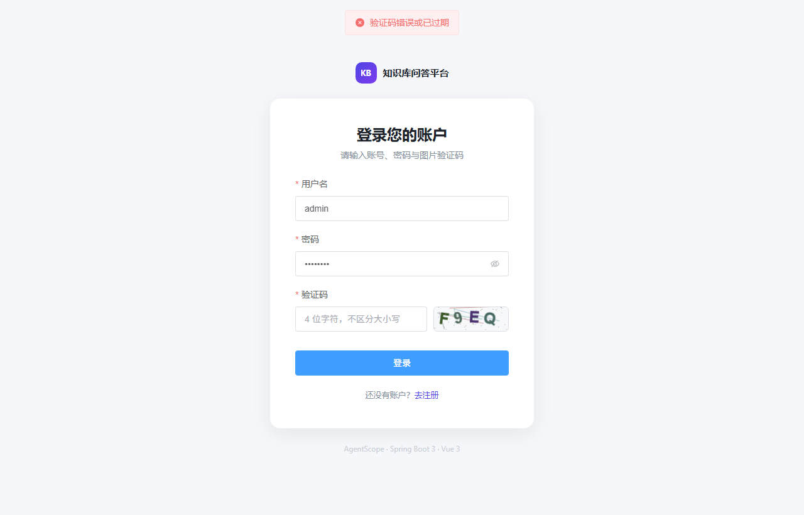

# 功能点三：登录鉴权与会话

> 所属模块：账号与访问控制（全站入口，所有功能的前置）
> 技术栈：Spring Boot 3.3 + PostgreSQL 16 + Vue3 + Pinia + vue-router + axios
> 前置知识：HTTP 状态码语义（401 / 403）、BCrypt 慢哈希、Servlet Filter 链、Vue Router 导航守卫
> 参考实现：`ai-vue`（心理健康助手前端）的 `utils/request.js` + `router/index.js` + `views/login.vue`
> 相关文档：图片验证码已拆分为 [docs/08-功能点-图片验证码.md](./08-功能点-图片验证码.md)
> 本文目标：照着「二、实践」从 2.1 敲到 2.11，能自己跑通「登录 → 拿 token → 被拦 → 被放行」整条链路

---

## 一、理论：动手之前要知道的东西

### 1.1 鉴权到底在解决什么问题

在没有鉴权之前，这个项目的接口是**裸奔**的：

```bash
curl -X POST http://localhost:8080/api/rag/documents/batch-delete -d '{"docIds":["..."]}'
# 一条命令，知识库清空，而且没人知道是谁干的
```

所以要解决的问题不是"加一个登录页"，而是三件具体的事：

| 要解决的问题 | 具体表现 | 本项目的答案 |
|---|---|---|
| **谁能进来** | 网址一传出去，谁都能调接口 | 账号 + 密码，登录后发 token |
| **他能干什么** | 普通用户能删管理员的数据 | 角色判权：`/api/rag/**` 仅 ADMIN |
| **他干过什么** | 出问题查不到人 | `last_login_at` + 会话表可定位到账号 |

这三件事有顺序：先有身份，才谈得上权限，才谈得上审计。所以身份是所有后续功能的地基。

### 1.2 三样东西分别存在哪

这是最容易搞混的地方，先钉死：

| 东西 | 存在哪 | 长什么样 |
|---|---|---|
| **账号**（用户名 + 密码） | **数据库 `app_users` 表** | 一行一个账号，密码列 `password_hash` 存 BCrypt 哈希 |
| **登录态**（这次登录有效） | **数据库 `app_sessions` 表** | 一行一次登录，主键是 token 的 SHA-256 |
| **前端凭证** | **localStorage** | `token` 和 `userInfo` 两个 key |

**账号密码就是存在数据库里的**，不在配置文件、不在代码、不在环境变量。登录时后端执行的就是这一句：

```sql
SELECT user_id, username, password_hash, role, display_name, enabled, must_change_password
FROM app_users WHERE username = 'admin';
```

查出来之后用 BCrypt 把用户输入和 `password_hash` 比一下，对上才放行。进容器能直接看到（真实输出）：

```bash
docker exec agentscope-kb-pg psql -U postgres -d ragdb_kb \
  -c "SELECT username, role, LEFT(password_hash,29) AS hash FROM app_users;"
```

```
 username | role  |             hash
----------+-------+--------------------------------
 admin    | ADMIN | $2a$10$GSWjQDEVupGP1trfDgTKPu
 user     | USER  | $2a$10$nyMM0soediGs5XVLz6xfnO
(2 rows)
```

改密码就改这张表（哈希要用 BCrypt 生成）：

```sql
UPDATE app_users SET password_hash = '<新密码的 BCrypt 哈希>' WHERE username = 'admin';
```

默认两个账号（`application.yml` → `app.auth` 下可改，只在库里没有账号时才创建）：

| 用户名 | 密码 | 角色 | 能干什么 |
|---|---|---|---|
| `admin` | `admin123` | ADMIN（userType=2） | 进后台、改知识库、用对话 |
| `user` | `user12345` | USER（userType=1） | 只能用对话，进不了后台 |

### 1.3 一次登录的完整链路

```
① 页面打开：GET /api/auth/captcha 取一张验证码（细节见 docs/08）
② 用户填：用户名 / 密码 / 验证码
③ POST /api/auth/login  {username, password, captchaId, captchaCode}
④ 后端先验验证码（错就直接返回，根本不查库）
⑤ 查 app_users，BCrypt 比对密码；错了按「账号+IP」计数，5 次锁 15 分钟
⑥ 都对 → 生成 32 字节随机 token，把它的 SHA-256 写进 app_sessions（24 小时）
⑦ 返回 {code:"200", data:{token, userInfo}}，前端把两个东西写进 localStorage
⑧ 按 userInfo.userType 跳转：2 → /admin/knowledge，1 → /chat

之后每个请求：
⑨ 请求头带上 token → AuthFilter 查 app_sessions → 放行 / 401
⑩ /api/rag/** 再判一次角色 → 不是 ADMIN 就 403
```

两个顺序细节，错了就白做：

- **验证码在密码之前**（第 ④ 步）：反过来的话，攻击者能拿"密码对不对"当探测信号。
- **角色判断在身份之后**（第 ⑩ 步）：先确认你是谁，再谈你能不能。

### 1.4 为什么密码用 BCrypt，而 token 只用 SHA-256

两者都是哈希，但威胁模型完全不同：

| | 密码 | 会话 token |
|---|---|---|
| 值从哪来 | **用户自己选的**，可能很弱（`123456`） | 服务端生成的 **32 字节随机数** |
| 攻击方式 | 拖库后**离线爆破** + 彩虹表 | 拖库后直接拿来用（不需要破解） |
| 所以要防什么 | 破解速度 | 可逆性 |
| 本项目的做法 | **BCrypt**：慢哈希 + 随机盐，单次约 100ms | **SHA-256**：快，够不可逆就行 |

一个反直觉但重要的点：**用 BCrypt 存 token 是错的**。它会让每个请求多花 100ms，安全性一点不涨——因为 token 没有"弱值"可以猜，慢哈希在这里纯属浪费 CPU。

### 1.5 为什么用服务端会话表，而不是 JWT

JWT 是无状态的：服务端不存，只验签名。听起来很美，但它有一个致命限制——**不能撤销**。

这个系统必须能立刻撤销：封号、改密踢人、管理员降权，都要即时生效。JWT 只能等它过期，或者维护一份"已撤销 token 黑名单"——那又回到有状态了，等于绕一圈回到原地。

所以本项目选会话表：**查一次就知道这条会话还在不在**，撤销窗口为零。代价是每个请求多一次按主键查询，微秒级，可以忽略。

### 1.6 三道校验，只有后两道算边界

| 层 | 代码位置 | 作用 | 能不能被绕过 |
|---|---|---|---|
| ① 前端路由守卫 | `router/index.ts` | 不让用户点进必然失败的页面 | **能**。改 localStorage、直接敲 URL 都行 |
| ② 后端过滤器 | `AuthFilter.java` | 没 token 一律 401，角色不够一律 403 | 不能 |
| ③ 数据层归属 | （尚未实现，见第四节） | A 能不能读写 B 的数据 | 不能 |

第 ① 层是**体验**，不是安全。判断标准很硬：**只在前端实现的权限，等于没实现。**

第 ③ 层目前缺着：任何 ADMIN 都能删任何文档。路径鉴权管"能不能调这个接口"，数据归属管"能不能碰这一行数据"——两层都要有，后者是下一个功能点的事。

### 1.7 前端三件套的分工

```
api/http.ts       axios 实例：请求自动带 token，401 统一清登录态跳登录页
     ↓
stores/auth.ts    Pinia：只存「我是谁」（token + userInfo），不存「能去哪」
     ↓
router/index.ts   路由表 + 守卫：读 store 里的 userType 决定放不放行
```

**为什么路由不放进 Pinia**：会变成两套真相源。刷新页面时守卫先跑、store 还没水合，管理员会被弹回登录页——这种 bug 极难排查。

`stores/auth.ts` 的初始值是**同步**从 localStorage 读的，所以刷新页面不会闪一下登录页，也不需要启动时再请求 `/auth/me`。

### 1.8 验证码在这条链路的哪个位置

它只占两处：页面打开时取图（第 ① 步）、登录时校验（第 ④ 步）。

画图、一次性语义、前端组件这些细节全部在 [docs/08](./08-功能点-图片验证码.md)，本文只保留接入点。拆开的原因很简单：它有自己完整的一套知识，混在登录文档里会让两条主线互相干扰。

---

## 二、实践：一步步做出来

### 2.0 先明确做完是什么样

| 检查点 | 预期 |
|---|---|
| 打开 `/app/` | 自动跳到 `/auth/login`，显示登录卡片 |
| 输 `admin` / `admin123` + 正确验证码 | 进 `/admin/knowledge`，左侧栏底部显示「系统管理员 / 管理员」 |
| 退出后用 `user` / `user12345` 登录 | 进 `/chat`，侧栏没有「知识库」按钮 |
| 手动敲 `/app/admin/knowledge`（普通用户） | 被弹回 `/chat` |
| 不带 token 请求 `/api/rag/documents` | 401 |
| 用普通用户 token 请求 `/api/rag/documents` | 403 |

登录页成品：


注册页（默认开放，注册出来是普通用户）：


### 2.1 第 1 步：建表

`src/main/resources/schema.sql` 末尾追加（`spring.sql.init.mode=always`，启动时自动执行，`IF NOT EXISTS` 保证幂等）：

```sql
CREATE TABLE IF NOT EXISTS app_users (
    user_id       UUID PRIMARY KEY,
    username      TEXT NOT NULL UNIQUE,          -- 登录名，唯一
    password_hash TEXT NOT NULL,                 -- BCrypt，永不存明文
    role          TEXT NOT NULL,                 -- ADMIN / USER
    display_name  TEXT NOT NULL,
    enabled       BOOLEAN NOT NULL DEFAULT TRUE,
    must_change_password BOOLEAN NOT NULL DEFAULT FALSE,
    created_at    TIMESTAMPTZ NOT NULL,
    last_login_at TIMESTAMPTZ
);

-- 存 token 的哈希，不存 token 本身：库被读走也无法拿来冒充登录
CREATE TABLE IF NOT EXISTS app_sessions (
    token_hash   TEXT PRIMARY KEY,
    user_id      UUID NOT NULL REFERENCES app_users(user_id) ON DELETE CASCADE,
    created_at   TIMESTAMPTZ NOT NULL,
    last_seen_at TIMESTAMPTZ NOT NULL,
    expires_at   TIMESTAMPTZ NOT NULL
);

CREATE INDEX IF NOT EXISTS idx_app_sessions_user ON app_sessions(user_id);
CREATE INDEX IF NOT EXISTS idx_app_sessions_expires ON app_sessions(expires_at);
```

两个设计说明：

- `role` 用 `TEXT` 而不是 PG 枚举类型：加角色不用 `ALTER TYPE`，代价是应用层要校验取值。
- `user_id` 上加了 `ON DELETE CASCADE`：删账号自动清会话，不留孤儿。

### 2.2 第 2 步：只引 BCrypt，不引整个 Spring Security

```xml
<!-- 只取 BCrypt 编码器，不引 spring-boot-starter-security：
     完整 Security 会自动装配一整套 FilterChain，与现有 AuthFilter / RateLimitFilter 抢职责 -->
<dependency>
    <groupId>org.springframework.security</groupId>
    <artifactId>spring-security-crypto</artifactId>
</dependency>
```

这一步很容易走偏。看到"要做鉴权"就去引 `spring-boot-starter-security`，结果是所有接口突然 401、默认登录页抢占路由、还要写一堆 `SecurityFilterChain` 配置去关掉它。**只想要 BCrypt，就别请整个框架进来。**

### 2.3 第 3 步：加配置项

```yaml
app:
  auth:
    token-header: token                 # 前端请求头里带 token 的字段名
    session-hours: 24
    idle-renew-minutes: 5               # 距上次访问超过 5 分钟才续期，避免每个请求写库
    registration-enabled: ${AUTH_REGISTRATION_ENABLED:true}
    admin-username: admin
    admin-init-password: ${ADMIN_INIT_PASSWORD:admin123}
    seed-demo-user: true
    demo-username: user
    demo-init-password: ${DEMO_INIT_PASSWORD:user12345}
    max-failed-attempts: 5
    lock-minutes: 15
    captcha-enabled: ${AUTH_CAPTCHA_ENABLED:true}
    captcha-ttl-seconds: 120
```

对应的 `AuthProperties` 用 `@Component + @ConfigurationProperties(prefix = "app.auth")`，和项目里 `RateLimitProperties` 保持同一套写法。

### 2.4 第 4 步：存储层，接口先定

```java
public interface UserStore {
    Optional<AppUser> findByUsername(String username);
    Optional<AppUser> findById(String userId);
    boolean insert(AppUser user);
    boolean changePassword(String userId, String passwordHash);
    void touchLastLogin(String userId, Instant at);
    long countByRole(UserRole role);
    boolean existsByUsername(String username);
}

public interface SessionStore {
    void create(String tokenHash, String userId, Instant createdAt, Instant expiresAt);
    Optional<SessionRow> find(String tokenHash);
    void touch(String tokenHash, Instant lastSeenAt, Instant expiresAt);
    void delete(String tokenHash);
    int deleteByUserExcept(String userId, String keepTokenHash);
    int purgeExpired(Instant now);
}
```

这不是形式主义。正因为抽了接口，后面的 15 个单元测试才能**不连数据库**就跑完——测试用内存实现，`Service` 层一行不用改。

JDBC 实现里有个必踩的坑：**UUID 主键要显式转型**。

```java
// JdbcTemplate 会把 String 按 varchar 绑定，不转型会报「varchar = uuid」
"SELECT ... FROM app_users WHERE user_id = ?::uuid"
```

### 2.5 第 5 步：AuthService（登录 / 签发 / 解析 / 改密）

```java
public LoginResult login(String rawUsername, String rawPassword, String clientKey) {
    String username = normalizeUsername(rawUsername);          // 统一小写
    String gateKey = username + "|" + clientKey;

    if (!gateAllows(gateKey)) {                                 // ① 先看锁没锁
        throw new AuthException(HttpStatus.TOO_MANY_REQUESTS,
                "登录失败次数过多，请 " + props.getLockMinutes() + " 分钟后再试");
    }

    Optional<AppUser> found = userStore.findByUsername(username);       // ② 查数据库
    // 用户不存在也跑一次 BCrypt：拉平响应时间，堵住账号枚举的时间侧信道
    boolean matched = encoder.matches(rawPassword,
            found.map(AppUser::passwordHash).orElse(dummyHash));

    if (found.isEmpty() || !matched || !found.get().enabled()) {
        gateFail(gateKey);
        throw AuthException.unauthorized("账号或密码错误");              // ③ 统一文案
    }

    gateSuccess(gateKey);
    userStore.touchLastLogin(found.get().userId(), Instant.now());
    sessionStore.purgeExpired(Instant.now());                        // 顺手清理过期会话
    return new LoginResult(found.get(), issueSession(found.get().userId()));
}
```

签发会话只有六行，是整套机制的根：

```java
public String issueSession(String userId) {
    byte[] bytes = new byte[32];
    RANDOM.nextBytes(bytes);
    String rawToken = Base64.getUrlEncoder().withoutPadding().encodeToString(bytes);
    Instant now = Instant.now();
    sessionStore.create(sha256(rawToken), userId, now, now.plus(Duration.ofHours(24)));
    return rawToken;      // 明文 token 只回给浏览器，库里存的是哈希
}
```

解析与滑动续期：

```java
public Optional<AppUser> resolve(String rawToken) {
    if (rawToken == null || rawToken.isBlank()) return Optional.empty();
    String tokenHash = sha256(rawToken);
    Optional<SessionRow> row = sessionStore.find(tokenHash);
    if (row.isEmpty()) return Optional.empty();

    Instant now = Instant.now();
    if (row.get().expiresAt().isBefore(now)) {
        sessionStore.delete(tokenHash);     // 过期顺手删掉
        return Optional.empty();
    }
    // 不是每个请求都续期：不足 5 分钟就跳过，否则 app_sessions 会变成写热点
    if (Duration.between(row.get().lastSeenAt(), now).toMinutes() >= props.getIdleRenewMinutes()) {
        sessionStore.touch(tokenHash, now, now.plus(Duration.ofHours(props.getSessionHours())));
    }
    return userStore.findById(row.get().userId()).filter(AppUser::enabled);
}
```

改密时踢掉其它会话（**当前这条保留**，否则用户改完自己被踢）：

```java
userStore.changePassword(userId, encoder.encode(newPassword));
sessionStore.deleteByUserExcept(userId, sha256(currentToken));
```

### 2.6 第 6 步：AuthFilter，真正的边界

```java
@Component
@Order(Ordered.HIGHEST_PRECEDENCE + 20)   // 排在 RateLimitFilter(+10) 之后：先限流，再鉴权
public class AuthFilter extends OncePerRequestFilter {

    private static final Set<String> PUBLIC_PATHS = Set.of(
            "/api/auth/login", "/api/auth/register", "/api/auth/captcha");

    @Override
    protected void doFilterInternal(HttpServletRequest req, HttpServletResponse resp, FilterChain chain)
            throws ServletException, IOException {

        String uri = req.getRequestURI();
        if (!uri.startsWith("/api/")) { chain.doFilter(req, resp); return; }   // 静态资源放行
        if (PUBLIC_PATHS.contains(uri)) { chain.doFilter(req, resp); return; }

        String token = readToken(req);
        Optional<AppUser> user = authService.resolve(token);
        if (user.isEmpty()) {
            writeJson(resp, 401, "-1", "登录已过期，请重新登录");
            return;
        }
        if (uri.startsWith("/api/rag/") && user.get().role() != UserRole.ADMIN) {
            writeJson(resp, 403, "403", "需要管理员权限");
            return;
        }

        req.setAttribute("authUser", user.get());
        req.setAttribute("authToken", token);
        chain.doFilter(req, resp);
    }
}
```

`readToken` 主用请求头 `token`，同时兼容 `Authorization: Bearer`——后者纯粹是为了 Postman 和自动化测试方便。

**注意白名单**：验证码接口必须在里面，否则用户连登录页都加载不出来。少这一行会掉进死循环，是这个功能最容易犯的错。

### 2.7 第 7 步：AuthController 与返回结构

返回结构对齐参考项目（`ai-vue`）的 `{code, msg, data}`：

```
成功：{"code":"200","msg":"ok","data":{...}}
失败：{"code":"401","msg":"账号或密码错误"}
```

```java
@PostMapping("/login")
public ResponseEntity<Map<String, Object>> login(@RequestBody Map<String, String> body, HttpServletRequest request) {
    // 验证码先校验，再走密码（细节见 docs/08）
    if (props.isCaptchaEnabled() && !captchaService.verify(body.get("captchaId"), body.get("captchaCode"))) {
        throw AuthException.badRequest("验证码错误或已过期");
    }
    AuthService.LoginResult result = authService.login(body.get("username"), body.get("password"), clientKey(request));
    return ok(Map.of("token", result.rawToken(), "userInfo", userInfo(result.user())));
}
```

`userInfo` 里的 `userType` 沿用参考项目的约定：**1 = 普通用户，2 = 管理员**。前端只认这个字段。

### 2.8 第 8 步：管理员种子

不能硬编码，但冷启动又必须有账号能进后台。做法是「库里没有 ADMIN 时才创建」：

```java
private void seedAdmin() {
    if (userStore.countByRole(UserRole.ADMIN) > 0) return;   // 已有就什么都不做，绝不覆盖
    try {
        authService.createUser(props.getAdminUsername(), props.getAdminInitPassword(),
                "系统管理员", UserRole.ADMIN, false);
        log.info("已创建管理员账号：{} / {}（存于 app_users 表）", ...);
    } catch (RuntimeException e) {
        log.error("管理员账号创建失败（不影响启动）：{}", e.getMessage());
    }
}
```

`catch (RuntimeException)` 而不是 `catch (AuthException)`，是踩过一次坑之后改的：原来 `countByRole` 写在 try 外面，数据库连不上时异常直接冒泡，**整个服务起不来**。种子失败只该告警，不该把服务拖下水。

### 2.9 第 9 步：前端三件套

**① `api/http.ts`：自动带 token，401 统一处理**

```ts
export const TOKEN_KEY = 'token'
export const USER_KEY = 'userInfo'

http.interceptors.request.use((config) => {
  const token = localStorage.getItem(TOKEN_KEY)
  if (token) config.headers.set(TOKEN_KEY, token)      // 每个请求自动带
  return config
})

http.interceptors.response.use(
  (response) => response,
  (error) => {
    const status = error.response?.status
    const url = error.config?.url ?? ''
    const isAuthEntry = url.includes('/auth/login') || url.includes('/auth/register')

    if (status === 401 && !isAuthEntry) {
      localStorage.removeItem(TOKEN_KEY)
      localStorage.removeItem(USER_KEY)
      ElMessage.error('登录已过期，请重新登录')
      window.location.href = '/app/auth/login'
      return Promise.reject(error)
    }
    // …其它错误统一弹提示
  }
)
```

`isAuthEntry` 那个判断必须留着：登录时密码输错后端也返回 401，不排除掉的话用户一输错就被"跳转到登录页"，看着像页面抽风。

**② `stores/auth.ts`：只存身份，不从它推路由**

```ts
state: () => ({
  token: localStorage.getItem(TOKEN_KEY) || '',
  userInfo: readUserInfo(),            // 同步读，刷新页面不闪登录页
  loading: false
}),
getters: {
  isLoggedIn: (s) => !!s.token && !!s.userInfo,
  isAdmin: (s) => s.userInfo?.userType === 2,
  homePath: (s) => (s.userInfo?.userType === 2 ? '/admin/knowledge' : '/chat')
}
```

登录成功要写**两处**，缺一不可：

```ts
const data = await loginApi(username, password, captchaId, captchaCode)  // {token, userInfo}
localStorage.setItem(TOKEN_KEY, data.token)
localStorage.setItem(USER_KEY, JSON.stringify(data.userInfo))
this.token = data.token
this.userInfo = data.userInfo
```

**③ `router/index.ts`：三段路由 + 三个判断**

```
/auth/login、/auth/register  →  AuthLayout（不需要登录）
/chat                        →  ChatLayout（要登录）
/admin/**                    →  AdminLayout（要管理员）
```

```ts
router.beforeEach((to) => {
  const auth = useAuthStore()

  if (!auth.isLoggedIn) {
    if (to.meta.requiresAuth) return { path: '/auth/login', query: { redirect: to.fullPath } }
    return true
  }
  if (to.path.startsWith('/auth')) return auth.homePath      // 已登录还去登录页 → 送回首页
  if (to.meta.adminOnly && !auth.isAdmin) return '/chat'      // 普通用户点后台 → 回对话页
  return true
})
```

### 2.10 第 10 步：登录页

登录页本身不复杂（`el-form` + 三个字段 + 提交），关键在三处交互细节：

```ts
onMounted(refreshCaptcha)              // 进页面就取一张验证码

async function submit() {
  const valid = await formRef.value.validate().catch(() => false)
  if (!valid) return
  try {
    const userInfo = await auth.signIn(form.username, form.password, captchaId.value, form.captchaCode)
    ElMessage.success(`欢迎回来，${userInfo.displayName}`)
    // 登录前想去哪就回哪；没有记录时按角色进后台或对话
    router.replace((route.query.redirect as string) || auth.homePath)
  } catch {
    await refreshCaptcha()             // 失败必须换一张（验证码是一次性的）
  }
}
```

`redirect` 那一行容易被忽略：用户从 `/admin/knowledge` 被踢到登录页，登录后应该回到原页面，而不是无脑进首页。

### 2.11 验证：五个检查点

**① 未登录访问业务接口 → 401**

```bash
curl -i http://localhost:8081/api/rag/documents
# HTTP/1.1 401
# {"code":"-1","msg":"登录已过期，请重新登录","status":401}
```

**② 登录成功拿到 token**

```bash
curl -s -X POST -H "Content-Type: application/json" \
  -d '{"username":"admin","password":"admin123","captchaId":"...","captchaCode":"..."}' \
  http://localhost:8081/api/auth/login

# {"code":"200","msg":"ok","data":{
#   "token":"CiBVAOzii_SqVqUaI2r_fzMBC5Uernq_SjqYXPefq2Q",
#   "userInfo":{"username":"admin","role":"ADMIN","userType":2,"mustChangePassword":false}}}
```

**③ 账号密码对、验证码错 → 被拦在查库之前**



注意图里三个细节：顶部红字提示、用户名密码都已填对、**验证码输入框被清空且图片换了新的一张**。这说明失败点在验证码，不是密码——正是"验证码先于密码"的体现。

**④ 管理员 200 / 普通用户 403**

```bash
curl -o /dev/null -w "%{http_code}\n" -H "token: <admin 的 token>" http://localhost:8081/api/rag/documents
# 200

curl -i -H "token: <user 的 token>" http://localhost:8081/api/rag/documents
# HTTP/1.1 403
# {"code":"403","msg":"需要管理员权限"}
```

**⑤ 单元测试全绿**

```bash
mvn -Dtest='AuthServiceTest,CaptchaServiceTest' test
# Tests run: 9  -- AuthServiceTest（会话只存哈希、失败文案不可区分、连续失败锁定、改密踢会话…）
# Tests run: 6  -- CaptchaServiceTest
```

15 个用例**全部不连数据库**，靠的是 2.4 节那两个接口的内存实现。

### 2.12 常见坑

| 现象 | 原因 | 解法 |
|---|---|---|
| 启动报 `Port 8080 was already in use` | 旧 docker 容器占着 8080（跑的是旧镜像） | 用 `SERVER_PORT=8081`，或 `docker compose down` |
| 登录成功但一刷新回登录页 | token 没写进 localStorage | F12 → Application → Local Storage 看两个 key |
| 普通用户点后台被强制登出 | 权限不足返回了 401 | 权限不足一律 403 |
| 所有 `uuid` 相关 SQL 报 `varchar = uuid` | JdbcTemplate 按 varchar 绑定 | SQL 里写 `?::uuid` |
| 服务起不来，日志只有 `Connection refused` | 数据库没起；种子查询冒泡 | 先起库；以及把种子异常兜住（见 2.8） |
| 连错 5 次提示锁定 | 防爆破机制生效 | 等 15 分钟，或重启（计数在内存） |
| 忘记密码 | 没有找回密码功能 | SQL 改 `password_hash`，或删该行让它重新种 |

---

## 三、面试深挖题

> 每题一个主问题，答案折叠；**追问单独列出**，每条追问的答案也折叠。建议先自己答一遍再展开，卡在第几层就说明哪块还没吃透。
> 验证码相关的追问在 [docs/08-功能点-图片验证码.md](./08-功能点-图片验证码.md) 第三节。

### Q1｜账号密码为什么一定要进数据库、并且用 BCrypt 存？

<details>
<summary>参考答案（点击展开）</summary>

账号是运行时数据，会增删改；放配置或代码里意味着改一个账号要发一次版，且明文密码会跟着 git 历史永久留存。BCrypt 是慢哈希 + 自带随机盐，拖库后很难还原出密码。
</details>

**追问 1：放配置文件不行吗？**

<details>
<summary>点击查看答案</summary>

三个问题。① 改密码要重启或发版；② 配置里的明文密码会跟着 git 历史永久留存；③ 无法支持"多个管理员""停用某个账号""记录最后登录时间"这些必然出现的需求。

配置只适合放"库里还没有账号时种什么"这类引导性参数，不能当账号存储用。
</details>

**追问 2：为什么不用 MD5 或 SHA-256？**

<details>
<summary>点击查看答案</summary>

它们是**快哈希**：显卡每秒能算百亿次，弱口令（`123456`）在彩虹表里直接命中。

BCrypt 把单次计算成本抬到约 100 毫秒，爆破速度掉到每秒个位数——这个"慢"就是它的全部价值。另外 BCrypt 自带随机盐，同样的密码两个人存进去长得完全不同，彩虹表彻底失效。
</details>

**追问 3：bcrypt 的 cost 参数怎么定？调大调小有什么影响？**

<details>
<summary>点击查看答案</summary>

cost 是迭代次数的指数，默认 10 表示 2^10 轮。调高一档，计算时间约翻倍。

判断标准是**单次登录耗时 < 500ms**：超过就该考虑加机器或降 cost。因为攻击者也付同样的成本，但正常用户一次登录只有一个请求，攻击者要试几百万次——这个不对称正是慢哈希的价值来源。
</details>

**追问 4：BCrypt 只处理前 72 字节，业务要支持超长密码怎么办？**

<details>
<summary>点击查看答案</summary>

先把两个已知限制说清：只处理密码**前 72 字节**，且遇到 `\0` 会截断。

本项目的处理最简单——密码长度上限设 64 位（`PASSWORD_MAX = 64`），天然不会触发 72 字节问题。

如果业务必须支持密码短语这类超长输入，标准做法是先 `SHA-256(password)` 再交给 BCrypt，即"预哈希"。注意预哈希结果要做 Base64 编码再传，否则二进制里的 `\0` 会被再次截断——这一步写错，等于所有密码在前 72 字节相同处就被判为相等。
</details>

**追问 5：密码不能明文存，为什么 session token 只存 SHA-256 就够？**

<details>
<summary>点击查看答案</summary>

威胁模型不同。

- 密码是**用户选的**，可能很弱（`123456`），所以要"慢"来抗离线爆破。
- token 是 **32 字节随机数**，没有弱值可猜，只需要"不可逆"——拖库拿到的哈希没法反推、也没法直接塞进请求头。

用 BCrypt 存 token 只会让每个请求多花 100ms，安全性一点没涨。
</details>

**追问 6：如果以后要接企业统一身份（LDAP / OIDC），表结构怎么改？**

<details>
<summary>点击查看答案</summary>

`app_users` 加一列 `external_sub`（外部身份唯一标识），`password_hash` 允许为 NULL（外部账号没有本地密码）。

登录流程在 `AuthService.login` 之前加分支：走 SSO 时不校验密码，改为校验外部 token 并映射到本地 `user_id`。

**会话层 `app_sessions` 完全不用动**——这正是把"认证"和"会话"拆成两个组件的收益。要避免的是把 SSO 逻辑塞进 `AuthFilter`，那会让所有接口的鉴权路径变得不可测。
</details>

---

### Q2｜前端已经有路由守卫了，为什么后端还要再拦一遍？

<details>
<summary>参考答案（点击展开）</summary>

前端守卫可以被完全绕过——改 localStorage、直接敲 URL、用 curl 都行。它只负责体验，后端 `AuthFilter` 才是身份边界。
</details>

**追问 1：具体怎么绕过？**

<details>
<summary>点击查看答案</summary>

最直接的是 `curl -H "token: ..." http://host/api/rag/documents`，根本不加载任何 JS。

退一步也可以在 DevTools 里把 `localStorage.userInfo` 的 `userType` 改成 2，刷新后前端就认为你是管理员——但后端读的是 `app_users.role`，照样 403。
</details>

**追问 2：那前端守卫存在的意义是什么？**

<details>
<summary>点击查看答案</summary>

三件事：① 未登录时把人送到登录页，而不是让他看一片报错；② 登录后按 `userType` 送到不同首页；③ 不渲染无权访问的菜单项，减少误点击。

全是体验，没有一条是安全。判断标准很硬：**只在前端实现的权限，等于没实现。**
</details>

**追问 3：为什么权限不足要返回 403 而不是 401？**

<details>
<summary>点击查看答案</summary>

401 的语义是"我不知道你是谁"，前端收到会清 token 跳登录页；403 是"我知道你是谁，但你没权限"，前端应该提示并留在原地。

混用的话，普通用户点一下后台菜单就被强制退出登录，他会以为是自己掉线了——这种"功能没错但体验像 bug"的问题最难排查。
</details>

**追问 4：现在 `/api/rag/**` 是"路径前缀 → 角色"的硬编码，接口多了怎么办？**

<details>
<summary>点击查看答案</summary>

接口少于 20 个时前缀判断最直观，改起来一眼能看到。

再多就该换注解（`@RequiresRole(ADMIN)` + 拦截器扫注解），或者退回 Spring Security 的 `authorizeHttpRequests`。

判断标准是"改一条权限规则时要不要改过滤器代码"——如果要，说明权限和路径耦合了。
</details>

**追问 5：怎么验证后端真的拦住了，而不是"看起来拦住了"？**

<details>
<summary>点击查看答案</summary>

写**反例测试**，不写正例。

每个受保护接口都要有一条"不带 token 请求它，断言 401"，以及一条"用 USER 的 token 请求它，断言 403"。

正例只能证明功能可用，反例才证明边界存在。这也是为什么本项目 `AuthServiceTest` 的 9 个用例全部围绕"拒绝场景"——能伪造 token、能被锁、能被踢下线，比"能登录"重要得多。
</details>

**追问 6：路径级鉴权就够了吗？还缺什么？**

<details>
<summary>点击查看答案</summary>

不够。

现在任何 ADMIN 都能删任何文档，"A 管理员能不能删 B 管理员上传的文档"路径级答不了。这需要给 `rag_documents` 加 owner 字段，并在**每一条查询**里带上归属条件。

路径鉴权管"能不能调这个接口"，数据归属管"能不能碰这一行数据"，两层都要有。后者是下一个功能点要解决的问题。
</details>

---

### Q3｜为什么用服务端会话表，而不是 JWT？

<details>
<summary>参考答案（点击展开）</summary>

因为这个系统必须能**立刻撤销**——封号、改密踢人、管理员降权都要即时生效。JWT 的无状态特性恰恰做不到这一点。
</details>

**追问 1：JWT 为什么不能撤销？不是可以设短过期吗？**

<details>
<summary>点击查看答案</summary>

短过期是"缩短窗口"，不是"撤销"。token 有效期 15 分钟，就意味着封号后最多还有 15 分钟作恶窗口。

而会话表查一次就知道"这条已经删了"，窗口为零。要让 JWT 真正可撤销，就得维护一份"已撤销 token 黑名单"——那又回到有状态了，等于绕一大圈回到起点。
</details>

**追问 2：会话表每个请求查一次库，性能扛得住吗？**

<details>
<summary>点击查看答案</summary>

按主键查一行、命中索引，成本在微秒级，相对一次业务查询可以忽略。

真正的压力在**写**——所以滑动续期加了门槛：距上次访问不足 5 分钟就不更新 `last_seen_at`，避免一个页面几十个并发请求把 `app_sessions` 打成写热点。

如果读也成瓶颈，加一层本地缓存（token_hash → 用户，TTL 30 秒）即可，代价是最多 30 秒的撤销延迟。
</details>

**追问 3：什么场景下 JWT 反而更合适？**

<details>
<summary>点击查看答案</summary>

① 服务间调用（无用户、无需撤销）；② 超大规模读接口，会话校验成为瓶颈；③ 跨多个系统共享身份且能接受撤销延迟。

判断标准是"**撤销需求**"和"**规模**"两个维度：需要即时撤销就选有状态；规模大到查不动才考虑无状态 + 短过期 + 黑名单。
</details>

**追问 4：将来做多实例部署，现在这套哪里会坏？**

<details>
<summary>点击查看答案</summary>

两处：

1. **登录失败计数在进程内存**，每台机器各算各的，等于把"5 次锁定"放大成"5 × 实例数"次。
2. **验证码答案也在各自内存**里——那个是另一个功能的问题，已在 docs/08 说明。

会话表本身没问题（共享库），token 也没绑机器。

修复顺序：先把失败计数挪到 Redis（有 TTL，天然适合），再考虑会话缓存。
</details>

**追问 5：怎么实现「同一账号只允许一处登录」？**

<details>
<summary>点击查看答案</summary>

加一行就够：签发新 token 前，先 `sessionStore.deleteByUserExcept(userId, null)` 清掉该用户所有会话。

这个能力恰好是 JWT 难以优雅实现的：JWT 要维护"每个用户当前的 token 版本号"，每次校验都比对版本——本质还是查了一次存储，只是把复杂度藏起来了。
</details>

**追问 6：如果 token 泄露了，怎么把损失压到最小？**

<details>
<summary>点击查看答案</summary>

三层：

1. **缩短有效期**：本项目 24 小时，配合滑动续期保证活跃用户不掉线；敏感系统可以缩到 2 小时 + refresh token。
2. **能撤销**：这是会话表相对 JWT 的核心优势——发现泄露直接删那一行，下一个请求就失效；改密踢掉其它会话也是同一机制。
3. **限制暴露面**：不要把 token 放进 URL（会进浏览器历史、Referer、网关日志）、不要写进前端日志、不要回显在错误页面。

最后一条常被忽略：token 一旦进了日志，等于把凭证发给了所有能看日志的人。
</details>

---

## 四、这套鉴权管到哪里为止

| 归本功能 | 归验证码（docs/08） | 还没做（下一功能点） |
|---|---|---|
| 账号表、密码哈希、登录失败锁定 | 图片生成、一次性校验、TTL | 数据归属（谁能改谁的文档） |
| token 签发 / 解析 / 撤销 | 前端验证码组件与刷新 | 操作审计（谁删了什么） |
| `AuthFilter` 的身份与角色判断 | 与登录接口的接入顺序 | 管理员账号管理界面 |
| 前端 token 存储、401 处理、路由守卫 | `captcha-enabled` 开关 | 找回密码 |

### 收益

| 场景 | 没有鉴权 | 有 |
|---|---|---|
| 未登录调管理接口 | 200，直接改数据 | 401，在过滤器层被拒 |
| 普通用户调管理接口 | 200，能删文档 | 403，且不会被踢下线 |
| 密码被撞 | 无限制 | 验证码 + 5 次锁 15 分钟 |
| 改密码后 | 旧登录态还能用 | 其它 token 立即失效（当前这条保留） |
| 拖库 | 明文凭证可直接登录 | 只能拿到 BCrypt 哈希与会话哈希 |
| 谁动过知识库 | 无从查起 | `last_login_at` + `app_sessions` 可定位到账号 |

一句话：**它不产生业务能力，但决定了谁能碰到业务能力。**
