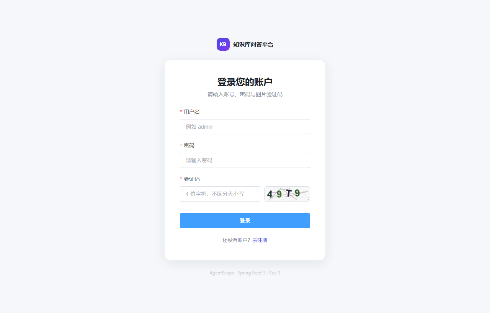
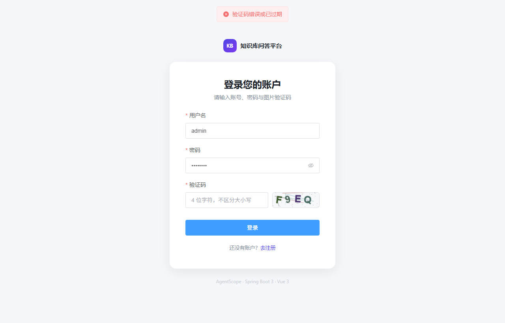

# 功能点四：图片验证码

> 所属模块：登录安全（从「功能点三：登录鉴权」拆出，可独立实现）
> 技术栈：Spring Boot 3.3 + Java2D（JDK 自带）+ Vue3 + Element Plus
> 前置知识：HTTP 无状态、Java AWT 画图基础、Base64 与 data URL、Map 与 TTL
> 本文目标：从零做出一个「能自己画图、答案不出服务端、一次性校验、能接进登录」的验证码

---

## 一、理论：动手之前要知道的东西

### 1.1 验证码到底在防什么

先说清它**不**防什么：它不防"愿意花钱的人"。人工打码一次 0.001 元，任何图片验证码都能被绕过。

它防的是**零成本脚本**：

| 攻击 | 没有验证码 | 有验证码 |
|---|---|---|
| 撞库（拿泄露的账号密码批量试） | 换 IP 就能无限试，一秒几十次 | 每次都要识别一张图，成本从 0 变成「每次都要计算或花钱」 |
| 批量注册（养号） | 脚本一天注册十万个 | 同上 |
| 刷接口（薅额度、爬数据） | 循环请求即可 | 每次请求都要过一道人工/OCR 处理 |

所以验证码的定位是**抬高单位尝试成本**，不是"证明你是人"。理解了这一点，就不会去纠结"我的验证码能不能被 OCR 破解"——你要做的是让破解成本高于攻击收益。

它和限流是**互补**的两件事：

- 限流管**频率**：一分钟最多 60 次。
- 验证码管**单次成本**：哪怕只试 5 次，每次都得先过一张图。

两者都要有。只有限流，攻击者可以慢慢磨（每分钟 60 次 × 24 小时 = 8.6 万次/天）；只有验证码，攻击者可以雇人批量识别。

### 1.2 关键前提：HTTP 是无状态的

用户在登录页看到的图，和 3 秒后提交的登录请求，**对服务端来说是两个毫不相干的请求**。HTTP 协议本身不记得"刚才是谁取了哪张图"。

所以必须有一处地方替服务端记住「这张图的答案是什么」。三种存法：

| 方案 | 做法 | 问题 |
|---|---|---|
| **服务端内存（本项目）** | `Map<captchaId, 答案>` | 多实例部署时，请求打到别的机器就验不过；重启即清空 |
| Redis | key = captchaId，value = 答案，TTL = 2 分钟 | 需要多一个中间件，但多实例天然支持（正解） |
| 把答案加密后回传前端 | 前端下次带着密文回来，服务端解密比对 | **不可行**。密钥必须给前端才能解密，等于没有密钥 |

第三条是很多人第一反应会想到的方案，也是必须排除的方案——**答案一旦离开服务端，就等于没有验证码**。

### 1.3 Java2D 画图的最小知识集

只需要四个概念，不用学整个 AWT：

| 概念 | 是什么 | 本项目怎么用 |
|---|---|---|
| `BufferedImage` | 内存里的一块像素矩阵 | 120×40 的画布 |
| `Graphics2D` | 画笔对象，负责所有绘制 | 填充底色、画线、写字、打点 |
| 坐标系 | 原点在**左上角**，y 轴**向下** | 文字基线在 y=28 附近，不是 y=40 |
| `AffineTransform` / `g.rotate` | 图形变换 | 每个字符绕自己的中心转 ±14° |

两个必踩的细节：

1. `g.dispose()` 要放在 `finally` 里。忘了释放会泄漏原生资源（Windows 上表现为句柄数持续上涨）。
2. `g.rotate(angle, x, y)` 是**绕点 (x,y) 旋转坐标系**，画完必须用 `g.rotate(-angle, x, y)` 转回来；否则后面每个字符都会叠在前一个的旋转上，越画越歪。

### 1.4 Base64 与 data URL

图片是二进制，JSON 是文本协议，两者不能直接混在一起。Base64 把二进制编码成纯文本，代价是体积增大约 33%。

编码后的字符串前面加上类型声明，就成了 **data URL**：

```
data:image/png;base64,iVBORw0KGgoAAAANSUhEUgAAAHgAAAAoCAIAAAC6iKly...
└──────┬──────┘└──┬──┘└──────────────┬──────────────┘
      MIME 类型   编码方式        实际的 Base64 数据
```

它可以直接放进 ``，浏览器会自己解码显示。好处是不用再开一个图片接口、不用处理跨域、不用管 Cookie。

顺带一个"缺点"其实是优点：**data URL 不会被浏览器缓存**。验证码本来就不该被缓存——缓存了用户点"换一张"可能还是看到旧图。

### 1.5 一次性 + 过期：为什么是「先删再判」

```java
Captcha captcha = store.remove(captchaId);   // ← 先删
if (captcha == null || expired) return false;
return code.equalsIgnoreCase(input);
```

注意 `remove` 在判断之前。写成"判断通过再删除"会留下一个漏洞：**答错的请求不消耗这张图**，攻击者可以拿同一张图反复猜 4 个字符，猜中概率从 1/23 万变成"随便试到对为止"。

「先删」还顺手解决了并发问题：两个请求同时拿同一个 captchaId 来验，`ConcurrentHashMap.remove` 只有一个能拿到非 null 返回值，另一个必然失败。天然的一次性语义，不需要加锁。

过期清理**不需要定时任务**：本项目在每次 `issue()`（有人取新图）时顺手扫一遍过期条目。没人取图的时候，也没有内存增长的压力。

### 1.6 前端只需要记住一件事

``，`captchaImage` 是 data URL 字符串。

- **换一张** = 换 src 的值（不需要 `key` 强制重渲染，因为 data URL 变了浏览器就会重新解码）。
- **失败后必须换**：后端已经把那张消费掉了。不换的话，用户第二次提交必然还是"验证码错误"，他会以为验证码坏了，而不是密码错了。

---

## 二、实践：一步步做出来

### 2.0 先明确做完是什么样

| 检查点 | 预期 |
|---|---|
| 打开登录页 | 验证码位置显示一张 4 位字符的图，字母有轻微倾斜、有干扰线 |
| 点图片 | 换一张，输入框清空 |
| 密码填对、验证码填错 | 提示「验证码错误或已过期」，图自动换新 |
| 同一张验证码提交两次 | 第二次必定失败 |
| 等 2 分钟再提交 | 失败（过期） |

最终成品（登录页里的验证码，就是本功能的产物）：



### 2.1 第 1 步：加配置项

`AuthProperties` 里加两个字段（不带这两个也能跑，但写死不如可配）：

```java
/** 图片验证码是否开启；关掉只用于本地自动化测试 */
private boolean captchaEnabled = true;

/** 验证码有效期（秒） */
private int captchaTtlSeconds = 120;

// 记得生成 getter / setter
```

`application.yml`：

```yaml
app:
  auth:
    captcha-enabled: ${AUTH_CAPTCHA_ENABLED:true}
    captcha-ttl-seconds: 120
```

留了 `AUTH_CAPTCHA_ENABLED` 这个环境变量口子，是因为**自动化测试时验证码很碍事**——curl 脚本没法识图。本地调试可以临时关掉，生产绝不能关。

### 2.2 第 2 步：先把"记账"写了，图最后画

很多人一上来就折腾怎么画图，结果把核心逻辑写乱了。正确顺序是**先让数据结构跑通**：生成 id → 存答案 → 能校验。图只是"答案的可视化"，最后补。

```java
@Service
public class CaptchaService {

    private static final SecureRandom RANDOM = new SecureRandom();
    private static final String CHARS = "34679ACDEFGHJKMNPQRTUVWXY";
    private static final int CODE_LENGTH = 4;

    /** key = captchaId，value = 答案 + 过期时间 */
    private final Map<String, Captcha> store = new ConcurrentHashMap<>();

    private record Captcha(String code, Instant expireAt) {}

    public CaptchaIssue issue() {
        purgeExpired();

        String code = randomCode();
        String captchaId = UUID.randomUUID().toString();
        int ttl = props.getCaptchaTtlSeconds();
        store.put(captchaId, new Captcha(code, Instant.now().plusSeconds(ttl)));

        String dataUrl = "data:image/png;base64," + Base64.getEncoder().encodeToString(render(code));
        return new CaptchaIssue(captchaId, dataUrl, ttl);
    }
}
```

字符集为什么是 `34679ACDEFGHJKMNPQRTUVWXY`：去掉了 `0/O`、`1/I/l`、`2/Z`、`5/S` 这些看着像的字。**这一行能直接减少一半"我明明输对了"的投诉**，成本为零。

### 2.3 第 3 步：把答案画成图

```java
private static final int WIDTH = 120;
private static final int HEIGHT = 40;

private static byte[] render(String code) {
    BufferedImage image = new BufferedImage(WIDTH, HEIGHT, BufferedImage.TYPE_INT_RGB);
    Graphics2D g = image.createGraphics();
    try {
        g.setRenderingHint(RenderingHints.KEY_ANTIALIASING, RenderingHints.VALUE_ANTIALIAS_ON);

        // ① 底色
        g.setColor(new Color(0xF7, 0xF8, 0xFA));
        g.fillRect(0, 0, WIDTH, HEIGHT);

        // ② 干扰线：6 条淡色斜线
        g.setStroke(new BasicStroke(1.2f));
        for (int i = 0; i < 6; i++) {
            g.setColor(randomColor(150, 215));
            g.drawLine(rand(WIDTH), rand(HEIGHT), rand(WIDTH), rand(HEIGHT));
        }

        // ③ 字符：逐个旋转 + 上下抖动
        g.setFont(new Font(Font.SANS_SERIF, Font.BOLD, 26));
        for (int i = 0; i < code.length(); i++) {
            double angle = (RANDOM.nextDouble() - 0.5) * 0.5;     // ±14°
            double pivotX = 16 + i * 24.0;
            g.rotate(angle, pivotX, HEIGHT / 2.0);
            g.setColor(randomColor(30, 110));
            g.drawString(String.valueOf(code.charAt(i)),
                    (float) pivotX - 8, 28 + RANDOM.nextInt(5) - 2);
            g.rotate(-angle, pivotX, HEIGHT / 2.0);               // 必须转回来
        }

        // ④ 噪点：直接改像素
        for (int i = 0; i < 40; i++) {
            image.setRGB(rand(WIDTH), rand(HEIGHT), randomColor(110, 200).getRGB());
        }
    } finally {
        g.dispose();
    }

    try (ByteArrayOutputStream out = new ByteArrayOutputStream()) {
        ImageIO.write(image, "png", out);
        return out.toByteArray();
    } catch (IOException e) {
        throw new IllegalStateException("验证码图片生成失败", e);
    }
}
```

三段毛刺各自的作用，别删错：

| 手段 | 挡的是什么 |
|---|---|
| 干扰线 | 简单的"按列切割"（切出一列像素就能分离字符） |
| 旋转 + 抖动 | 字符模板匹配（模板库里是大字正立的字） |
| 噪点 | 二值化（噪点把纯黑白阈值打乱） |

实际效果（连续取三次，字符与位置都不同）：

| 第 1 张 | 第 2 张 | 第 3 张 |
|---|---|---|
|  |  |  |

### 2.4 第 4 步：校验（先删再判）

```java
public boolean verify(String captchaId, String input) {
    if (captchaId == null || captchaId.isBlank() || input == null || input.isBlank()) {
        return false;
    }
    Captcha captcha = store.remove(captchaId);        // ← 一行定生死
    if (captcha == null) {
        return false;                                  // 不存在 / 已被用过
    }
    if (captcha.expireAt().isBefore(Instant.now())) {
        return false;                                  // 过期
    }
    return captcha.code().equalsIgnoreCase(input.trim());
}
```

`equalsIgnoreCase` 而不是 `equals`：用户看到大写 `F` 打成小写 `f` 不该被判错，这不降低安全性（答案空间不变）。

### 2.5 第 5 步：暴露接口 + 加进放行白名单

```java
@GetMapping("/captcha")
public ResponseEntity<Map<String, Object>> captcha() {
    CaptchaService.CaptchaIssue issue = captchaService.issue();
    Map<String, Object> data = new LinkedHashMap<>();
    data.put("captchaId", issue.captchaId());
    data.put("image", issue.imageDataUrl());
    data.put("expireSeconds", issue.expireSeconds());
    return ok(data);
}
```

**别忘了白名单**。这个接口必须在登录之前就能访问，否则会掉进死循环：

```java
private static final Set<String> PUBLIC_PATHS = Set.of(
        "/api/auth/login",
        "/api/auth/register",
        "/api/auth/captcha");     // ← 少这一行，取验证码就返回 401
```

返回体（真实响应）：

```json
{"code":"200","msg":"ok","data":{
  "captchaId":"b902caf0-875d-47f4-bbdf-eb3bd195669d",
  "image":"data:image/png;base64,iVBORw0KGgoAAAANSUhEUgAAAHgAAAAoCAIAAAC6iKly...",
  "expireSeconds":120}}
```

**注意返回体里没有 code 字段**（正确答案）。这是整个功能最不能妥协的一点。

### 2.6 第 6 步：接进登录，顺序不能反

```java
@PostMapping("/login")
public ResponseEntity<Map<String, Object>> login(@RequestBody Map<String, String> body, ...) {
    String captchaId = body.get("captchaId");
    String captchaCode = body.get("captchaCode");

    // 验证码在密码之前校验
    if (props.isCaptchaEnabled() && !captchaService.verify(captchaId, captchaCode)) {
        throw AuthException.badRequest("验证码错误或已过期");
    }

    AuthService.LoginResult result = authService.login(body.get("username"), body.get("password"), clientKey(request));
    return ok(Map.of("token", result.rawToken(), "userInfo", userInfo(result.user())));
}
```

为什么必须在前：如果先查密码再验验证码，攻击者可以用「密码错误」和「验证码错误」两种不同提示，反推密码对不对——验证码就退化成一个可以无限刷的密码探测接口。

### 2.7 第 7 步：前端（API + 页面）

**API 层**：

```ts
export interface CaptchaIssue {
  captchaId: string
  image: string        // data URL，直接给 img src
  expireSeconds: number
}

export async function fetchCaptcha(): Promise<CaptchaIssue> {
  const { data } = await http.get<Wrapped<CaptchaIssue>>('/auth/captcha')
  return data.data
}
```

**页面**：

```ts
const captchaImage = ref('')
const captchaId = ref('')

async function refreshCaptcha() {
  const issue = await fetchCaptcha()
  captchaId.value = issue.captchaId
  captchaImage.value = issue.image
  form.captchaCode = ''            // 换图必须清空已输入的字符
}
onMounted(refreshCaptcha)

async function submit() {
  try {
    await auth.signIn(form.username, form.password, captchaId.value, form.captchaCode)
    router.replace(route.query.redirect || auth.homePath)
  } catch {
    await refreshCaptcha()          // 失败也必须换
  }
}
```

**模板**（验证码输入框 + 图片并排）：

```vue
<el-form-item label="验证码" prop="captchaCode">
  <div class="captcha-row">
    <el-input v-model="form.captchaCode" size="large" maxlength="4"
              placeholder="4 位字符，不区分大小写" @keyup.enter="submit" />
    <div class="captcha-box" title="看不清？点击换一张" @click="refreshCaptcha">
      
      <span v-else class="captcha-fallback">点击重试</span>
    </div>
  </div>
</el-form-item>
```

```css
.captcha-row { display: flex; gap: 10px; align-items: center; }
.captcha-row .el-input { flex: 1; }
.captcha-box {
  width: 120px; height: 40px; flex-shrink: 0; overflow: hidden; cursor: pointer;
  border: 1px solid #dcdfe6; border-radius: 6px; background: #f7f8fa;
  display: flex; align-items: center; justify-content: center;
}
.captcha-box img { width: 100%; height: 100%; object-fit: cover; display: block; }
```

### 2.8 验证：五个检查点

**① 接口能出图**

```bash
curl -s http://localhost:8081/api/auth/captcha | head -c 160
# {"code":"200","msg":"ok","data":{"captchaId":"...","image":"data:image/png;base64,iVBOR...
```

**② 图能看清、每次不同**：连续取三次，对照 2.3 节那三张图——字符不同、倾斜角度不同、噪点位置不同。

**③ 验证码错时被拦在查库之前**：密码填对、验证码填错，点登录——



注意图里三个细节，正好对上前面的设计：
- 顶部红字「验证码错误或已过期」
- 用户名 `admin`、密码已填（说明密码本身是对的）
- **验证码输入框被清空、右侧图片换成了新的一张**（`refreshCaptcha()` 生效）

**④ 一次性**：拿同一个 `captchaId` 连续提交两次正确的 code，第二次必然失败。

```bash
CAP=$(curl -s http://localhost:8081/api/auth/captcha)
ID=$(echo "$CAP" | sed -n 's/.*"captchaId":"\([^"]*\)".*/\1/p')
# 第一次用正确 code → 200；第二次还用这个 ID → 400 验证码错误
```

**⑤ 过期**：取一张图放 2 分钟再提交，返回「验证码错误或已过期」。

### 2.9 常见坑

| 现象 | 原因 | 解法 |
|---|---|---|
| 取验证码就 401 | 忘了把 `/api/auth/captcha` 加进过滤器白名单 | 加进 `PUBLIC_PATHS` |
| 验证码总是"错误" | 服务重启过，答案在内存里被清空 | 刷新页面重取（或改用 Redis） |
| 明明输对还是错 | 字符集里留了 `0/O`、`1/I` 这类易混字符 | 换成本文的字符集 |
| 用户第二次提交必定失败 | 前端失败后没换图，后端已消费 | `catch` 里调 `refreshCaptcha()` |
| 字全挤在左边 / 越画越歪 | 忘了 `g.rotate(-angle, x, y)` 转回来 | 每次旋转后还原 |
| 图片偶尔全黑 | `TYPE_INT_RGB` 却没填底色 | 先 `fillRect` 整块背景 |
| 多实例下时好时坏 | 答案存在各自进程内存 | 换 Redis，key = captchaId，TTL 2 分钟 |

---

## 三、面试深挖题

> 每题一个主问题，答案折叠；追问单独列出，每条答案也折叠。**建议先自己答一遍再展开。**

### Q1｜验证码的答案为什么绝对不能跟着图片一起返回给前端？

<details>
<summary>参考答案（点击展开）</summary>

因为前端代码运行在用户机器上，用户（或攻击者）对它有完全控制权。答案一旦到达前端，无论是放在响应体、Cookie、还是藏在 JS 变量里，都能被 Network 面板或断点直接读出来。此时"填验证码"就退化成一个可以程序化填写的固定字段，防护价值归零。

正确做法：**服务端只发 `captchaId` + 图片，答案留在服务端**；前端提交时把 `captchaId` 和用户输入一起送回来，由服务端比对。
</details>

**追问 1：那前端怎么知道用户填得对不对？**

<details>
<summary>点击查看答案</summary>

不知道，也不需要知道。前端只负责收集输入并原样提交，判定权完全在服务端。

这和权限校验是同一条原则——**任何安全判定都不能放在客户端**。前端能做的只有"改善体验"：比如限制只能输 4 位、输入框自动聚焦，但绝不能替服务端做判断。
</details>

**追问 2：如果把答案加密后再传给前端，前端解密比对呢？**

<details>
<summary>点击查看答案</summary>

不行。要解密就得把密钥给前端，而密钥在前端等于没有密钥。攻击者读完 JS 就能解密任意一张图的答案。

同理，"传答案的哈希、前端算哈希比对"也不行——前端算哈希需要明文。

判断标准很简单：**只要明文（或可逆密文）到达过客户端，这个方案就是失败的**，不管中间套了几层算法。
</details>

**追问 3：答案存在后端内存里，服务重启就没了，用户会受影响吗？**

<details>
<summary>点击查看答案</summary>

会，但影响可控。已经打开登录页的用户在重启后提交，会收到「验证码错误或已过期」，刷新页面重取一张即可。

这个体验损失换来了实现简单、零依赖。如果业务不能接受（比如频繁发版），把答案放 Redis 即可，改动只有 `CaptchaService` 里那两个 Map 操作，接口和前端一行不用动——**这就是把存储细节关在 Service 里的收益**。
</details>

**追问 4：多实例部署时这套会出什么问题？怎么排查？**

<details>
<summary>点击查看答案</summary>

现象：**随机一半概率提示"验证码错误"**，而且刷新重试有时好有时坏，很难复现。

原因：请求被负载均衡打到哪台机器不确定，取图和提交验证码很可能落在不同实例上，后者没有这个 `captchaId`。

排查手法：在 `issue()` 和 `verify()` 里打一行日志带上实例标识（端口或 hostname），观察两个请求是否落在不同实例。

解法：答案放 Redis（key = captchaId，TTL 2 分钟），或者用会话粘滞（sticky session，但这是治标）。
</details>

**追问 5：如果攻击者用打码平台（人工识别，1 次 0.001 元）来绕呢？**

<details>
<summary>点击查看答案</summary>

验证码本来就挡不住愿意付费的人工，这不是实现缺陷，是这类方案的固有边界。要防这种情况得靠组合手段：

1. **频率限制**：同 IP / 同账号的失败次数（本项目：5 次锁 15 分钟）。
2. **风控画像**：新设备、异地登录、毫秒级间隔、无鼠标轨迹——这些信号比验证码更能识别机器。
3. **分级验证**：低风险只给图片验证码，高风险（异地 + 新设备 + 大额操作）要求短信/扫码二次验证。

验证码是"最便宜的第一道筛子"，它的价值在于把零成本脚本挡在门外，而不是当成唯一防线。
</details>

**追问 6：那为什么不干脆上行为验证码（滑块、点选）？**

<details>
<summary>点击查看答案</summary>

三个成本：① 要么接第三方（费用 + 依赖外部可用性），要么自己实现前端轨迹采集 + 后端风险评分，工作量是图片验证码的十倍以上；② 无障碍性差，视障用户基本无法完成；③ 调试和自动化测试更麻烦。

判断依据是**你的威胁等级**：内部管理后台 + 有限的公网入口，4 位图片验证码 + 失败锁定就足够了；面向全网的注册/领券场景，才值得上行为验证码。
</details>

---

### Q2｜「一次性」和「有效期」各自防的是什么？少一个会怎样？

<details>
<summary>参考答案（点击展开）</summary>

- **少了「一次性」**：一张图的答案可以被反复试。4 位字符约 23 万种组合，攻击者拿一张图不断提交，猜中只是时间问题——而且服务端每次都会告诉他"错了"，等于提供了一个 23 万次机会的枚举器。
- **少了「有效期」**：攻击者可以先批量取 10 万张图存着，慢慢用 OCR/人工识别，识别完再拿着 `captchaId` 去撞库。验证码的"实时性"是它的核心价值之一。

两个条件配合，才把"每次尝试都要现场识别一张新图"这件事变成硬约束。
</details>

**追问 1：一次性在代码里具体是哪一行保证的？**

<details>
<summary>点击查看答案</summary>

`store.remove(captchaId)` 写在 `verify` 的**第一行**，取出即删除。

关键在于位置：如果写成"验证通过后再删"，答错的请求就不会消耗这张图，一次性立刻失效。这类 bug 很难被测出来——正常用户永远不会重复提交同一张验证码，只有攻击者会。
</details>

**追问 2：两个请求同时拿同一个 captchaId 来验，会怎样？**

<details>
<summary>点击查看答案</summary>

只有一个能成功。`ConcurrentHashMap.remove(key)` 是原子操作，返回被移除的值；两个线程并发时，只有一个拿到非 null，另一个拿到 null 直接失败。

**这就是为什么用 `remove` 而不是"先 `get` 判断、再 `remove`"**——后者的两步之间存在窗口，两个请求可能都判断为"存在且正确"，造成一次验证码被用两次。这类"先查后改"的竞态是并发场景的经典坑，靠"取出来再判断"能天然规避。
</details>

**追问 3：过期条目谁来清理？不清理会怎样？**

<details>
<summary>点击查看答案</summary>

本项目在每次 `issue()`（有人取新图）时顺手 `purgeExpired()` 扫一遍。理由是：只要有人取图，就一定会清旧的；没人取图时，内存也不会继续增长。

如果不清理：每张验证码占几十字节，一天 10 万次登录就是几 MB，看着不多，但这是**只增不减**的泄漏，跑几个月就危险了。

另外加了一道容量兜底：`store.size() > 10000` 时整体清空并打警告日志。这是防"有人写脚本狂刷 captcha 接口把内存打爆"——不优雅，但能保命。
</details>

**追问 4：过期时间定 2 分钟怎么算出来的？**

<details>
<summary>点击查看答案</summary>

从"正常人填完表单需要多久"倒推：输账号密码 + 辨认 4 个字符，30 秒足够；2 分钟留了 4 倍余量，覆盖"输错了重输一次"的情况。

反过来，过期时间也不能太长：定 30 分钟，就等于给了攻击者 30 分钟的"囤图-识别-使用"窗口，实时性基本丧失。

工程上的经验值：图片验证码 1–3 分钟，短信验证码 5 分钟。
</details>

**追问 5：如果产品要求「验证码 5 分钟内可重复使用」，怎么做才不牺牲安全？**

<details>
<summary>点击查看答案</summary>

不要真的放开重复使用，改成**有限次尝试**：给每条记录加 `attempts` 字段，允许最多 3 次，超过即作废。

这样既容忍了手误（用户输错一次不用换图），又把单张图的猜测次数从"无限"压到 3 次——23 万种组合除以 3，攻击者需要的请求量依然是天文数字。

代价是服务端要多存一个字段，并且 `verify` 里不能再用 `remove`，要改成"读取 → 判次数 → 累加/删除"。注意这时候必须用 `synchronized` 或 `compute()` 保证计数原子性。
</details>

**追问 6：分布式环境下，上面这些语义怎么保证？**

<details>
<summary>点击查看答案</summary>

Redis 上有三种做法，按推荐度排：

1. **`GETDEL`（Redis 6.2+）**：取出的同时删除，原子，等价于本地 Map 的 `remove`。最贴合"一次性"语义。
2. **Lua 脚本**：把"读 + 判断 + 删/减"打包成原子操作。兼容老版本，也能实现"3 次机会"。
3. `GET` + `DEL` 两条命令：**不推荐**，两条命令之间有空隙，并发下可能被用两次。

另外 TTL 交给 Redis 的 `EXPIRE` 就行，不用自己写清理逻辑——这是它比内存方案省事的地方。
</details>

---

### Q3｜图上的干扰线、旋转、噪点，到底要做到什么程度？

<details>
<summary>参考答案（点击展开）</summary>

不追求"机器认不出"，只追求**破解成本 > 攻击收益**。

具体到手段：
- 干扰线挡的是"按列切割"这类最简单的字符分离；
- 旋转 + 抖动挡的是模板匹配（模板库里都是正立的标准字形）；
- 噪点挡的是二值化阈值。

这三样加起来，能让"手写一个 OCR 脚本"从半小时变成几天，而现成的通用 OCR（如 Tesseract）对这类图识别率会掉到很低。成本对比足够了，因为最难的部分永远不是识别——是"每次都要重新识别一张新图"（前面的一次性 + 过期）。
</details>

**追问 1：为什么不干脆用最复杂的方案（雪花、扭曲、粘连）？**

<details>
<summary>点击查看答案</summary>

因为**用户体验是成本**。图越难，正常人输错率越高，登录失败率上升，客服成本上升，甚至有人会放弃登录。

经验上：字符轻微倾斜 + 浅色干扰线 + 少量噪点，是"脚本难识别 / 人眼好辨认"的甜点区。再加码，机器识别率只降一点，人眼体验掉一大截。

而且——难度加到极致也挡不住专业打码平台，那部分收益本来就该由风控来拿。
</details>

**追问 2：为什么字符集要去掉 0/O、1/I/l 这类字符？**

<details>
<summary>点击查看答案</summary>

因为它们在人眼里就是同一个字。用户看到 `0`，输入 `O`，被判错；再试一次又错，就会认为"这个验证码有问题"。

去掉之后答案空间从 36⁴（约 167 万）降到 23⁴（约 28 万），安全强度仍远超需求（配合一次性 + 锁定）。

这是典型的**用一点点理论强度换大量实际可用性**——产品体验问题经常比安全参数更需要优先处理。
</details>

**追问 3：为什么用 `equalsIgnoreCase` 而不是 `equals`？这不降低安全性吗？**

<details>
<summary>点击查看答案</summary>

不降。大小写不敏感意味着答案空间从 23⁴ 变成 23⁴（因为字符集里大小写本来就不区分了），安全性没有变化，但用户不用纠结"看到的是大写还是小写"。

对比一下：如果字符集同时有 `a` 和 `A`，那 `equalsIgnoreCase` 确实会让 `a` 和 `A` 互相通过，答案空间减半。所以**要么字符集只保留一种大小写，要么用 `equals`**，两者选一，不要既保留双写又忽略大小写。
</details>

**追问 4：视障用户怎么过这道验证码？**

<details>
<summary>点击查看答案</summary>

纯图片验证码对视障用户是不可用的，这是已知缺陷。常见补偿方案：

1. **语音验证码**：提供"听一段音频"的备选（注意音频也要加噪，否则语音识别一下就破了）；
2. **无障碍豁免**：登录后允许在账号设置里开启"信任此设备 30 天"，减少重复验证；
3. **后台兜底**：人工客服可以临时关闭某账号的验证码要求（要有审计日志）。

真正的产品必须至少提供第 1 或第 3 条，否则在一些地区属于合规问题。
</details>

**追问 5：如果业务要求"登录页零门槛"，有什么替代方案？**

<details>
<summary>点击查看答案</summary>

可以按风险分级，把验证码从"每次都出现"改成"条件触发"：

- **无感验证**：默认不显示验证码，后台用设备指纹、IP 信誉、行为轨迹打分；
- **风险触发**：只有评分超阈值（新设备 + 异地 + 高频）才弹验证码；
- **登录后补偿**：异常登录成功但打标记，敏感操作（改密码、看订单）时再二次验证。

这套方案体验最好，但工程量大得多，而且需要真实流量养模型。**小项目直接从"每次都要"开始，等有了数据再优化**，不要一上来就做风控。
</details>

**追问 6：验证码日志该怎么打？打多了会不会泄露答案？**

<details>
<summary>点击查看答案</summary>

**绝对不能把答案打进日志**。日志会被收集、转发、长期留存，等于把答案写进了一个攻击者可能拿到的副本里。

该打的是：`captchaId`（前 8 位即可，便于串联）、客户端 IP、结果（成功/失败/过期）、耗时。

不该打的是：正确答案、用户输入、完整 token。

这条规则和"不能把密码打进日志"是同一类要求，但验证码更容易被忽略——因为它看起来"只是个临时的字符串"。
</details>

---

## 四、和登录功能的关系

本功能是「功能点三：登录鉴权」的一个子系统，边界如下：

| 归本功能 | 归登录功能 |
|---|---|
| 生成图片、存答案、一次性校验 | 账号校验、密码哈希、会话签发 |
| 验证码有效期与清理 | 登录失败锁定、401/403 语义 |
| 前端验证码组件与刷新逻辑 | 路由守卫、token 存储、退出登录 |

接入点只有一个：`AuthController.login()` 里、调用 `AuthService.login()` **之前**的那三行。所以它可以单独开发、单独测试、单独上线（配置 `captcha-enabled=false` 即可摘除）。

登录部分的完整链路见 [docs/07-功能点-登录鉴权与会话.md](./07-功能点-登录鉴权与会话.md)。
