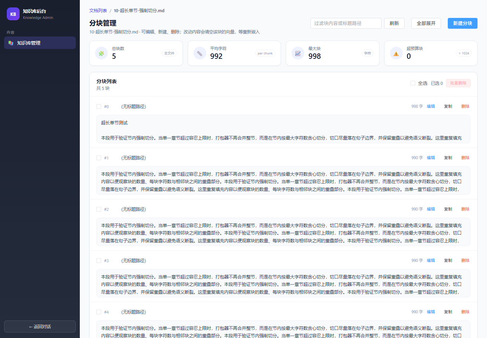

# 技术栈说明：分块策略的选型

> 关键词：Chunking Strategy、Retrieval Granularity、Context Window
> 本文结构：一、为什么它是独立问题｜二、六种策略与适用场景｜三、本项目实现与实测｜四、行业场景对照｜五、调优方法论｜六、测试题

---

## 一、为什么分块是一个独立的技术问题

### 1.1 检索的单位不是文档，是块

```
用户提问 → 向量化 → 在「块」里找最相似的 K 个 → 拼进 prompt → 模型回答
```

模型看到的从来不是整篇文档，而是**几个块**。这意味着：

> 分块决定了「模型能读到什么」，检索算法只能在这个范围内挑。

### 1.2 三个互相冲突的目标

| 目标 | 块大 | 块小 |
|---|---|---|
| 语义完整（答案不被切断） | ✅ 好 | ❌ 差 |
| 定位精度（能精确召回） | ❌ 差 | ✅ 好 |
| 上下文成本（token 花多少） | ❌ 贵 | ✅ 省 |

分块策略的本质，就是在这三者之间找一个对当前业务最不坏的平衡点。**没有普适最优解**，只有"对这类文档最优"。

### 1.3 一个常被忽略的事实：向量是"平均"

一个块 → 一个向量，而这个向量是块内所有语义的**加权平均**。块里塞了三个主题，向量就变成"三个主题的混合体"，查询命中的是一种模糊的相似，而不是精准的某一点。

这也是为什么"块大一点信息更全"往往适得其反：**信息更全，但表达更糊。**

---

## 二、六种策略与适用场景

### 2.1 定长滑窗（Fixed-size chunking）

**做法**：每 N 个字符切一刀，相邻块保留 M 个字符重叠。

| 维度 | 评价 |
|---|---|
| 优点 | 实现最简单；速度最快；块长均匀，便于估算 token |
| 缺点 | 切在句中；表格/代码被拦腰截断；章节标题丢失；重叠带来冗余与重复召回 |
| 适用 | 结构极弱的纯文本（日志、聊天记录、OCR 结果）、需要快速搭原型的场景 |
| 本项目 | ❌ 未采用 |

### 2.2 递归分隔符切分（Recursive，LangChain 风格）

**做法**：按优先级分隔符逐级退让——先按 `\n\n`（段落）切，超长再按 `\n`，再按 `。`，最后才按字符切。

| 维度 | 评价 |
|---|---|
| 优点 | 通用、无需格式解析；几乎不会切在句中；生态成熟（`RecursiveCharacterTextSplitter`） |
| 缺点 | 只认"符号"，不认"语义"；不知道标题属于谁；表格仍会断 |
| 适用 | 格式无法预知、要快速支持多格式；Markdown/纯文本为主的通用知识库 |
| 本项目 | 🔸 部分思想被借鉴（先用空行分段，再按句子切） |

### 2.3 结构感知（Block-aware，本项目采用）

**做法**：先把文档解析成带类型的块（标题/段落/列表/表格/代码），再按类型分别切分，最后按"节"打包。

| 维度 | 评价 |
|---|---|
| 优点 | 保留章节路径（`outlinePath`）；表格按行切且重复表头；代码不切断；块自带语义归属 |
| 缺点 | 每种格式要写解析器；结构解析失败时退化明显（如 PDF/DOCX 走纯文本） |
| 适用 | 有明确结构的文档：制度、手册、合同、产品文档、技术文档 |
| 本项目 | ✅ 采用 |

**为什么本项目选它**：目标文档是中文制度与 FAQ，核心结构就是「标题层级 + 表格 + 列表」。这几样恰好是定长滑窗与递归切分都会破坏的东西。选它换来的是**块带章节上下文**，这也是 `embeddingText` 能补前缀的前提。

### 2.4 语义分块（Semantic chunking）

**做法**：把文本按句切碎，计算相邻句的向量相似度，相似度骤降处作为切点。

| 维度 | 评价 |
|---|---|
| 优点 | 切点贴近真实语义边界，跨主题的内容不会被塞进一块 |
| 缺点 | 需要嵌入模型（成本、延迟）；结果依赖模型版本，不可复现；切点不可解释，难调 |
| 适用 | 长篇叙述性文本（访谈、论文正文、小说），且检索质量是硬指标 |
| 本项目 | ❌ 未采用（依赖嵌入链路，属下一阶段实验） |

### 2.5 父子分块 / 句子窗口（Small-to-big）

**做法**：检索用**小块**（精准），命中后把该块所在的**大块（父块 / 前后窗口）**喂给模型（完整）。

| 维度 | 评价 |
|---|---|
| 优点 | 同时拿到"定位准"和"上下文全"，是当前效果最好的一类工程方案 |
| 缺点 | 要维护两层索引；存储翻倍；实现复杂度高 |
| 适用 | 问答质量要求高、愿意投入工程成本的生产级 RAG |
| 本项目 | ❌ 未采用（当前是单层块，留作后续演进方向） |

### 2.6 类型特化（表格 / 代码 / 对话）

这不是"一种策略"，而是"对不同内容用不同策略"，通常叠加在前几种之上。

| 内容类型 | 特化做法 | 理由 |
|---|---|---|
| 表格 | 按行切 + **每块重复表头** | 表头是数据行的语义前提，丢了就看不懂 |
| 代码 | 按函数/类切，绝不按字符切 | 切一半的代码无法阅读，也没法执行 |
| 对话/纪要 | 按发言人轮次或话题切 | 一条完整发言才是语义单元 |
| 法律条款 | 按"条/款/项"切 | 引用与责任边界天然以条款为单位 |

本项目对表格（`rows-per-chunk` + 表头重复）、代码（整块不切）、列表（按条目切）都做了特化。

### 2.7 横向对比总表

| 策略 | 实现成本 | 结构保留 | 语义质量 | 可解释性 | 适合的文档 |
|---|---|---|---|---|---|
| 定长滑窗 | ★ | ✗ | ★★ | ★★★★ | 弱结构文本、日志 |
| 递归分隔符 | ★★ | ✂️ 部分 | ★★★ | ★★★★ | 通用、格式未知 |
| **结构感知** | ★★★★ | ✓ 完整 | ★★★★ | ★★★★ | 制度/手册/合同 |
| 语义分块 | ★★★ | ✗ | ★★★★★ | ★ | 长叙述文本 |
| 父子分块 | ★★★★★ | ✓ | ★★★★★ | ★★★ | 高要求生产系统 |
| 类型特化 | ★★（叠加） | ✓ | ★★★★ | ★★★★ | 表格/代码密集 |

### 2.8 选型决策树

```
文档是否有稳定结构（标题/表格/条款）？
├── 是 → 能否为每种格式写解析器？
│         ├── 能 → 【结构感知】+ 类型特化     ← 本项目
│         └── 不能 → 递归分隔符 + 表格后处理
└── 否 → 检索质量是否是硬指标？
          ├── 是 → 语义分块 或 父子分块
          └── 否 → 定长滑窗（带 10~20% 重叠）
```

---

## 三、本项目的实现与实测

### 3.1 五类 Block → 五种 Chunker

| Block 类型 | 分块策略 | 说明 |
|---|---|---|
| `HeadingBlock` | 不产块 | 只更新 `HeadingHandler` 的当前路径 |
| `ParagraphBlock` | 超长段按句子切 + 重叠 | 走 `TextSplitter`，切口控制在上限内 |
| `ListBlock` | 整列表成块，过长按条目切 | 保住"条目"这个语义单元 |
| `TableBlock` | 按 `rows-per-chunk` 切，**每块重复表头** | 表头必须跟着数据 |
| `CodeBlock` | 整段不切 | 切了就没法运行 |

### 3.2 两层预算：Chunker 内 + Packer

```
第 1 层（块内）：ParagraphChunker 用 TextSplitter 把超长段落切到 maxChars 以内
第 2 层（打包）：ChunkPacker 按「节」合并草稿
                 节长 ≤ maxChars × toleranceFactor（1024×3=3072）→ 整节一块，允许超预算
                 节长 > 3072 → 节内按 maxChars 贪心切分
```

这个 `toleranceFactor` 是工程妥协：严格按 1024 切会产生大量碎块，允许 3 倍短时超出，换取"节内语义完整"。

### 3.3 实测的三种形态

| 文档 | 字符数 | 块数 | 形态 | 路径 |
|---|---|---|---|---|
| `01-产品保修政策.md` | 573 | 1 | 整篇一节，打包合并 | `产品保修政策` |
| `09-长文档-多章节.md` | 3790 | 2 | 节间合并到 3072 上限 | 仅根级 |
| `10-超长单节-强制切分.md` | 4967 | 5 | 单节超容忍 → 节内切分 | 空（无标题） |

第三种形态的实际效果（每块约 990 字，超预算块 0）：



### 3.4 两个反直觉现象（必须能解释）

**① 60 行 CSV 只有 1 块**

`rows-per-chunk: 50` 先把表格切成 2 段，但整节 2412 字 < 3072 容忍上限，打包阶段又合并回一块。**参数生效的前提是"节"足够长**——这是文档里最容易写错的地方。

**② 多章节合并后路径退化**

`09` 的 8 个二级标题合并成 2 块后，`outlinePath` 只剩根级 `售后服务细则（分章节）`。原因：合并时取所有草稿的**公共路径前缀**。

后果：块内其实有多个子主题，但检索时无法区分。缓解方向是降低 `toleranceFactor` 或不跨节合并——属于参数优化项。

---

## 四、行业场景对照

| 场景 | 推荐策略 | 参数倾向 | 原因 |
|---|---|---|---|
| 客服 FAQ / 帮助中心 | 结构感知 或 语义分块 | 小块 200~400 字 | 一问一答，答案通常很短 |
| 法务合同 | 结构感知（按条/款） | 按条款边界，不强求等长 | 引用与责任以条款为单位 |
| 财务报表 / 对账表 | 表格特化 | 行块 + 表头重复，**禁止跨表合并** | 表头丢失 = 数据不可解读 |
| 代码库 / API 文档 | 结构特化（按函数/类） | 不切函数体 | 半个函数无法使用 |
| 医学文献 / 论文 | 父子分块 | 小块检索 + 父块喂入 | 结论在摘要，细节在正文 |
| 会议纪要 / 客服对话 | 按发言人轮次 | 按轮次切，跨轮次不合并 | 一条完整发言才是语义单元 |
| 网页抓取（结构混乱） | 递归分隔符 | 512~1024 字 + 15% 重叠 | 无法预知结构，先保通用 |

---

## 五、调优方法论

### 5.1 先定指标，再调参数

| 指标 | 怎么算 | 说明 |
|---|---|---|
| **召回率 @K** | 金标问题里，正确答案所在块出现在前 K 名的比例 | 最核心的指标 |
| 平均块长 | 总字符 / 块数 | 反映粒度 |
| 超预算块比例 | 块长 > maxChars 的块占比 | 反映打包是否合理 |
| 路径缺失率 | `outlinePath` 为空的块占比 | 反映结构保留程度 |
| 块数膨胀比 | 块数 / 原文字符数 | 过高说明切太碎 |

### 5.2 调参流程（一次只动一个变量）

```
① 准备 30~50 条金标问答（含"答案在第几段"）
② 跑基线，记录五个指标
③ 只改一个参数（如 maxChars 1024 → 512），重跑，对比
④ 参数写进配置快照（否则不知道哪篇文档用什么切的）
⑤ 回归：确认老问题没被改坏
```

### 5.3 三个反模式

| 反模式 | 为什么错 |
|---|---|
| 只看块数 | 块数变多不等于召回变好，可能只是切碎了 |
| 一次改多个参数 | 无法归因，出了问题不知道是谁的锅 |
| 用感觉代替金标集 | "看起来更好"是最贵的错觉 |

### 5.4 本项目的现状与下一步

现状：参数是**全局配置**（1024/128/50/3），改完要重启 + 重传；块没有 `enabled` 开关；没有金标集。

下一步顺序（有依赖关系，不能跳）：

1. **加参数快照**（`rag_documents.chunk_spec`）——不知道用什么切的，就无法对比
2. **建 30 条金标问答**——没有度量就没有优化
3. **块级 `enabled` 开关**——先能排除坏块，再谈调参
4. **接嵌入 + 检索**——有了召回率指标，分块调优才真正可量化

---

## 六、测试题

### 6.1 基础自检

<details>
<summary><b>Q1. 为什么不能把整篇文档直接嵌入？</b></summary>
<p>两个硬限制：① 嵌入模型有输入长度上限；② 整篇一个向量意味着&quot;全篇语义平均&quot;，检索只能定位到&quot;整篇&quot;，无法定位到具体段落。</p>
</details>

<details>
<summary><b>Q2. 块越大，召回越准吗？</b></summary>
<p>不是。块大信息全，但向量被多主题稀释，定位精度下降；且每次检索带入的 token 成本上升。块大小要在&quot;语义完整&quot;与&quot;定位精度&quot;间取平衡。</p>
</details>

<details>
<summary><b>Q3. 定长滑窗和递归分隔符的本质区别？</b></summary>
<p>定长滑窗只按长度切；递归分隔符按&quot;段落 → 行 → 句 → 字符&quot;的优先级逐级退让，尽量切在自然边界。后者几乎不会切在句中，但仍然不知道章节归属。</p>
</details>

<details>
<summary><b>Q4. 结构感知分块相比前两者的核心增量是什么？</b></summary>
<p><strong>块带结构</strong>：知道自己在哪个标题下（<code>outlinePath</code>）、是表格还是代码、表头是什么。这是后续补上下文（<code>embeddingText</code>）和做类型特化的前提。</p>
</details>

<details>
<summary><b>Q5. 支持"父子分块"需要多存什么？</b></summary>
<p>两层：小块（用于检索）+ 父块/窗口（用于喂模型），并记录映射关系。存储与索引成本大约翻倍，换来&quot;定位准 + 上下文全&quot;。</p>
</details>

<details>
<summary><b>Q6. 表格为什么必须重复表头？</b></summary>
<p>表头定义了列的语义。没有表头，&quot;15 天&quot;不知道是退货还是换货——数据行失去可解读性。</p>
</details>

### 6.2 面试延伸

<details>
<summary><b>Q7. 给你一份 200 页的产品手册，怎么设计分块？</b></summary>
<p>先看结构（章节/表格/图注），能做结构解析就做结构感知分块；参数上块上限 600~1000 字，保留 10% 左右重叠；表格单独按行切并重复表头；用 30 条金标问答对比 512 / 1024 两档的召回率再定稿。</p>
</details>

<details>
<summary><b>Q8. 语义分块的代价是什么？为什么很多团队最终没用？</b></summary>
<p>每句都要嵌入，成本随文本量线性增长；切点依赖模型版本，不可复现也不可解释；出问题时无法定位&quot;为什么这里切开&quot;。多数团队最终选&quot;结构感知 + 合理参数&quot;，把语义分块留给难处理的子集。</p>
</details>

<details>
<summary><b>Q9. 重叠（overlap）设多少合适？设太大会有什么问题？</b></summary>
<p>常见 10~20%。太大会导致：① 存储与嵌入成本上升；② 相邻块高度相似，检索时重复召回，把有限的 top-K 名额挤占掉；③ 拼接上下文时出现重复内容，浪费 token。</p>
</details>

<details>
<summary><b>Q10. 分块效果怎么评估？没有金标集怎么办？</b></summary>
<p>有金标集：召回率@K、MRR。没有金标集：先构造 20~30 条&quot;答案明确在某段&quot;的问题做最小评测集；再用可观测指标辅助（超预算块比例、路径缺失率、平均块长分布）。</p>
</details>

<details>
<summary><b>Q11. 一个块同时命中多个问题的场景，说明分块有什么问题？</b></summary>
<p>块过大或多主题混装。向量是平均值，于是&quot;什么都能沾一点，什么都说不上准&quot;。解法是缩小块或引入语义/结构切分，把主题拆开。</p>
</details>

<details>
<summary><b>Q12. 为什么说"分块策略要跟文档类型绑定"？</b></summary>
<p>因为语义单元由文档形态决定：合同以条款为单元，代码以函数为单元，FAQ 以问答对为单元。拿同一套切法套所有文档，必然在某些类型上切碎语义。</p>
</details>
